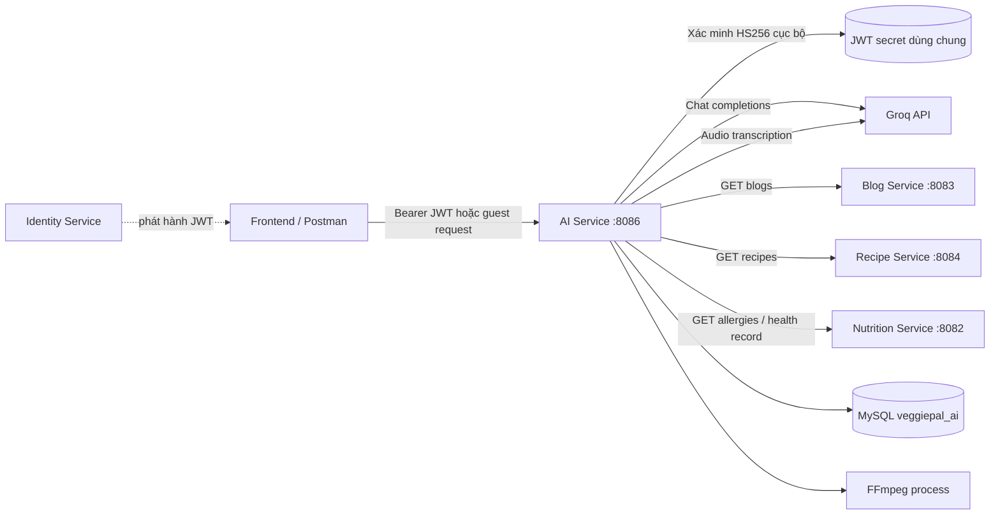
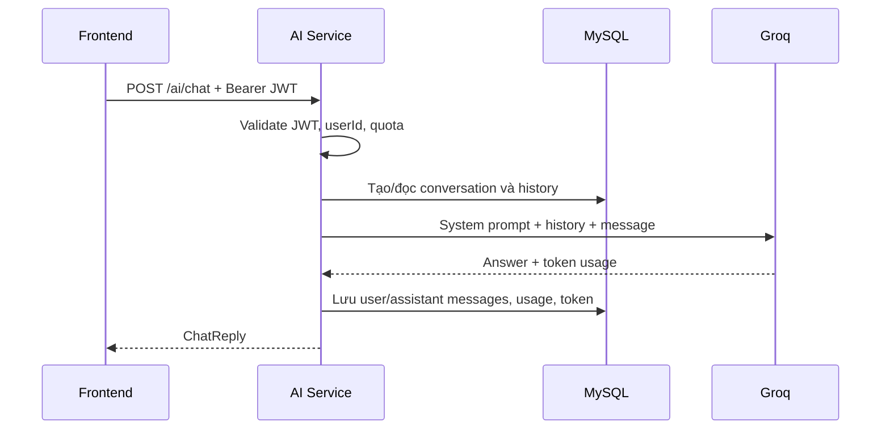
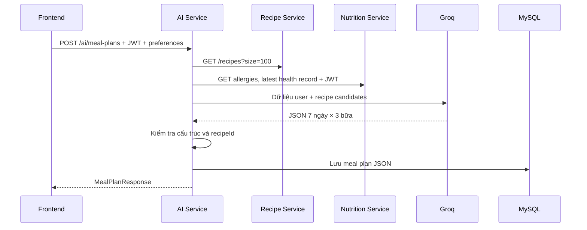
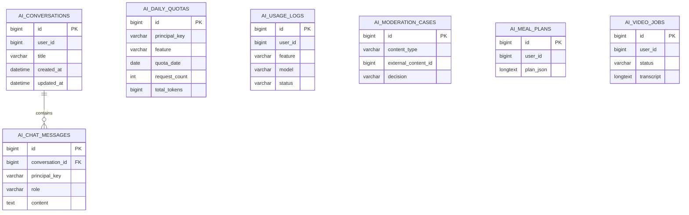

# AI Service — Tài liệu kỹ thuật

> Dự án: **VeggiePal**  
> Service: `ai-service`  
> Cổng mặc định: `8086`  
> Phạm vi tài liệu: mã nguồn hiện có trong `ai-service`; không suy diễn endpoint hoặc tích hợp chưa được triển khai.

## Mục lục

1. [Giới thiệu](#1-giới-thiệu)
2. [Công nghệ và thư viện](#2-công-nghệ-và-thư-viện)
3. [Kiến trúc](#3-kiến-trúc)
4. [Sáu module chức năng](#4-sáu-module-chức-năng)
5. [Workflow Frontend — Backend — AI](#5-workflow-frontend--backend--ai)
6. [Database và Flyway](#6-database-và-flyway)
7. [REST API](#7-rest-api)
8. [Cấu hình](#8-cấu-hình)
9. [Cách chạy](#9-cách-chạy)
10. [Kiểm thử bằng Postman](#10-kiểm-thử-bằng-postman)
11. [Bảo mật và giới hạn sử dụng](#11-bảo-mật-và-giới-hạn-sử-dụng)
12. [Trạng thái triển khai và kiểm thử](#12-trạng-thái-triển-khai-và-kiểm-thử)
13. [Troubleshooting](#13-troubleshooting)

---

## 1. Giới thiệu

`ai-service` là microservice tập trung các khả năng AI của VeggiePal. Service cung cấp tư vấn ăn chay qua hội thoại, kiểm duyệt nội dung, đề xuất nội dung/công thức, tạo thực đơn, xử lý video công thức và thống kê hoạt động AI cho quản trị viên.

Phạm vi thực tế của service:

- Gọi Groq Chat Completions và Groq Audio Transcriptions.
- Lưu dữ liệu hội thoại, quota, usage log, kết quả kiểm duyệt, thực đơn và video job vào MySQL.
- Xác thực JWT do hệ thống Identity phát hành bằng shared secret HS256.
- Đọc Blog và Recipe để tạo recommendation.
- Đọc Recipe, dị ứng và hồ sơ sức khỏe để tạo meal plan.
- Dùng FFmpeg cục bộ để tách audio trước khi gửi đến Whisper.

Service **không** phát hành JWT, không tự tạo Blog/Recipe/Video, không tìm kiếm nhà hàng/cửa hàng chay và không có dữ liệu nghiệp vụ giả. Blog Service hiện gọi AI Moderation trước khi công khai Blog/Comment và nhận callback khi Admin quyết định. Repository chưa có service sở hữu Video, vì vậy moderation/recommendation/video-by-ID cho Video chưa thể nối E2E.

### 1.1 Đối chiếu workflow

| Workflow | Phạm vi đối chiếu | Trạng thái sau cập nhật |
|---|---|---|
| 1 | Nền tảng service/API | AI Service tập trung, package-by-feature, MySQL/Flyway |
| 2 | Chat/JWT | Chat guest/member, lịch sử, ownership, xóa hội thoại, JWT HS256 |
| 3 | Content Moderation | Blog và Comment đã nối E2E; Video thiếu service sở hữu dữ liệu |
| 4 | Recommendation | Blog và Recipe dùng ID thật; Video chưa có API nguồn |
| 5 | Meal Planning | Lọc dị ứng, xác minh vegan, tính macro xác định, 7 ngày × 3 bữa, thay món có tái kiểm tra |
| 6 | Security/Quota | JWT đồng nhất, guest session do server cấp, atomic quota-row provisioning, token guard |
| 7 | Video Processing | Upload, FFmpeg/FFprobe, Whisper, extraction; chưa có `videoId` nguồn và chưa bất đồng bộ |
| 8 | Tìm nhà hàng chay | Ngoài phạm vi AI theo yêu cầu |
| 9 | Admin/Monitoring | Moderation queue/callback, summary, filter và phân trang usage logs, model/quota read-only |

## 2. Công nghệ và thư viện

Nguồn xác thực: [`ai-service/pom.xml`](../ai-service/pom.xml) và cấu hình trong source.

| Thành phần | Phiên bản/cách dùng thực tế |
|---|---|
| Java | Java 21 |
| Spring Boot | Parent `4.1.1` |
| Web | `spring-boot-starter-webmvc`, `RestClient` |
| Persistence | Spring Data JPA, Hibernate |
| Database | MySQL; MySQL Connector/J runtime |
| Migration | `spring-boot-starter-flyway`, `flyway-mysql` |
| Security | Spring Security, OAuth2 Resource Server JWT, HS256 |
| Validation | Jakarta Bean Validation |
| AI | Groq-compatible Chat Completions và Audio Transcriptions API |
| Speech-to-text | model mặc định `whisper-large-v3-turbo` qua Groq |
| Video/audio | executable FFmpeg bên ngoài JVM |
| JSON | Jackson `JsonNode` và `ObjectMapper` |
| API docs | Springdoc OpenAPI `3.1.0` |
| Observability | Spring Boot Actuator (`health`, `info`) |
| Boilerplate | Lombok |
| Test | Spring Boot Test, Spring Security Test, H2 |
| Build | Maven Wrapper, Spring Boot Maven Plugin |

FFmpeg không phải dependency Maven. Máy chạy service phải cài FFmpeg hoặc cấu hình đường dẫn executable qua `FFMPEG_PATH`.

## 3. Kiến trúc

### 3.1 Package by Feature

```text
ai-service/
├── pom.xml
└── src/
    ├── main/
    │   ├── java/com/veggiepal/ai/
    │   │   ├── chat/              # Chat guest/member, lịch sử hội thoại
    │   │   ├── moderation/        # Kiểm duyệt và admin review
    │   │   ├── recommendation/    # Gợi ý Blog/Recipe
    │   │   ├── mealplan/          # Tạo, đọc, thay món trong thực đơn
    │   │   ├── video/             # FFmpeg, Whisper, trích xuất công thức
    │   │   ├── monitoring/        # Usage logs, tổng hợp token, model đang dùng
    │   │   ├── quota/             # Quota request/token theo ngày
    │   │   ├── groq/              # GroqClient, model properties, DTO Groq
    │   │   ├── security/          # JWT, authorization, CurrentUser
    │   │   ├── configuration/     # RestClient, Jackson, OpenAPI
    │   │   └── common/            # ApiResponse, lỗi và exception handler
    │   └── resources/
    │       ├── application.properties
    │       └── db/migration/       # V1 schema chính, V2 guest sessions
    └── test/
        ├── java/com/veggiepal/ai/  # context, chat, quota tests
        └── resources/application.properties
```

Mỗi feature sở hữu controller, service, DTO, entity/repository liên quan. Các concern dùng chung (`groq`, `quota`, `security`, `common`, `configuration`) được tách riêng.

### 3.2 Sơ đồ tương tác



Không có service discovery hoặc message broker trong `ai-service`. Các downstream URL được cấu hình bằng environment variable. Blog và Recipe được gọi không kèm JWT; hai endpoint Nutrition được gọi kèm Bearer token của người dùng.

### 3.3 Luồng xử lý chung

1. Spring Security kiểm tra endpoint public/authenticated/admin.
2. Controller validate DTO và lấy `userId` từ claim `userId` khi cần.
3. Service đọc dữ liệu local hoặc gọi downstream service.
4. Service tạo prompt giới hạn theo nghiệp vụ và gọi model riêng cho feature.
5. Kết quả AI được parse/đối chiếu với dữ liệu thật khi feature hỗ trợ.
6. Dữ liệu và usage được lưu vào MySQL.
7. API trả envelope `ApiResponse`.

Envelope thành công:

```json
{
  "code": 1000,
  "result": {}
}
```

Envelope lỗi:

```json
{
  "code": 6000,
  "message": "Message is required"
}
```

Các trường null của `ApiResponse` bị bỏ qua. DTO lồng bên trong vẫn có thể chứa trường null.

## 4. Sáu module chức năng

### 4.1 AI Chatbot

**Guest**

- Client phải gọi endpoint public tạo session; server phát UUID có TTL mặc định 24 giờ.
- Session được gắn với SHA-256 hash của remote address và pepper bí mật; session lấy từ địa chỉ khác bị từ chối.
- Mỗi địa chỉ được tạo tối đa 3 session/ngày theo mặc định.
- Quota mặc định 3 request/ngày.
- Không lưu nội dung hội thoại; quota dùng principal `guest-ip:<ipHash>` nên tạo session mới không reset lượt, và usage log không lưu IP thật.
- Mỗi request là một lượt độc lập, không có lịch sử nhiều lượt cho guest.

**Member**

- Yêu cầu JWT và claim `userId`.
- Nếu không truyền `conversationId`, service tạo conversation mới; title là tối đa 80 ký tự đầu của message đã trim.
- Nếu truyền `conversationId`, service chỉ đọc conversation thuộc đúng user.
- Nạp tối đa 12 message gần nhất theo cấu hình, đảo lại đúng thứ tự thời gian rồi gửi Groq.
- Sau khi Groq trả thành công mới lưu cặp message `user` và `assistant`.
- Quota mặc định 50 request/ngày/người dùng.

System prompt giới hạn bot ở tư vấn dinh dưỡng chay, tránh chẩn đoán y khoa, khuyên gặp chuyên gia với trường hợp nghiêm trọng/rủi ro cao, trả lời bằng ngôn ngữ của người dùng và ngắn gọn.

### 4.2 AI Content Moderation

- Nhận nội dung loại `BLOG`, `VIDEO` hoặc `COMMENT`.
- Groq phân loại các nhóm: hate, harassment, sexual, violence, self-harm, illegal, spam và dangerous misinformation.
- Quyết định: `APPROVED`, `REJECTED`, `REVIEW_REQUIRED`.
- Nếu AI trả `REJECTED` nhưng confidence dưới `0.85`, service hạ xuống `REVIEW_REQUIRED`.
- Mọi kết quả được lưu thành moderation case.
- Admin xem danh sách chờ và quyết định `APPROVED` hoặc `REJECTED`; không được gửi `REVIEW_REQUIRED` khi review.

Blog Service đã thay `AutoApproveContentModerationService` bằng HTTP client gọi AI Service. Blog/Comment được lưu trước ở trạng thái không public để có ID thật; nếu AI lỗi, transaction không tự công khai. `REVIEW_REQUIRED` giữ resource ở `PENDING`; Admin review tại AI Service sẽ callback `/internal/moderation/...` về Blog Service, kiểm tra đúng author rồi mới đổi trạng thái. Video vẫn chưa nối được vì repository chưa có service/API sở hữu Video.

### 4.3 AI Recommendation

- Nhận `interest` và `limit` (mặc định 6, được clamp 1–10).
- Gọi Blog Service: `GET /blogs?size=20` và thêm `keyword` nếu có interest.
- Gọi Recipe Service: `GET /recipes?size=20` và thêm `keyword` nếu có interest.
- Prompt chỉ gửi loại, ID và title của candidate thật.
- AI trả danh sách `{type, id, reason}`; service chỉ giữ item có `type + id` khớp candidate đã lấy.
- Response gắn `content` là object gốc từ downstream service.
- Nếu không có candidate, trả mảng rỗng và không gọi Groq.

Giới hạn hiện tại:

- Chỉ có `BLOG` và `RECIPE`; chưa có Video recommendation.
- Chưa cá nhân hóa từ lịch sử người dùng; đầu vào là `interest`, mặc định nghiệp vụ là `ăn chay`.
- Lỗi từ một downstream làm toàn bộ request thất bại với `6006`.

### 4.4 AI Meal Planning

- Lấy tối đa 100 recipe thật từ Recipe Service.
- Dùng JWT người gọi để lấy `/nutrition/me/allergies` và `/nutrition/me/health-records/latest`.
- Kết hợp mục tiêu sức khỏe, sở thích, nguyên liệu sẵn có, dị ứng, hồ sơ sức khỏe và recipe candidates vào prompt.
- AI phải tạo đúng 7 ngày, mỗi ngày đúng 3 bữa, và chỉ sử dụng `recipeId` tồn tại trong candidates.
- Service kiểm tra cấu trúc 7 ngày/3 bữa và ID thật trước khi lưu JSON.
- Member có thể xem danh sách, xem chi tiết và thay món theo `day` + `mealType`.

Giới hạn hiện tại:

- Recipe Service trả thêm macro/100g, cờ vegan/allergen và normalized ingredient name. AI Service tự tính macro theo gram và servings; LLM không thực hiện phép tính quyết định.
- Dị ứng được lọc trước khi tạo prompt và kiểm tra lại sau kết quả AI. Do schema Recipe chỉ có cờ allergen chung, hệ thống fail-closed với mọi ingredient có `allergen=true` khi user có dị ứng.
- Kết quả phải có 7 tên ngày duy nhất; mỗi ngày có đúng một `BREAKFAST`, `LUNCH`, `DINNER`.
- Có thể truyền `dailyNutritionTarget`; từng ngày sai min/max calorie, protein, carbohydrate hoặc fat sẽ bị từ chối.
- Thay món gọi lại Nutrition Service, loại món không an toàn, bắt buộc ID mới khác `currentRecipeId` và tái tính toàn bộ macro.
- Mùa/vùng miền chưa được ưu tiên vì Recipe Service không có trường dữ liệu tương ứng. Không có Health App API; module chỉ dùng health record thật của Nutrition Service.

### 4.5 AI Video Processing

- Nhận multipart `video/*`, giới hạn mặc định 100 MiB và thời lượng tối đa mặc định 1.800 giây.
- Tạo `ai_video_jobs` ở trạng thái `PROCESSING`.
- Lưu tạm file upload, chạy FFmpeg để tách MP3 mono 16 kHz.
- FFprobe xác minh thời lượng/định dạng đọc được; FFmpeg có timeout chờ 120 giây và process bị hủy khi timeout.
- Gửi audio đến Groq Whisper để lấy transcript.
- Gửi transcript đến chat model để trích xuất title, ingredients và steps.
- Thành công: cập nhật `COMPLETED`; lỗi: cập nhật `FAILED` và lưu error.
- File tạm được xóa trong khối `finally`.

Xử lý hiện tại là **đồng bộ**: request HTTP chờ toàn bộ FFmpeg, transcription và extraction hoàn tất hoặc thất bại. Cả transcription và extraction đều có usage/error log; transcription ghi token 0 vì API response hiện dùng không trả token. Whisper cũng retry giới hạn với 429/5xx/lỗi mạng. Chưa có xử lý theo `videoId` hay job bất đồng bộ vì không tồn tại Video owner API/storage contract trong repository.

### 4.6 AI Monitoring

- Admin xem tổng số request, prompt token và completion token trong 1–90 ngày.
- Admin xem tối đa 100 usage log mới nhất; endpoint tìm kiếm mới hỗ trợ phân trang/lọc feature, status, user và khoảng thời gian.
- Admin xem model hiện được cấu hình cho sáu tác vụ.
- Usage log ghi cả `SUCCESS` và `FAILED`, model, feature, latency và error rút gọn.

Admin có thể đọc model và giới hạn quota hiệu lực. Cấu hình vẫn read-only từ environment/properties để tránh thay đổi runtime không có audit/persistence; chưa có dashboard cảnh báo.

## 5. Workflow Frontend — Backend — AI

### 5.1 Chat member nhiều lượt



Frontend giữ `conversationId` từ lần đầu để tiếp tục hội thoại. Backend chịu trách nhiệm ownership, history window, quota và persistence. Groq chỉ sinh câu trả lời, không quản lý session.

### 5.2 Moderation

1. Frontend hoặc microservice nguồn gửi text và metadata đến `/ai/moderation/check` với JWT.
2. Backend gọi moderation model, chuẩn hóa quyết định và lưu case.
3. Nếu `REVIEW_REQUIRED`, giao diện Admin đọc queue `/ai/admin/moderation`.
4. Admin gửi quyết định cuối qua `PUT /ai/admin/moderation/{id}`.
5. Việc cập nhật trạng thái Blog/Video/Comment gốc nằm ngoài code hiện tại.

### 5.3 Recommendation

1. Frontend gửi interest và limit.
2. Backend lấy candidates thật từ Blog/Recipe Service.
3. AI xếp chọn và giải thích trên các ID được cung cấp.
4. Backend loại ID bịa/sai và ghép object gốc vào response.
5. Frontend hiển thị `reason` cùng `content`.

### 5.4 Meal plan



### 5.5 Video

1. Frontend upload file multipart với key `file`.
2. Backend kiểm tra rỗng/kích thước, tạo job và file tạm.
3. FFmpeg tách audio; Whisper tạo transcript.
4. Chat model trích xuất recipe JSON.
5. Backend lưu job và trả trạng thái/kết quả trong cùng request.
6. Frontend có thể đọc lại job bằng ID.

### 5.6 Monitoring

Frontend Admin gửi JWT có role `ADMIN`; Backend tổng hợp database hoặc đọc model properties. Các endpoint này không gọi AI.

## 6. Database và Flyway

Schema được quản lý bởi hai migration hiện có:

```text
src/main/resources/db/migration/V1__create_ai_schema.sql
src/main/resources/db/migration/V2__secure_guest_sessions.sql
```

`spring.jpa.hibernate.ddl-auto=validate`: Hibernate chỉ xác minh mapping; Flyway chịu trách nhiệm tạo/thay đổi schema.

### 6.1 Các bảng

| Bảng | Entity | Mục đích và quan hệ |
|---|---|---|
| `ai_conversations` | `Conversation` | Hội thoại member; chứa `user_id`, title, timestamps. Index theo user/update time. |
| `ai_chat_messages` | `ChatMessage` | Message `user`/`assistant`; FK nullable đến conversation, `ON DELETE CASCADE`; có principal và token. Code hiện chỉ lưu message member có conversation. |
| `ai_daily_quotas` | `DailyQuota` | Request/token theo `principal_key + feature + quota_date`; unique composite, có `version` cho optimistic locking. |
| `ai_usage_logs` | `UsageLog` | Nhật ký feature/model/status/token/latency/error; index theo time, feature và user. |
| `ai_moderation_cases` | `ModerationCase` | Nội dung, quyết định AI/admin, categories, confidence, reviewer và timestamps. |
| `ai_meal_plans` | `MealPlan` | Owner, tên, mục tiêu và JSON thực đơn trong `LONGTEXT`. |
| `ai_video_jobs` | `VideoJob` | Owner, filename, trạng thái, transcript, extraction JSON và error. |
| `ai_guest_sessions` | `GuestSession` | UUID do server cấp, hash địa chỉ mạng, thời điểm tạo/hết hạn; index theo IP hash và expiry. |



Các ID tham chiếu sang user/blog/recipe/video chỉ là scalar; database AI không có foreign key xuyên microservice.

### 6.2 Quota và transaction

- Principal member: `user:<userId>`; guest: `guest-ip:<ipHash>`.
- Quota chat được reserve trong transaction `REQUIRES_NEW`, dùng pessimistic lock với row đã tồn tại.
- Request count tăng **trước** khi gọi Groq, nên một lần gọi AI thất bại vẫn tiêu tốn lượt request.
- Token được cộng sau lần gọi thành công, theo feature.
- Daily token limit được kiểm tra trên tổng token các feature của principal trong ngày.
- Chat gọi `reserveChat`; mọi feature AI gọi `checkTokenBudget` trước Groq. Request quota riêng vẫn chỉ áp dụng cho Chat.
- Việc provision quota row dùng native atomic upsert rồi pessimistic lock, tránh race tạo row đầu tiên giữa nhiều instance.
- `synchronized` chỉ tuần tự hóa trong một JVM; khóa database mới là cơ chế phối hợp trên row đã tồn tại.
- Các lời gọi Groq/downstream chạy ngoài transaction JPA dài; chat chỉ mở transaction ngắn để lưu conversation và cặp message sau khi AI trả về.

Ngày quota dùng `LocalDate.now()` của JVM; cần đồng nhất timezone khi triển khai nhiều instance.

## 7. REST API

### 7.1 Authentication và base URL

Khi chạy trực tiếp:

```text
http://localhost:8086
```

Header cho API authenticated:

```http
Authorization: Bearer <JWT>
Content-Type: application/json
```

JWT phải ký HS256 bằng cùng `JWT_SECRET`, có claim `userId`; claim `role` được chuyển thành authority `ROLE_<role>`. Endpoint Admin yêu cầu `ROLE_ADMIN`.

OpenAPI cấu hình server `/api`, nhưng route Gateway không thuộc phạm vi source này. Khi test trực tiếp port 8086, dùng `/ai/...` như bảng dưới, không tự thêm `/api`.

### 7.2 Danh sách endpoint

| Method | Endpoint | Quyền | Chức năng |
|---|---|---|---|
| POST | `/ai/chat/guest-sessions` | Public | Cấp guest session có TTL |
| POST | `/ai/chat/guest` | Public | Chat guest |
| POST | `/ai/chat` | Authenticated | Chat có lịch sử |
| GET | `/ai/chat/conversations` | Authenticated | Danh sách conversation của user |
| GET | `/ai/chat/conversations/{id}` | Authenticated, owner | Chi tiết conversation |
| DELETE | `/ai/chat/conversations/{id}` | Authenticated, owner | Xóa conversation và message |
| POST | `/ai/moderation/check` | Authenticated | Kiểm duyệt nội dung |
| GET | `/ai/admin/moderation` | Admin | Queue cần duyệt |
| PUT | `/ai/admin/moderation/{id}` | Admin | Duyệt case |
| GET | `/ai/recommendations` | Authenticated | Gợi ý Blog/Recipe |
| POST | `/ai/meal-plans` | Authenticated | Tạo thực đơn 7 ngày |
| GET | `/ai/meal-plans` | Authenticated | Danh sách thực đơn của user |
| GET | `/ai/meal-plans/{id}` | Authenticated, owner | Chi tiết thực đơn |
| POST | `/ai/meal-plans/{id}/replace` | Authenticated, owner | Thay món |
| POST | `/ai/videos/process` | Authenticated | Xử lý video đồng bộ |
| GET | `/ai/videos/{id}` | Authenticated, owner | Đọc video job |
| GET | `/ai/admin/monitoring/summary` | Admin | Tổng hợp usage |
| GET | `/ai/admin/monitoring/logs` | Admin | 100 log mới nhất |
| GET | `/ai/admin/monitoring/logs/search` | Admin | Lọc/phân trang usage log |
| GET | `/ai/admin/monitoring/models` | Admin | Model đang cấu hình |
| GET | `/ai/admin/monitoring/limits` | Admin | Giới hạn quota/token hiệu lực |
| GET | `/actuator/health` | Public | Health check |

Swagger UI và OpenAPI cũng public tại `/swagger-ui/**`, `/swagger-ui.html`, `/v3/api-docs/**`.

### 7.3 Chat API

#### POST `/ai/chat/guest-sessions`

Không cần body hoặc Authorization:

```json
{
  "code": 1000,
  "result": {
    "guestSession": "9d5f3aba-66af-4ef0-b893-5a65e9d25f0a",
    "expiresAt": "2026-10-17T09:00:00"
  }
}
```

#### POST `/ai/chat/guest`

```json
{
  "guestSession": "9d5f3aba-66af-4ef0-b893-5a65e9d25f0a",
  "message": "Một bữa sáng chay giàu protein nên có gì?"
}
```

```json
{
  "code": 1000,
  "result": {
    "conversationId": null,
    "answer": "Bạn có thể kết hợp đậu hũ, yến mạch và hạt...",
    "remainingRequests": 2,
    "promptTokens": 85,
    "completionTokens": 110
  }
}
```

#### POST `/ai/chat`

Tạo hội thoại:

```json
{
  "message": "Gợi ý nguồn vitamin B12 cho người ăn chay."
}
```

Tiếp tục hội thoại:

```json
{
  "conversationId": 1,
  "message": "Liều lượng thường được khuyến nghị như thế nào?"
}
```

Response cùng cấu trúc `ChatReply`, nhưng `conversationId` có giá trị.

#### GET `/ai/chat/conversations`

```json
{
  "code": 1000,
  "result": [
    {
      "id": 1,
      "title": "Gợi ý nguồn vitamin B12 cho người ăn chay.",
      "createdAt": "2026-10-16T09:30:00",
      "updatedAt": "2026-10-16T09:32:00"
    }
  ]
}
```

#### GET `/ai/chat/conversations/1`

```json
{
  "code": 1000,
  "result": {
    "conversation": {
      "id": 1,
      "title": "Gợi ý nguồn vitamin B12 cho người ăn chay.",
      "createdAt": "2026-10-16T09:30:00",
      "updatedAt": "2026-10-16T09:32:00"
    },
    "messages": [
      {
        "id": 1,
        "role": "user",
        "content": "Gợi ý nguồn vitamin B12 cho người ăn chay.",
        "createdAt": "2026-10-16T09:30:00"
      }
    ]
  }
}
```

#### DELETE `/ai/chat/conversations/1`

Xóa conversation thuộc user hiện tại; FK cascade xóa messages. ID không tồn tại/không thuộc user trả 404/code 6002.

### 7.4 Moderation API

#### POST `/ai/moderation/check`

```json
{
  "contentType": "BLOG",
  "externalContentId": 42,
  "authorId": 7,
  "text": "Nội dung cần kiểm duyệt"
}
```

```json
{
  "code": 1000,
  "result": {
    "caseId": 10,
    "decision": "REVIEW_REQUIRED",
    "categories": ["spam"],
    "reason": "Cần quản trị viên xác minh ngữ cảnh.",
    "confidence": 0.78,
    "createdAt": "2026-10-16T10:00:00"
  }
}
```

#### GET `/ai/admin/moderation`

Trả mảng `ModerationResponse` chỉ gồm case `REVIEW_REQUIRED`, theo thời gian tạo tăng dần.

#### PUT `/ai/admin/moderation/10`

```json
{
  "decision": "APPROVED",
  "reason": "Đã kiểm tra thủ công, nội dung hợp lệ."
}
```

`decision` khi admin review chỉ được dùng `APPROVED` hoặc `REJECTED`.

### 7.5 Recommendation API

#### GET `/ai/recommendations?interest=protein&limit=4`

```json
{
  "code": 1000,
  "result": [
    {
      "type": "RECIPE",
      "id": 12,
      "reason": "Phù hợp nhu cầu món chay giàu protein.",
      "content": {
        "id": 12,
        "title": "Đậu hũ áp chảo"
      }
    }
  ]
}
```

`content` là JSON nguyên bản từ Blog/Recipe Service nên có thể có thêm trường tùy API downstream. Ví dụ trên chỉ minh họa các trường tối thiểu mà module sử dụng (`id`, `title`).

### 7.6 Meal Plan API

#### POST `/ai/meal-plans`

```json
{
  "name": "Thực đơn tuần tăng cơ",
  "healthGoal": "Tăng protein, duy trì cân nặng",
  "preferences": ["món Việt", "ít dầu"],
  "availableIngredients": ["đậu hũ", "nấm", "yến mạch"],
  "dailyNutritionTarget": {
    "minCalories": 1500,
    "maxCalories": 2200,
    "minProtein": 60,
    "maxProtein": 140,
    "minCarbohydrate": 150,
    "maxCarbohydrate": 320,
    "minFat": 35,
    "maxFat": 90
  }
}
```

Response `plan` có JSON do model trả và đã qua kiểm tra cấu trúc:

```json
{
  "code": 1000,
  "result": {
    "id": 5,
    "name": "Thực đơn tuần tăng cơ",
    "goal": "Tăng protein, duy trì cân nặng",
    "plan": {
      "days": [
        {
          "day": "Monday",
          "meals": [
            {"mealType": "BREAKFAST", "recipeId": 11, "nutrition": {"calories": 320.50, "protein": 18.20, "carbohydrate": 42.10, "fat": 9.40}},
            {"mealType": "LUNCH", "recipeId": 12},
            {"mealType": "DINNER", "recipeId": 13}
          ]
        }
      ]
    },
    "createdAt": "2026-10-16T11:00:00",
    "updatedAt": "2026-10-16T11:00:00"
  }
}
```

Response thực tế có đủ 7 phần tử trong `days`; ví dụ được rút gọn để dễ đọc.
`dailyNutritionTarget` là tùy chọn. Nếu truyền, mọi khoảng min/max phải hợp lệ và từng ngày phải thỏa mục tiêu sau phép tính của Backend.

#### GET `/ai/meal-plans`

Trả mảng `MealPlanResponse` của user, mới nhất trước.

#### GET `/ai/meal-plans/5`

Trả một `MealPlanResponse`; ID không tồn tại hoặc không thuộc user trả 404.

#### POST `/ai/meal-plans/5/replace`

```json
{
  "day": "Monday",
  "mealType": "DINNER",
  "currentRecipeId": 13
}
```

Trả toàn bộ `MealPlanResponse` sau khi cập nhật.

### 7.7 Video Processing API

#### POST `/ai/videos/process`

Request là `multipart/form-data`, key bắt buộc: `file`.

```text
file = <chọn tệp video>
```

```json
{
  "code": 1000,
  "result": {
    "id": 3,
    "status": "COMPLETED",
    "filename": "cong-thuc.mp4",
    "transcript": "Đầu tiên cắt đậu hũ...",
    "extraction": {
      "title": "Đậu hũ áp chảo",
      "ingredients": [
        {"name": "đậu hũ", "quantity": "300 g"}
      ],
      "steps": [
        {"number": 1, "instruction": "Cắt đậu hũ."}
      ]
    },
    "error": null,
    "createdAt": "2026-10-16T12:00:00",
    "updatedAt": "2026-10-16T12:00:15"
  }
}
```

#### GET `/ai/videos/3`

Trả cùng cấu trúc `VideoJobResponse`. `status` có thể là `PROCESSING`, `COMPLETED` hoặc `FAILED` theo dữ liệu entity.

### 7.8 Monitoring API

#### GET `/ai/admin/monitoring/summary?days=7`

```json
{
  "code": 1000,
  "result": {
    "periodDays": 7,
    "requests": 25,
    "promptTokens": 4300,
    "completionTokens": 2900,
    "averageLatencyMs": 842.5,
    "failedRequests": 2
  }
}
```

`days` được clamp trong khoảng 1–90. `requests` đếm usage logs, gồm cả thành công và thất bại.

#### GET `/ai/admin/monitoring/logs`

```json
{
  "code": 1000,
  "result": [
    {
      "id": 21,
      "userId": 7,
      "principalKey": "user:7",
      "feature": "CHAT",
      "model": "openai/gpt-oss-20b",
      "status": "SUCCESS",
      "promptTokens": 120,
      "completionTokens": 90,
      "latencyMs": 850,
      "errorMessage": null,
      "createdAt": "2026-10-16T12:30:00"
    }
  ]
}
```

#### GET `/ai/admin/monitoring/logs/search`

Ví dụ có thể copy vào Postman:

```text
GET /ai/admin/monitoring/logs/search?feature=CHAT&status=FAILED&userId=7&from=2026-10-01T00:00:00&to=2026-10-31T23:59:59&page=0&size=20
```

Response gồm `items`, `page`, `size`, `totalElements`, `totalPages`. `size` được clamp 1–100.

#### GET `/ai/admin/monitoring/models`

```json
{
  "code": 1000,
  "result": {
    "chat": "openai/gpt-oss-20b",
    "moderation": "openai/gpt-oss-20b",
    "recommendation": "openai/gpt-oss-20b",
    "mealPlan": "openai/gpt-oss-20b",
    "videoExtraction": "openai/gpt-oss-20b",
    "transcription": "whisper-large-v3-turbo"
  }
}
```

#### GET `/ai/admin/monitoring/limits`

Trả `guestChatRequestsPerDay`, `memberChatRequestsPerDay`, `dailyTokenLimit`, `maxHistoryMessages` và `maxInputCharacters` từ cấu hình hiệu lực.

### 7.9 Status code và error code

| HTTP | Code | Ý nghĩa thực tế |
|---:|---:|---|
| 200 | 1000 | Thành công |
| 400 | 6000 | Validation, request hoặc thao tác không hợp lệ |
| 401 | 6001 | Chưa xác thực/JWT không hợp lệ |
| 403 | 6002 | Không có quyền; security handler hiện dùng cùng code 6002 |
| 404 | 6002 | Resource không tồn tại hoặc không thuộc user |
| 429 | 6003 | Vượt quota request hoặc daily token limit |
| 503 | 6004 | Groq không khả dụng/rate limit/timeout/lỗi client |
| 503 | 6005 | Chưa cấu hình Groq API key |
| 503 | 6006 | Downstream service không khả dụng hoặc dữ liệu bắt buộc không hợp lệ/rỗng |
| 502 | 6007 | AI trả JSON/cấu trúc không hợp lệ |
| 422 | 6008 | Video/FFmpeg/transcription/extraction thất bại |
| 413 | 6009 | File video vượt giới hạn |
| 500 | 6999 | Lỗi không phân loại |

Lưu ý: code `6002` đang được dùng cho cả HTTP 403 và 404; client phải đọc đồng thời HTTP status và body.

## 8. Cấu hình

File: `ai-service/src/main/resources/application.properties`.

### 8.1 Biến môi trường

| Biến | Mặc định trong source | Công dụng |
|---|---|---|
| `GROQ_BASE_URL` | `https://api.groq.com/openai/v1` | Base URL Groq |
| `GROQ_API_KEY` | rỗng | API key; bắt buộc khi gọi AI |
| `GROQ_CONNECT_TIMEOUT` | `5s` | Timeout kết nối |
| `GROQ_READ_TIMEOUT` | `45s` | Timeout đọc response |
| `GROQ_MAX_RETRIES` | `2` | Số lần retry sau lần đầu |
| `GROQ_CHAT_MODEL` | `openai/gpt-oss-20b` | Chat |
| `GROQ_MODERATION_MODEL` | `openai/gpt-oss-20b` | Moderation |
| `GROQ_RECOMMENDATION_MODEL` | `openai/gpt-oss-20b` | Recommendation |
| `GROQ_MEAL_PLAN_MODEL` | `openai/gpt-oss-20b` | Meal plan |
| `GROQ_VIDEO_EXTRACTION_MODEL` | `openai/gpt-oss-20b` | Trích xuất recipe từ transcript |
| `GROQ_TRANSCRIPTION_MODEL` | `whisper-large-v3-turbo` | Speech-to-text |
| `DB_URL` | MySQL `localhost:3307/veggiepal_ai` | JDBC URL |
| `DB_USERNAME` | `root` | Database user |
| `DB_PASSWORD` | Không có | Bắt buộc cung cấp qua environment/local `.env` |
| `JWT_SECRET` | Không có | Bắt buộc, shared HS256 secret tối thiểu 32 UTF-8 byte |
| `BLOG_SERVICE_URL` | `http://localhost:8083` | Blog Service |
| `RECIPE_SERVICE_URL` | `http://localhost:8084` | Recipe Service |
| `NUTRITION_SERVICE_URL` | `http://localhost:8082` | Nutrition Service |
| `AI_GUEST_DAILY_LIMIT` | `3` | Lượt chat guest/ngày |
| `AI_GUEST_SESSION_PEPPER` | fallback sang `JWT_SECRET` | Pepper hash remote address |
| `AI_GUEST_SESSION_TTL` | `24h` | Thời gian sống guest session |
| `AI_GUEST_MAX_SESSIONS_PER_IP_PER_DAY` | `3` | Chống tạo session hàng loạt |
| `AI_MEMBER_DAILY_LIMIT` | `50` | Lượt chat member/ngày |
| `AI_CHAT_MAX_HISTORY` | `12` | Số message lịch sử gửi model |
| `AI_CHAT_MAX_INPUT_CHARS` | `4000` | Property đã bind; validation hiện vẫn cố định `@Size(max=4000)` |
| `AI_DAILY_TOKEN_LIMIT` | `50000` | Tổng token/ngày/principal |
| `FFMPEG_PATH` | `ffmpeg` | Lệnh/đường dẫn FFmpeg |
| `FFPROBE_PATH` | `ffprobe` | Lệnh/đường dẫn FFprobe |
| `AI_VIDEO_MAX_BYTES` | `104857600` | Kích thước file tối đa |
| `AI_VIDEO_MAX_DURATION_SECONDS` | `1800` | Thời lượng video tối đa |

Không lưu API key, mật khẩu production hoặc JWT thật trong Git. Ví dụ PowerShell cho phiên terminal hiện tại:

```powershell
$env:GROQ_API_KEY = "<your-groq-api-key>"
$env:JWT_SECRET = "<same-hs256-secret-as-identity-service-min-32-bytes>"
$env:DB_URL = "jdbc:mysql://localhost:3307/veggiepal_ai?createDatabaseIfNotExist=true"
$env:DB_USERNAME = "<db-user>"
$env:DB_PASSWORD = "<db-password>"
$env:FFMPEG_PATH = "ffmpeg"
```

### 8.2 Retry và lỗi Groq

Chat Completions và Audio Transcriptions retry có giới hạn với HTTP `429`, `5xx` và lỗi `RestClient`; mặc định tối đa 2 retry sau request đầu, backoff khoảng 250 ms rồi 500 ms. Lỗi 4xx không thuộc 429 không retry.

## 9. Cách chạy

### 9.1 Điều kiện

- JDK 21.
- MySQL chạy và tài khoản có quyền với schema `veggiepal_ai` (URL mặc định dùng port 3307).
- `GROQ_API_KEY` hợp lệ để gọi chức năng AI.
- `JWT_SECRET` trùng Identity Service.
- Blog/Recipe/Nutrition chạy nếu kiểm thử feature phụ thuộc.
- FFmpeg có trong `PATH` hoặc `FFMPEG_PATH` trỏ đúng executable.

Kiểm tra:

```powershell
java -version
ffmpeg -version
```

### 9.2 IntelliJ IDEA

1. Open thư mục repository hoặc import `ai-service/pom.xml` dưới dạng Maven project.
2. Chọn Project SDK 21.
3. Tạo Spring Boot run configuration với main class `com.veggiepal.ai.AiServiceApplication`.
4. Working directory đặt tại `ai-service`.
5. Khai báo các environment variable, tối thiểu database, JWT và Groq key.
6. Run và chờ Flyway/Hibernate khởi tạo hoàn tất.

### 9.3 Maven Wrapper

Từ thư mục `ai-service`:

```powershell
cd ai-service
.\mvnw.cmd clean test
.\mvnw.cmd spring-boot:run
```

Build executable JAR:

```powershell
.\mvnw.cmd clean package
java -jar target\ai-service-0.0.1-SNAPSHOT.jar
```

### 9.4 Kiểm tra port 8086

```powershell
Invoke-RestMethod http://localhost:8086/actuator/health
```

Kỳ vọng:

```json
{"status":"UP"}
```

OpenAPI:

```text
http://localhost:8086/swagger-ui.html
http://localhost:8086/v3/api-docs
```

## 10. Kiểm thử bằng Postman

### 10.1 Environment đề xuất

```text
aiBaseUrl = http://localhost:8086
memberToken = <JWT member hợp lệ>
adminToken = <JWT admin hợp lệ>
conversationId =
mealPlanId =
videoJobId =
moderationCaseId =
```

Không ghi token thật vào collection được commit. JWT lấy từ luồng đăng nhập thực tế của Identity Service; `ai-service` không có login endpoint.

### 10.2 Chat

1. `POST {{aiBaseUrl}}/ai/chat/guest-sessions`, không body/Authorization; lưu `result.guestSession`.
2. `POST {{aiBaseUrl}}/ai/chat/guest` với session vừa cấp.
3. Gọi tổng cộng 3 lần từ cùng địa chỉ, kể cả đổi session: thành công; lần thứ 4 trong cùng ngày kỳ vọng HTTP 429/code 6003.
4. Dùng session tự đặt, hết hạn hoặc từ địa chỉ khác: kỳ vọng 401/code 6001.
5. `POST {{aiBaseUrl}}/ai/chat` với Bearer `{{memberToken}}`; lưu `result.conversationId`.
6. Gửi lượt hai với ID vừa lưu, sau đó gọi list/detail và xác minh thứ tự message.
7. Dùng conversation của user khác: kỳ vọng 404/code 6002.
8. Gọi `DELETE /ai/chat/conversations/{id}`, sau đó GET lại phải trả 404.

Test script để lưu ID:

```javascript
const body = pm.response.json();
if (body.result?.guestSession) {
  pm.environment.set("guestSession", body.result.guestSession);
}
if (body.result?.conversationId) {
  pm.environment.set("conversationId", body.result.conversationId);
}
```

### 10.3 Moderation

1. Gửi nội dung rõ ràng và nội dung cần xem xét qua `/ai/moderation/check`.
2. Kiểm tra decision thuộc ba enum và case được trả về.
3. Với admin token, đọc queue và review case bằng `APPROVED`/`REJECTED`; xác minh Blog/Comment nguồn đổi trạng thái.
4. Gửi `REVIEW_REQUIRED` trong admin review: kỳ vọng 400.
5. Dùng member token cho `/ai/admin/**`: kỳ vọng 403.

### 10.4 Recommendation

1. Bảo đảm Blog Service `8083` và Recipe Service `8084` có dữ liệu thật.
2. Gọi `GET {{aiBaseUrl}}/ai/recommendations?interest=protein&limit=4`.
3. Xác minh mọi `type/id` tồn tại trong downstream và `content` là object thật.
4. Tắt một downstream: kỳ vọng 503/code 6006.
5. Thử `limit=100`: response tối đa 10 phần tử.

### 10.5 Meal Plan

1. Chạy Recipe/Nutrition Service và dùng JWT của user có dữ liệu dị ứng/hồ sơ sức khỏe.
2. Gửi request tạo meal plan theo mục 7.6.
3. Xác minh `days` có 7 phần tử, mỗi ngày đủ ba meal type, tất cả recipe ID có thật và có `nutrition`/`nutritionTotals` do Backend tính.
4. Lưu ID và kiểm tra list/detail/replace.
5. Dùng day/mealType không có trong plan: kỳ vọng 400.
6. Khi Recipe Service trả rỗng hoặc downstream lỗi: kỳ vọng 503/code 6006.

### 10.6 Video

Trong Postman chọn Body → form-data → key `file`, type **File**.

1. Upload video nhỏ có giọng nói rõ; kỳ vọng `COMPLETED`, transcript và extraction.
2. Gọi GET bằng `result.id` để đọc lại.
3. Không chọn file, file rỗng hoặc MIME không phải `video/*`: kỳ vọng 400.
4. File lớn hơn `AI_VIDEO_MAX_BYTES`: kỳ vọng 413/code 6009; video quá thời lượng/không đọc được trả 422/code 6008.
5. Cấu hình sai `FFMPEG_PATH`: job thất bại, endpoint trả lỗi xử lý video và bản ghi có trạng thái `FAILED`.

### 10.7 Monitoring

1. Tạo một số request chat/moderation.
2. Dùng `{{adminToken}}` gọi summary, logs, logs/search, models và limits.
3. Thử `days=0` và `days=200`; `periodDays` kỳ vọng lần lượt là 1 và 90.
4. Dùng member token: kỳ vọng 403.

### 10.8 Bộ lỗi nền tảng

- Không gửi token cho endpoint protected → 401/code 6001.
- JWT sai chữ ký/hết hạn → 401/code 6001.
- Body thiếu field bắt buộc → 400/code 6000.
- Xóa `GROQ_API_KEY` rồi gọi AI → 503/code 6005.
- Model trả JSON sai schema → 502/code 6007.

## 11. Bảo mật và giới hạn sử dụng

### 11.1 JWT và quyền

- Session policy stateless; CSRF disabled cho REST API.
- JWT được decode bằng Nimbus HS256 và shared `jwt.secret`.
- `CurrentUser` đọc claim `userId` dưới dạng number hoặc string.
- Converter đọc claim `role`, thêm prefix `ROLE_`.
- Public: Swagger/OpenAPI, health, cấp guest session và guest chat.
- `/ai/admin/**`: `ROLE_ADMIN`.
- Các endpoint còn lại: authenticated.
- Query theo resource user luôn dùng cả `id` và `userId` để bảo vệ ownership.

### 11.2 Quota và token

- Guest/member có daily request limit riêng cho Chat.
- Guest session phải do server cấp, còn hạn và khớp hash địa chỉ mạng; số session tạo/ngày cũng bị giới hạn.
- Có daily token limit tổng theo principal.
- History bị giới hạn; input chat tối đa 4.000 ký tự.
- Model có `max_completion_tokens` riêng: chat 700, moderation 350, recommendation 500, meal plan 1.800, video extraction 1.200.
- Recommendation bỏ qua Groq nếu không có candidate.

Daily token limit hiện không phải hard-stop trước mọi feature: Chat kiểm tra trước, còn moderation/recommendation/meal plan/video extraction chỉ cộng token sau khi gọi thành công.

### 11.3 Bảo vệ dữ liệu

- Không đưa Groq key/JWT/password vào request log hoặc tài liệu.
- Transcript, nội dung moderation, hội thoại và hồ sơ AI có thể chứa dữ liệu cá nhân; cần hạn chế quyền đọc database và đặt chính sách retention ở môi trường vận hành. Source hiện chưa có job xóa/ẩn danh dữ liệu.
- Text moderation đầy đủ được lưu trong database.
- Video upload chỉ tồn tại tạm thời; transcript/extraction được lưu lâu dài trong DB.
- Tên file được lấy basename và giới hạn độ dài trước khi lưu.

### 11.4 Khả năng chịu lỗi Groq

- Timeout kết nối/đọc cấu hình được.
- Chat completion retry giới hạn cho 429/5xx/lỗi mạng.
- Lỗi được chuẩn hóa thành error code; usage thất bại được ghi với token 0.
- Error text lưu trong usage log được cắt tối đa 500 ký tự.

## 12. Trạng thái triển khai và kiểm thử

### 12.1 Ma trận trạng thái

| Hạng mục | Đã có code | Automated test hiện có | E2E với hạ tầng thật |
|---|:---:|:---:|:---:|
| Spring context + Flyway/JPA validate | Có | Có (`contextLoads`, H2 + MySQL dialect) | Đã xác minh Flyway V1/V2, schema MySQL 3306 |
| Guest chat | Có | Có unit test quota/reply/usage và guest-session guard | Cần Groq API key thật |
| Member chat + multi-turn persistence | Có | Có integration test với Groq mock (`ChatPersistenceIntegrationTest`) | Cần Groq API key thật |
| Daily quota/token guard | Có | Có unit test guest limit và token limit (`QuotaServiceTest`) | Đã test atomic upsert + pessimistic lock |
| Content moderation + admin review | Có | Unit test callback owner (`ModerationOwnerClientTest` - 4 tests) và review (`ModerationServiceTest`) | Đã kết nối E2E callback sang Blog Service |
| Recommendation Blog/Recipe | Có | Có unit test (`RecommendationServiceTest` - 4 tests) | Cần chạy Blog/Recipe Service thật |
| Meal planning + replace | Có | Có test tính macro và fail-closed dị ứng (`MealPlanValidatorTest` - 2 tests) | Cần chạy Recipe/Nutrition Service thật |
| Video FFmpeg + Whisper + extraction | Có | Có unit test validation/get/quota (`VideoProcessingServiceTest` - 5 tests) | Cần FFmpeg cài đặt cục bộ & Groq Whisper |
| Monitoring summary/logs/search/models/limits | Có | Có unit test search/pagination (`MonitoringServiceTest` - 2 tests) | Đã kiểm chứng JPA Specification |

Automated tests hiện có trong `ai-service` (25/25 tests PASS):

- `AiServiceApplicationTests.contextLoads`
- `ChatPersistenceIntegrationTest.memberConversationIsPersistedAndContinued`
- `ChatServiceTest.guestChatReservesQuotaAndReturnsUsage`
- `GuestSessionServiceTest` (session giả mạo và giới hạn 3 session/IP/ngày - 2 tests)
- `MealPlanValidatorTest` (tính toán macro chuẩn xác và dị ứng fail-closed - 2 tests)
- `ModerationOwnerClientTest` (kiểm tra validation ID/author, unsupported type, REST PUT callback sang Blog Service, xử lý downstream timeout - 4 tests)
- `ModerationServiceTest.adminDecisionIsAppliedToOwnerBeforeCaseIsFinalized`
- `MonitoringServiceTest` (search pagination clamping & filter specification - 2 tests)
- `QuotaServiceTest.fourthGuestRequestIsRejected`
- `QuotaServiceTest.tokenLimitBlocksBeforeProviderCall`
- `RecommendationServiceTest` (xử lý safeLimit clamp, empty candidate, xếp hạng candidate từ Groq, invalid AI response, downstream timeout - 4 tests)
- `VideoProcessingServiceTest` (kiểm tra empty file, content-type video/*, max file size, get video job, xử lý 404 resource not found - 5 tests)

Trạng thái Baseline Build Verification toàn bộ 5 Microservices (298/298 tests PASS):

1. `ai-service`: `mvnw.cmd clean verify` -> **BUILD SUCCESS** (25/25 tests pass, Flyway V1/V2 validated).
2. `identity-service`: `mvnw.cmd clean verify` -> **BUILD SUCCESS** (56/56 tests pass).
3. `recipe-service`: `mvnw.cmd clean verify` -> **BUILD SUCCESS** (1/1 test pass).
4. `nutrition-service`: `mvnw.cmd clean verify` -> **BUILD SUCCESS** (41/41 tests pass).
5. `blog-service`: `mvnw.cmd clean verify` -> **BUILD SUCCESS** (175/175 tests pass, bao gồm 20 integration tests với mock fallback content moderation).

### 12.2 Phụ thuộc/chức năng chưa được xác minh hoặc chưa có

- Kết nối live Groq và quyền truy cập các model cấu hình.
- Schema/response live của Blog, Recipe và Nutrition có khớp assumptions parser hay không.
- JWT live từ Identity có chính xác claim `userId`, `role`, thuật toán và shared secret hay không.
- FFmpeg trên máy/container triển khai và giới hạn tài nguyên cho video dài.
- Gateway route `/api` và Docker Compose không được chỉnh sửa/kiểm chứng trong phạm vi này.
- Chưa có Video recommendation.
- Blog/Comment đã tự động moderation; Video chưa có service nguồn để tích hợp.
- Chưa có cấu hình model động, alerting hoặc API quản trị quota.
- Chưa có asynchronous queue cho video.
- Không có tìm kiếm nhà hàng/cửa hàng chay.

## 13. Troubleshooting

| Triệu chứng | Nguyên nhân thường gặp | Cách kiểm tra/khắc phục |
|---|---|---|
| Service không khởi động, lỗi datasource | MySQL sai host/port/user/password | Kiểm tra `DB_URL`, `DB_USERNAME`, `DB_PASSWORD`; URL mặc định dùng port 3307. |
| Flyway/Hibernate validation failed | Schema bị sửa tay hoặc migration chưa chạy | Không dùng `ddl-auto=update` trong AI Service; đối chiếu `flyway_schema_history`, V1/V2 và tạo migration mới khi thay schema. |
| Database `veggiepal_ai` không tồn tại | User không có quyền create database | Tạo schema trước hoặc cấp quyền phù hợp; URL mặc định có `createDatabaseIfNotExist=true`. |
| 401 code 6001 | Thiếu/hết hạn/sai chữ ký JWT | Gửi `Authorization: Bearer ...`, đồng bộ `JWT_SECRET` và kiểm tra HS256. |
| 403 code 6002 với Admin API | Claim role không tạo ra `ROLE_ADMIN` | Kiểm tra claim `role` trong JWT; endpoint yêu cầu authority `ROLE_ADMIN`. |
| 404 code 6002 dù ID tồn tại | Resource thuộc user khác | Dùng token của owner; service cố tình không lộ resource của user khác. |
| 429 code 6003 | Hết lượt chat hoặc daily token | Kiểm tra `ai_daily_quotas`, các biến quota và ngày/timezone JVM. |
| Guest chat trả 401 | Session không do server cấp, hết hạn hoặc remote address thay đổi | Gọi lại `/ai/chat/guest-sessions`; kiểm tra reverse proxy giữ địa chỉ client ổn định. |
| 503 code 6005 | `GROQ_API_KEY` rỗng | Set environment variable rồi restart service. |
| 503 code 6004 | Groq timeout, 429, 5xx hoặc request bị từ chối | Kiểm tra key/model/base URL; xem usage log; điều chỉnh timeout hợp lý. |
| 503 code 6006 | Blog/Recipe/Nutrition không chạy hoặc response khác schema | Kiểm tra URL, port, endpoint và JSON envelope downstream; meal plan cũng yêu cầu danh sách recipe không rỗng. |
| 502 code 6007 | Model trả JSON không parse được/ID ngoài candidates | Xem usage/error log, model và prompt; retry request nếu phù hợp. |
| 422 code 6008 | FFprobe/FFmpeg lỗi, video quá dài, transcription/extraction lỗi | Chạy `ffprobe -version`, `ffmpeg -version`, kiểm tra codec/input, path, giới hạn thời lượng, Groq key/model và log job. |
| 413 code 6009 | Video vượt `AI_VIDEO_MAX_BYTES` | Nén/cắt video hoặc thay giới hạn có kiểm soát. |
| Swagger gọi sai `/api` | OpenAPI server được cấu hình `/api` nhưng đang chạy trực tiếp | Với port 8086, gọi trực tiếp `/ai/...`; chỉ dùng `/api` khi Gateway thực sự có route tương ứng. |
| Thay `AI_CHAT_MAX_INPUT_CHARS` nhưng validation không đổi | DTO đang hardcode `@Size(max=4000)` | Coi 4.000 là giới hạn hiệu lực hiện tại; property chỉ được bind, chưa điều khiển annotation. |
| Video request mất lâu | Luồng video xử lý đồng bộ, FFmpeg chờ tối đa 120 giây rồi mới qua AI | Dùng video nhỏ khi test; theo dõi timeout HTTP phía client/reverse proxy. |

---

## Nguồn đối chiếu trong repository

Tài liệu này được lập từ các thành phần thực tế sau:

- Toàn bộ package dưới `ai-service/src/main/java/com/veggiepal/ai`.
- `ai-service/src/main/resources/application.properties`.
- `ai-service/src/main/resources/db/migration/V1__create_ai_schema.sql` và `V2__secure_guest_sessions.sql`.
- `ai-service/src/test` và test configuration.
- `ai-service/pom.xml`.

Khi code, migration hoặc API downstream thay đổi, cần cập nhật tài liệu đồng thời và chạy lại automated test/E2E tương ứng trước khi đánh dấu chức năng đã xác minh.
