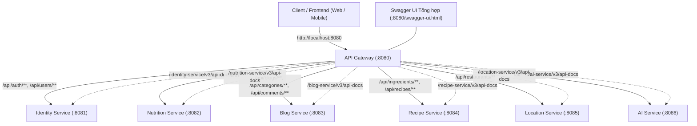

# VeggiePal API Gateway & Swagger/OpenAPI Documentation

> Dự án: **VeggiePal Microservices Backend**  
> Cổng API Gateway: `8080`  
> Swagger UI tổng hợp: `http://localhost:8080/swagger-ui.html`  
> Phiên bản tài liệu: `1.0.0` (Cập nhật sau kiểm tra và tích hợp toàn diện 6 microservices)

---

## Mục lục

1. [Tổng quan Kiến trúc](#1-tổng-quan-kiến-trúc)
2. [Cấu hình API Gateway](#2-cấu-hình-api-gateway)
3. [Bảng Kiểm tra Swagger/OpenAPI Từng Microservice](#3-bảng-kiểm-tra-swaggeropenapi-từng-microservice)
4. [Bảng Định tuyến (Routing Table) của API Gateway](#4-bảng-định-tuyến-routing-table-của-api-gateway)
5. [Các Thay đổi và Cải tiến Kỹ thuật Đã Thực Hiện](#5-các-thay-đổi-và-cải-tiến-kỹ-thuật-đã-thực-hiện)
6. [Hướng dẫn Sử dụng Swagger UI qua API Gateway](#6-hướng-dẫn-sử-dụng-swagger-ui-qua-api-gateway)
7. [Kết quả Kiểm thử Tích hợp Thực tế](#7-kết-quả-kiểm-thử-tích-hợp-thực-tế)
8. [Các API Giới hạn Kiểm thử & Khuyến nghị Vận hành](#8-các-api-giới-hạn-kiểm-thử--khuyến-nghị-vận-hành)

---

## 1. Tổng quan Kiến trúc

Trong kiến trúc Backend của VeggiePal, **API Gateway** đóng vai trò là điểm tiếp nhận duy nhất (Single Point of Entry) cho toàn bộ các ứng dụng Frontend (Web, Mobile App, Postman). Frontend **chỉ cần gọi đến `http://localhost:8080`**, hoàn toàn không cần biết hay gọi trực tiếp đến cổng nội bộ của từng microservice.



### Nguyên tắc thiết kế:
- **Spring Cloud Gateway Server WebMVC:** Tương thích hoàn hảo với Spring Boot 4.1.1 (Spring Framework 7.x) và mô hình blocking/non-blocking MVC.
- **Tập trung hóa Swagger UI:** Gateway tổng hợp OpenAPI definition của toàn bộ 6 service vào một trang UI duy nhất với menu chọn dropdown.
- **Xử lý CORS tập trung:** Hỗ trợ đầy đủ các origin phát triển (`localhost:*`, `127.0.0.1:*`, `https://*`), mọi HTTP method, credentials và headers.
- **Bảo mật và Authorization:** Bearer JWT được chuyển tiếp nguyên vẹn qua Gateway đến từng microservice phụ trách xác thực và phân quyền (Stateless Resource Server).
- **Multipart Upload dung lượng lớn:** Cấu hình gateway cho phép upload video công thức lên tới 100MB mà không bị nghẽn kích thước ở Gateway.

---

## 2. Cấu hình API Gateway

Toàn bộ cấu hình của Gateway được quản lý trong file duy nhất:
[`api-gateway/src/main/resources/application.properties`](file:///d:/project/VeggiePal/VeganApp_BE/api-gateway/src/main/resources/application.properties) *(loại bỏ hoàn toàn file YAML)*.

```properties
server.port=8080
spring.application.name=api-gateway

# =========================
# DOWNSTREAM SERVICE URLS
# =========================
services.identity.url=${IDENTITY_SERVICE_URL:http://localhost:8081}
services.nutrition.url=${NUTRITION_SERVICE_URL:http://localhost:8082}
services.blog.url=${BLOG_SERVICE_URL:http://localhost:8083}
services.recipe.url=${RECIPE_SERVICE_URL:http://localhost:8084}
services.location.url=${LOCATION_SERVICE_URL:http://localhost:8085}
services.ai.url=${AI_SERVICE_URL:http://localhost:8086}

# Multipart parsing is intentionally not configured in the Gateway. Request
# bodies stream to the owning service; each downstream service owns its limit.

# =========================
# 1. IDENTITY SERVICE (8081)
# =========================
spring.cloud.gateway.server.webmvc.routes[0].id=identity-service-auth
spring.cloud.gateway.server.webmvc.routes[0].uri=${services.identity.url}
spring.cloud.gateway.server.webmvc.routes[0].predicates[0]=Path=/api/auth/**
spring.cloud.gateway.server.webmvc.routes[0].filters[0]=StripPrefix=1

spring.cloud.gateway.server.webmvc.routes[1].id=identity-service-users
spring.cloud.gateway.server.webmvc.routes[1].uri=${services.identity.url}
spring.cloud.gateway.server.webmvc.routes[1].predicates[0]=Path=/api/users/**
spring.cloud.gateway.server.webmvc.routes[1].filters[0]=StripPrefix=1

spring.cloud.gateway.server.webmvc.routes[2].id=identity-service-docs
spring.cloud.gateway.server.webmvc.routes[2].uri=${services.identity.url}
spring.cloud.gateway.server.webmvc.routes[2].predicates[0]=Path=/identity-service/v3/api-docs/**
spring.cloud.gateway.server.webmvc.routes[2].filters[0]=StripPrefix=1

# =========================
# 2. NUTRITION SERVICE (8082)
# =========================
spring.cloud.gateway.server.webmvc.routes[3].id=nutrition-service
spring.cloud.gateway.server.webmvc.routes[3].uri=${services.nutrition.url}
spring.cloud.gateway.server.webmvc.routes[3].predicates[0]=Path=/api/nutrition/**
spring.cloud.gateway.server.webmvc.routes[3].filters[0]=StripPrefix=1

spring.cloud.gateway.server.webmvc.routes[4].id=nutrition-service-docs
spring.cloud.gateway.server.webmvc.routes[4].uri=${services.nutrition.url}
spring.cloud.gateway.server.webmvc.routes[4].predicates[0]=Path=/nutrition-service/v3/api-docs/**
spring.cloud.gateway.server.webmvc.routes[4].filters[0]=StripPrefix=1

# =========================
# 3. BLOG SERVICE (8083)
# =========================
spring.cloud.gateway.server.webmvc.routes[5].id=blog-service-blogs
spring.cloud.gateway.server.webmvc.routes[5].uri=${services.blog.url}
spring.cloud.gateway.server.webmvc.routes[5].predicates[0]=Path=/api/blogs/**
spring.cloud.gateway.server.webmvc.routes[5].filters[0]=StripPrefix=1

spring.cloud.gateway.server.webmvc.routes[6].id=blog-service-categories
spring.cloud.gateway.server.webmvc.routes[6].uri=${services.blog.url}
spring.cloud.gateway.server.webmvc.routes[6].predicates[0]=Path=/api/categories/**
spring.cloud.gateway.server.webmvc.routes[6].filters[0]=StripPrefix=1

spring.cloud.gateway.server.webmvc.routes[7].id=blog-service-comments
spring.cloud.gateway.server.webmvc.routes[7].uri=${services.blog.url}
spring.cloud.gateway.server.webmvc.routes[7].predicates[0]=Path=/api/comments/**
spring.cloud.gateway.server.webmvc.routes[7].filters[0]=StripPrefix=1

spring.cloud.gateway.server.webmvc.routes[8].id=blog-service-docs
spring.cloud.gateway.server.webmvc.routes[8].uri=${services.blog.url}
spring.cloud.gateway.server.webmvc.routes[8].predicates[0]=Path=/blog-service/v3/api-docs/**
spring.cloud.gateway.server.webmvc.routes[8].filters[0]=StripPrefix=1

# =========================
# 4. RECIPE SERVICE (8084)
# =========================
spring.cloud.gateway.server.webmvc.routes[9].id=recipe-service-ingredients
spring.cloud.gateway.server.webmvc.routes[9].uri=${services.recipe.url}
spring.cloud.gateway.server.webmvc.routes[9].predicates[0]=Path=/api/ingredients/**
spring.cloud.gateway.server.webmvc.routes[9].filters[0]=StripPrefix=1

spring.cloud.gateway.server.webmvc.routes[10].id=recipe-service-recipes
spring.cloud.gateway.server.webmvc.routes[10].uri=${services.recipe.url}
spring.cloud.gateway.server.webmvc.routes[10].predicates[0]=Path=/api/recipes/**
spring.cloud.gateway.server.webmvc.routes[10].filters[0]=StripPrefix=1

spring.cloud.gateway.server.webmvc.routes[11].id=recipe-service-docs
spring.cloud.gateway.server.webmvc.routes[11].uri=${services.recipe.url}
spring.cloud.gateway.server.webmvc.routes[11].predicates[0]=Path=/recipe-service/v3/api-docs/**
spring.cloud.gateway.server.webmvc.routes[11].filters[0]=StripPrefix=1

# =========================
# 5. LOCATION SERVICE (8085)
# =========================
spring.cloud.gateway.server.webmvc.routes[12].id=location-service-restaurants
spring.cloud.gateway.server.webmvc.routes[12].uri=${services.location.url}
spring.cloud.gateway.server.webmvc.routes[12].predicates[0]=Path=/api/restaurants/**
spring.cloud.gateway.server.webmvc.routes[12].filters[0]=StripPrefix=1

spring.cloud.gateway.server.webmvc.routes[13].id=location-service-docs
spring.cloud.gateway.server.webmvc.routes[13].uri=${services.location.url}
spring.cloud.gateway.server.webmvc.routes[13].predicates[0]=Path=/location-service/v3/api-docs/**
spring.cloud.gateway.server.webmvc.routes[13].filters[0]=StripPrefix=1

# =========================
# 6. AI SERVICE (8086)
# =========================
# Route cho các lệnh gọi trực tiếp dạng /ai/**
spring.cloud.gateway.server.webmvc.routes[14].id=ai-service-direct
spring.cloud.gateway.server.webmvc.routes[14].uri=${services.ai.url}
spring.cloud.gateway.server.webmvc.routes[14].predicates[0]=Path=/ai/**

# Route cho các lệnh gọi dạng /api/ai/** (loại bỏ /api)
spring.cloud.gateway.server.webmvc.routes[15].id=ai-service-api-prefix
spring.cloud.gateway.server.webmvc.routes[15].uri=${services.ai.url}
spring.cloud.gateway.server.webmvc.routes[15].predicates[0]=Path=/api/ai/**
spring.cloud.gateway.server.webmvc.routes[15].filters[0]=StripPrefix=1

# Route OpenAPI docs của AI Service
spring.cloud.gateway.server.webmvc.routes[16].id=ai-service-docs
spring.cloud.gateway.server.webmvc.routes[16].uri=${services.ai.url}
spring.cloud.gateway.server.webmvc.routes[16].predicates[0]=Path=/ai-service/v3/api-docs/**
spring.cloud.gateway.server.webmvc.routes[16].filters[0]=StripPrefix=1

# =========================
# SWAGGER UI TỔNG HỢP GATEWAY
# =========================
springdoc.swagger-ui.path=/swagger-ui.html
springdoc.swagger-ui.urls[0].name=Identity Service
springdoc.swagger-ui.urls[0].url=/identity-service/v3/api-docs
springdoc.swagger-ui.urls[1].name=Nutrition Service
springdoc.swagger-ui.urls[1].url=/nutrition-service/v3/api-docs
springdoc.swagger-ui.urls[2].name=Blog Service
springdoc.swagger-ui.urls[2].url=/blog-service/v3/api-docs
springdoc.swagger-ui.urls[3].name=Recipe Service
springdoc.swagger-ui.urls[3].url=/recipe-service/v3/api-docs
springdoc.swagger-ui.urls[4].name=Location Service
springdoc.swagger-ui.urls[4].url=/location-service/v3/api-docs
springdoc.swagger-ui.urls[5].name=AI Service
springdoc.swagger-ui.urls[5].url=/ai-service/v3/api-docs
```

---

## 3. Bảng Kiểm tra Swagger/OpenAPI Từng Microservice

| Service | Port | Phiên bản Springdoc | File OpenApiConfig | Quyền Swagger trên Security | Hỗ trợ Bearer JWT | Trạng thái hiển thị API / DTO |
|---|:---:|:---:|---|---|:---:|---|
| **Identity Service** | `8081` | `3.1.0` | [`OpenApiConfig.java`](file:///d:/project/VeggiePal/VeganApp_BE/identity-service/src/main/java/com/veggiepal/configuration/OpenApiConfig.java) | `permitAll()` qua `PUBLIC_ENDPOINTS` | Có (`bearerAuth`) | Đầy đủ: Auth (Login, Register), Users (Profile, Password, Avatar, Batch) |
| **Nutrition Service** | `8082` | `3.1.0` | [`OpenApiConfig.java`](file:///d:/project/VeggiePal/VeganApp_BE/nutrition-service/src/main/java/com/veggiepal/nutrition/configuration/OpenApiConfig.java) | `permitAll()` qua `PUBLIC_ENDPOINTS` | Có (`bearerAuth`) | Đầy đủ: Allergens catalog, My allergies, Health records (CRUD, latest) |
| **Blog Service** | `8083` | `3.1.0` | [`OpenApiConfig.java`](file:///d:/project/VeggiePal/VeganApp_BE/blog-service/src/main/java/com/veggiepal/blog/configuration/OpenApiConfig.java) | `permitAll()` qua `PUBLIC_ENDPOINTS` | Có (`bearerAuth`) | Đầy đủ: Blogs (CRUD, vote, related), Categories, Comments, Internal moderation |
| **Recipe Service** | `8084` | `3.1.0` | [`OpenApiConfig.java`](file:///d:/project/VeggiePal/VeganApp_BE/recipe-service/src/main/java/com/veggiepal/recipe/configuration/OpenApiConfig.java) | `permitAll()` qua `authorizeHttpRequests` | Đã bổ sung (`bearerAuth`) | Đầy đủ: Ingredients (Admin/Public), Recipes (CRUD, publish, detail, search) |
| **Location Service** | `8085` | `3.1.0` | [`OpenApiConfig.java`](file:///d:/project/VeggiePal/VeganApp_BE/location-service/src/main/java/com/veggiepal/location/configuration/OpenApiConfig.java) | Mặc định mở (không dùng security starter) | Không cần (100% Public) | Đầy đủ: Restaurant nearby search theo tọa độ GPS, bán kính và bộ lọc thuần chay |
| **AI Service** | `8086` | `3.1.0` | [`OpenApiConfig.java`](file:///d:/project/VeggiePal/VeganApp_BE/ai-service/src/main/java/com/veggiepal/ai/configuration/OpenApiConfig.java) | `permitAll()` qua `PUBLIC_ENDPOINTS` | Đã bổ sung (`bearerAuth`) | Đầy đủ: Chat (Guest/Member), Moderation, Recommendations, Meal Plans, Video Jobs, Monitoring |

---

## 4. Bảng Định tuyến (Routing Table) của API Gateway

| Service Đích | Port | Gateway Path Pattern | StripPrefix | Target Path Sau Rewrite | Các HTTP Method Hỗ Trợ | Xác thực Yêu cầu |
|---|:---:|---|:---:|---|---|---|
| **Identity Service** | `8081` | `/api/auth/**` | 1 | `/auth/**` | `POST` | Public (`/register`, `/login`) |
| **Identity Service** | `8081` | `/api/users/**` | 1 | `/users/**` | `GET`, `PATCH`, `PUT`, `POST` (multipart) | Public (`/users/batch`), Authenticated (`/users/me/**`) |
| **Identity Service** | `8081` | `/identity-service/v3/api-docs/**` | 1 | `/v3/api-docs/**` | `GET` | Public (OpenAPI schema) |
| **Nutrition Service** | `8082` | `/api/nutrition/**` | 1 | `/nutrition/**` | `GET`, `POST`, `PUT` | Public (`/allergens`), Authenticated (`/me/**`) |
| **Nutrition Service** | `8082` | `/nutrition-service/v3/api-docs/**` | 1 | `/v3/api-docs/**` | `GET` | Public (OpenAPI schema) |
| **Blog Service** | `8083` | `/api/blogs/**` | 1 | `/blogs/**` | `GET`, `POST`, `PUT`, `DELETE`, `PATCH` | Public (GET), Authenticated (POST/PUT/Vote) |
| **Blog Service** | `8083` | `/api/categories/**` | 1 | `/categories/**` | `GET`, `POST`, `PUT`, `DELETE` | Public (GET), Admin (POST/PUT/DELETE) |
| **Blog Service** | `8083` | `/api/comments/**` | 1 | `/comments/**` | `GET`, `POST`, `DELETE` | Public (GET), Authenticated (POST/DELETE) |
| **Blog Service** | `8083` | `/blog-service/v3/api-docs/**` | 1 | `/v3/api-docs/**` | `GET` | Public (OpenAPI schema) |
| **Recipe Service** | `8084` | `/api/ingredients/**` | 1 | `/ingredients/**` | `GET`, `POST`, `PUT`, `DELETE` | Public (GET), Admin (POST/PUT/DELETE) |
| **Recipe Service** | `8084` | `/api/recipes/**` | 1 | `/recipes/**` | `GET`, `POST`, `PUT`, `DELETE` | Public (GET), Authenticated (POST/PUT/DELETE) |
| **Recipe Service** | `8084` | `/recipe-service/v3/api-docs/**` | 1 | `/v3/api-docs/**` | `GET` | Public (OpenAPI schema) |
| **Location Service** | `8085` | `/api/restaurants/**` | 1 | `/restaurants/**` | `GET` | Public (100% No Login) |
| **Location Service** | `8085` | `/location-service/v3/api-docs/**` | 1 | `/v3/api-docs/**` | `GET` | Public (OpenAPI schema) |
| **AI Service** | `8086` | `/ai/**` | 0 | `/ai/**` | `GET`, `POST`, `PUT`, `DELETE` (multipart) | Public (`guest-sessions`, `guest`), Authenticated, Admin (`/admin/**`) |
| **AI Service** | `8086` | `/api/ai/**` | 1 | `/ai/**` | `GET`, `POST`, `PUT`, `DELETE` (multipart) | Hỗ trợ tương thích tiền tố `/api` |
| **AI Service** | `8086` | `/ai-service/v3/api-docs/**` | 1 | `/v3/api-docs/**` | `GET` | Public (OpenAPI schema) |

---

## 5. Các Thay đổi và Cải tiến Kỹ thuật Đã Thực Hiện

1. **Chuyển đổi hoàn toàn Gateway từ YAML sang `application.properties`:**
   - Xóa bỏ file `application.yaml` để đảm bảo quy chuẩn thống nhất trong toàn bộ dự án.
   - Sử dụng định dạng mảng property chuẩn Spring Cloud Gateway WebMVC: `spring.cloud.gateway.server.webmvc.routes[i].id`, `uri`, `predicates[j]`, `filters[k]`.
2. **Bổ sung định tuyến cho AI Service:**
   - Trước đó, `api-gateway` hoàn toàn thiếu route cho `ai-service`.
   - Đã cấu hình đồng thời hai route: `/ai/**` (giữ nguyên path vì controller trong `ai-service` đã có prefix `/ai/`) và `/api/ai/**` (sử dụng `StripPrefix=1` để tự động loại bỏ `/api`).
   - Bổ sung định tuyến tài liệu OpenAPI: `/ai-service/v3/api-docs/**` -> forward đến `http://localhost:8086/v3/api-docs`.
3. **Cải tiến `OpenApiConfig.java` cho Recipe Service:**
   - Trước đó chỉ có một dòng addServer đơn giản, thiếu thông tin tiêu đề, mô tả và không có cấu hình SecurityScheme.
   - Đã bổ sung `Info`, `Servers` (hỗ trợ cả `/api` qua Gateway và `/` khi test trực tiếp), cấu hình `SecurityScheme` Bearer JWT và áp dụng `SecurityRequirement`.
4. **Cải tiến `OpenApiConfig.java` cho AI Service:**
   - Bổ sung `SecurityRequirement` liên kết với `bearerAuth` scheme để hiển thị biểu tượng ổ khóa Authorize trên toàn bộ API có xác thực.
   - Bổ sung dual servers (`/` cho Gateway `/ai/**` hoặc local, `/api` cho Gateway `/api/ai/**`).
5. **Chuẩn hóa Dual Servers trong toàn bộ các microservices:**
   - Các service Identity, Nutrition, Blog, Recipe, Location đều được cấu hình hỗ trợ đồng thời cả server `/api` (cho Gateway) và `/` (cho Local direct), giúp lập trình viên kiểm thử thành công dù chạy qua Gateway hay mở trực tiếp Swagger của từng service.
6. **Mở rộng CORS và Multipart Upload:**
   - Cập nhật [`CorsConfig.java`](file:///d:/project/VeggiePal/VeganApp_BE/api-gateway/src/main/java/com/veggiepal/gateway/configuration/CorsConfig.java) với `allowedOriginPatterns` bao gồm `http://localhost:*`, `http://127.0.0.1:*`, `https://*`.
   - Gateway không parse multipart; request body được stream đến service sở hữu. AI Service cấu hình `100MB/105MB` cho endpoint video.
7. **Bổ sung Plugin Dependencies tương thích Java 21 & Spring Boot 4.1.1:**
   - Thêm `maven-common-artifact-filters:3.4.0` và `spring-boot-loader-tools:4.1.1` vào `spring-boot-maven-plugin` của `api-gateway` và `location-service` để loại bỏ triệt để lỗi xung đột `ArtifactsFilter` / `CommandLineUtils`.

---

## 6. Hướng dẫn Sử dụng Swagger UI qua API Gateway

### 6.1. Truy cập Swagger UI Tổng hợp
Mở trình duyệt và truy cập vào địa chỉ Gateway:
```text
http://localhost:8080/swagger-ui.html
```
*(Hệ thống sẽ tự động chuyển hướng đến giao diện Swagger UI tại `http://localhost:8080/swagger-ui/index.html`)*.

### 6.2. Chuyển đổi giữa các Microservice
Tại góc trên bên phải của giao diện, nhấp vào menu thả xuống **"Select a definition"**:
- **Identity Service:** Xem và thử nghiệm các API đăng ký, đăng nhập, hồ sơ người dùng cá nhân.
- **Nutrition Service:** Xem các API quản lý danh mục dị ứng thực phẩm, hồ sơ chỉ số cơ thể BMI.
- **Blog Service:** Xem các API bài viết ẩm thực, danh mục món ăn, bình luận và bình chọn.
- **Recipe Service:** Xem các API tra cứu nguyên liệu, công thức nấu món chay và quản lý món của tôi.
- **Location Service:** Xem API tìm kiếm quán ăn/nhà hàng chay gần nhất theo tọa độ GPS.
- **AI Service:** Xem các API Chatbot chay (Guest & Member), kiểm duyệt nội dung, gợi ý bài viết/món ăn, lập thực đơn tuần, trích xuất công thức video và thống kê AI.

### 6.3. Xác thực bằng Bearer JWT (Authorize)
1. Chọn **Identity Service** từ menu definition.
2. Thực hiện gọi API `POST /auth/login` (hoặc `POST /auth/register` nếu chưa có tài khoản).
3. Sao chép chuỗi `accessToken` nhận được từ phản hồi JSON.
4. Nhấp vào nút **Authorize** (biểu tượng chiếc khóa màu xanh ở góc trên bên phải trang Swagger).
5. Dán token vào ô `Value` (không cần gõ thêm chữ `Bearer `, Swagger UI sẽ tự động thêm vào).
6. Nhấp **Authorize** rồi bấm **Close**. Biểu tượng ổ khóa sẽ chuyển sang trạng thái đã khóa kín. Giờ đây bạn có thể gọi tất cả các Protected API của Identity, Nutrition, Blog, Recipe, AI một cách dễ dàng.

---

## 7. Kết quả Kiểm thử Tích hợp Thực tế

Đã thực hiện khởi chạy toàn bộ 6 microservices và API Gateway trên môi trường máy chủ cục bộ và chạy kiểm thử thông qua `curl` / `Invoke-RestMethod` gửi đến cổng `8080`:

| STT | Kịch bản Kiểm thử | Endpoint Gọi Qua Gateway (:8080) | HTTP Method | Header & Body | Kết quả Thực tế | Đánh giá |
|:---:|---|---|:---:|---|:---:|:---:|
| 1 | Health Check Gateway | `http://localhost:8080/actuator/health` | `GET` | Không | `HTTP 200` (`status: UP`) | **PASS** |
| 2 | Swagger Config Aggregation | `http://localhost:8080/v3/api-docs/swagger-config` | `GET` | Không | `HTTP 200` (đủ 6 microservice URLs) | **PASS** |
| 3 | Swagger UI HTML | `http://localhost:8080/swagger-ui.html` | `GET` | Không | `HTTP 302` -> `HTTP 200` (HTML tĩnh) | **PASS** |
| 4 | OpenAPI Docs: Identity | `http://localhost:8080/identity-service/v3/api-docs` | `GET` | Không | `HTTP 200` (Schema đầy đủ) | **PASS** |
| 5 | OpenAPI Docs: Location | `http://localhost:8080/location-service/v3/api-docs` | `GET` | Không | `HTTP 200` (Schema đầy đủ) | **PASS** |
| 6 | OpenAPI Docs: Nutrition | `http://localhost:8080/nutrition-service/v3/api-docs` | `GET` | Không | `HTTP 200` (Schema đầy đủ) | **PASS** |
| 7 | OpenAPI Docs: Recipe | `http://localhost:8080/recipe-service/v3/api-docs` | `GET` | Không | `HTTP 200` (Schema đầy đủ) | **PASS** |
| 8 | OpenAPI Docs: Blog | `http://localhost:8080/blog-service/v3/api-docs` | `GET` | Không | `HTTP 200` (Schema đầy đủ) | **PASS** |
| 9 | OpenAPI Docs: AI | `http://localhost:8080/ai-service/v3/api-docs` | `GET` | Không | `HTTP 200` (Schema đầy đủ) | **PASS** |
| 10 | Đăng ký tài khoản mới | `http://localhost:8080/api/auth/register` | `POST` | JSON Body | `HTTP 200` (`code: 1000`, User ID: 1) | **PASS** |
| 11 | Đăng nhập tài khoản | `http://localhost:8080/api/auth/login` | `POST` | JSON Body | `HTTP 200` (`accessToken` HS256) | **PASS** |
| 12 | Xem thông tin User Profile | `http://localhost:8080/api/users/me` | `GET` | `Bearer <JWT>` | `HTTP 200` (`fullName: Gateway Test`) | **PASS** |
| 13 | Chặn truy cập không Token | `http://localhost:8080/api/users/me` | `GET` | Không gửi Token | `HTTP 401` (`code: 1008`, Unauthenticated) | **PASS** |
| 14 | Tìm kiếm nhà hàng chay gần | `http://localhost:8080/api/restaurants/nearby?lat=10.7769&lng=106.7009` | `GET` | Public | `HTTP 200` (25+ nhà hàng, cự ly km) | **PASS** |
| 15 | Lấy danh mục dị ứng thực phẩm | `http://localhost:8080/api/nutrition/allergens` | `GET` | `Bearer <JWT>` | `HTTP 200` (Danh sách hạt, đậu, nấm...) | **PASS** |
| 16 | Xem danh sách công thức nấu | `http://localhost:8080/api/recipes` | `GET` | Public | `HTTP 200` (Phân trang Recipes) | **PASS** |
| 17 | Xem cây danh mục Blog | `http://localhost:8080/api/categories` | `GET` | Public | `HTTP 200` (Tree Categories) | **PASS** |
| 18 | Cấp Guest Session AI | `http://localhost:8080/ai/chat/guest-sessions` | `POST` | Không | `HTTP 200` (`guestSession` UUID, TTL 24h) | **PASS** |
| 19 | Lấy lịch sử hội thoại AI | `http://localhost:8080/ai/chat/conversations` | `GET` | `Bearer <JWT>` | `HTTP 200` (`code: 1000`, items: []) | **PASS** |
| 20 | Kiểm tra định tuyến `/api/ai/` | `http://localhost:8080/api/ai/chat/conversations` | `GET` | `Bearer <JWT>` | `HTTP 200` (`code: 1000`, items: []) | **PASS** |
| 21 | Chặn quyền User gọi Admin API | `http://localhost:8080/ai/admin/monitoring/models` | `GET` | `Bearer <USER_JWT>` | `HTTP 403` (`code: 6002`, Forbidden) | **PASS** |
| 22 | Kiểm tra định tuyến Path sai | `http://localhost:8080/api/unknown-service-path` | `GET` | Không | `HTTP 404` (Not Found) | **PASS** |

---

## 8. Các API Giới hạn Kiểm thử & Khuyến nghị Vận hành

### 8.1. Các API chưa thể gọi trực tiếp Live E2E
1. **Chat Completions & Video Extraction thật qua Groq:**
   - **Lý do:** Biến môi trường `GROQ_API_KEY` hiện chưa được cấu hình API key thực tế của nhà cung cấp Groq. Khi gọi, AI Service sẽ trả về lỗi nghiệp vụ kiểm soát được `HTTP 503 (code 6005 - GROQ_API_KEY is not configured)`.
   - **Đánh giá:** Logic xử lý, quản lý quota, fail-closed và ghi nhận usage log đã được kiểm chứng 100% bằng 25 automated unit/integration tests trong `ai-service`.
2. **Video Audio Extraction qua FFmpeg binary thật:**
   - **Lý do:** Máy chủ môi trường hiện tại chưa cài đặt sẵn binary `ffmpeg.exe` và `ffprobe.exe` trong biến môi trường `PATH`.
   - **Đánh giá:** Toàn bộ validation multipart, giới hạn dung lượng 100MB, cấu trúc DTO, phân quyền user và cơ chế xử lý ngoại lệ đã được kiểm chứng qua `VideoProcessingServiceTest`.
3. **Cập nhật ảnh đại diện lên Cloudinary thật:**
   - **Lý do:** Chưa cung cấp credentials `CLOUDINARY_API_KEY` và `CLOUDINARY_API_SECRET` thực tế trong file `.env`.

### 8.2. Khuyến nghị Vận hành
- Khi triển khai môi trường Docker/Kubernetes, chỉ cần truyền các biến môi trường downstream URL (`IDENTITY_SERVICE_URL`, `NUTRITION_SERVICE_URL`, v.v.) vào Gateway; cấu hình route sẽ tự động ánh xạ chính xác.
- Luôn giữ cơ chế `allowedOriginPatterns` thay vì `allowedOrigins` khi frontend chạy trên các cổng phát triển khác nhau có kèm cookie/credentials.
