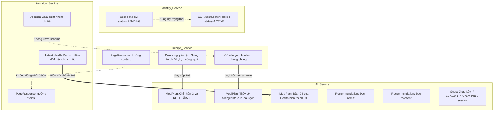

# BÁO CÁO AUDIT RÀNG BUỘC, VALIDATION VÀ BUSINESS LOGIC BACKEND VEGGIEPAL

> **Tài liệu Phân tích Kiến trúc & Logic Nghiệp vụ Chuyên sâu**  
> **Người thực hiện:** Senior Backend Architect & Business Logic Analyst  
> **Phạm vi kiểm tra:** 7 Microservices (`api-gateway`, `identity-service`, `nutrition-service`, `blog-service`, `recipe-service`, `location-service`, `ai-service`)  
> **Nguyên tắc thẩm định:** CHỈ PHÂN TÍCH DỰA TRÊN MÃ NGUỒN THỰC TẾ, KHÔNG SUY ĐOÁN, KHÔNG SỬA CODE  
> **Ngày lập:** 17/10/2026  

---

## MỤC LỤC
1. [Tổng quan các ràng buộc theo từng Service](#1-tổng-quan-các-ràng-buộc-theo-từng-service)
2. [Bảng tổng hợp Toàn bộ Validation, Giới hạn, Đơn vị, Enum và Trạng thái](#2-bảng-tổng-hợp-toàn-bộ-validation-giới-hạn-đơn-vị-enum-và-trạng-thái)
3. [Phân tích Chi tiết 9 Workflow Nghiệp vụ](#3-phân-tích-chi-tiết-9-workflow-nghiệp-vụ)
4. [Danh sách Xung đột và Bất hợp lý Giữa các Service](#4-danh-sách-xung-đột-và-bất-hợp-lý-giữa-các-service)
5. [Bảng Đánh giá Mức độ Nghiêm trọng (P0 / P1 / P2 / OK)](#5-bảng-đánh-giá-mức-độ-nghiêm-trọng-p0--p1--p2--ok)
6. [Kịch bản Request và Dữ liệu Gây lỗi Thực tế (Reproduction Scenarios)](#6-kịch-bản-request-và-dữ-liệu-gây-lỗi-thực-tế-reproduction-scenarios)
7. [Lộ trình Khắc phục và Đề xuất Kiến trúc Ưu tiên](#7-lộ-trình-khắc-phục-và-đề-xuất-kiến-trúc-ưu-tiên)
8. [Các Ràng buộc Hợp lý Cần Giữ nguyên](#8-các-ràng-buộc-hợp-lý-cần-giữ-nguyên)

---

## 1. TỔNG QUAN CÁC RÀNG BUỘC THEO TỪNG SERVICE

### 1.1. API Gateway (`:8080`)
- **Kiến trúc:** Spring Cloud Gateway Server WebMVC (Servlet-based, không phải WebFlux).
- **Ràng buộc định tuyến:** Định tuyến dựa trên `Path` và `StripPrefix=1`.
  - `/api/auth/**`, `/api/users/**` -> `identity-service:8081`
  - `/api/nutrition/**` -> `nutrition-service:8082`
  - `/api/blogs/**`, `/api/categories/**`, `/api/comments/**` -> `blog-service:8083`
  - `/api/ingredients/**`, `/api/recipes/**` -> `recipe-service:8084`
  - `/api/restaurants/**` -> `location-service:8085`
  - `/ai/**` (không strip) và `/api/ai/**` (strip 1) -> `ai-service:8086`
- **CORS:** Cấu hình tại `CorsConfig.java` cho phép `http://localhost:*`, `http://127.0.0.1:*`, `https://*` với `allowCredentials(true)`.
- **Giới hạn Multipart:** Khai báo `spring.servlet.multipart.max-file-size=100MB`, `max-request-size=105MB` để hỗ trợ upload video lớn.
- **Thiếu sót kiến trúc:** Không cấu hình timeout (`connectTimeout`, `readTimeout`) cho Gateway WebMVC, dẫn đến rủi ro treo kết nối dài hạn khi gọi downstream blocking (như Video processing).

### 1.2. Identity Service (`:8081`)
- **Database:** MySQL `veggiepal_identity`, DDL auto `update`.
- **Xác thực:** Phát hành JWT HS256, thời hạn 24 giờ, subject = email, claims = `userId`, `role`.
- **Ràng buộc nghiệp vụ:**
  - Email chuẩn hóa `trim().toLowerCase()`, duy nhất (`unique = true`).
  - Mật khẩu mã hóa BCrypt, yêu cầu tối thiểu 6 ký tự.
  - Avatar tải lên Cloudinary, tối đa 2MB, kiểm tra Magic Bytes (`ImageTypeDetector`) khớp Content-Type (JPEG, PNG, WEBP).
  - Phân giải batch tác giả `GET /users/batch` giới hạn tối đa 50 ID, chỉ trả về user có `status = ACTIVE`.
- **Lỗi logic nghiêm trọng:** User đăng ký mới luôn bị gán `status = PENDING`. Không có luồng kích hoạt email hay admin duyệt, khiến tài khoản không bao giờ chuyển thành `ACTIVE`. Do đó, `GET /users/batch` không thể hiển thị tên/avatar tác giả cho các bài blog/recipe của họ.

### 1.3. Nutrition Service (`:8082`)
- **Database:** MySQL `veggiepal_nutrition`, DDL auto `update`, seed `allergens` từ `data.sql`.
- **Ràng buộc thể chất:**
  - Chiều cao `heightCm`: từ 50.0 đến 250.0 cm, tối đa 1 chữ số thập phân (`@Digits(integer=3, fraction=1)`).
  - Cân nặng `weightKg`: từ 20.0 đến 300.0 kg, tối đa 1 chữ số thập phân.
  - Chỉ số BMI: Tính tự động theo công thức $BMI = \frac{weightKg}{(heightCm/100)^2}$, làm tròn `HALF_UP` 1 chữ số thập phân.
- **Ràng buộc dị ứng:** Bảng `allergens` độc quyền cho người ăn chay (loại bỏ sữa, trứng, hải sản), nhóm theo 8 danh mục (`AllergenCategory`). User cập nhật dị ứng bằng danh sách `allergenIds` (mảng rỗng `[]` là xóa hết).
- **Lỗ hổng bảo mật/logic:** Endpoint danh mục dị ứng `GET /nutrition/allergens` không được đưa vào `PUBLIC_ENDPOINTS`, buộc khách vãng lai (Guest) phải có Bearer Token mới xem được danh mục.

### 1.4. Blog Service (`:8083`)
- **Database:** MySQL `veggiepal_blog`, DDL auto `update`, seed danh mục và blog mẫu từ `data.sql`.
- **Ràng buộc danh mục:** Cây phân cấp tối đa 2 cấp (`parent.getParent() == null`). Tên danh mục duy nhất trên toàn hệ thống (`utf8mb4_0900_as_ci`). Chỉ được xóa danh mục khi không có danh mục con và không có bài viết.
- **Ràng buộc bài viết:**
  - Tiêu đề tối đa 150 ký tự; nội dung tối thiểu 20 ký tự (không chặn cận trên trong DTO dẫn đến lỗi tràn cột MySQL `TEXT` 64KB).
  - Thumbnail tối đa 5MB, kiểm tra Magic Bytes.
  - Trạng thái chuyển giao nghiêm ngặt: `DRAFT` -> `PENDING` (khi submit hoặc tạo với `publish=true`) -> `PUBLISHED` / `REJECTED` / `BANNED`. Bài bị `BANNED` không được phép sửa hay mở lại.
- **Ràng buộc bình luận:** Cấp bình luận tối đa 1 cấp phản hồi (`parent.getParent() == null`). Giới hạn tối đa 500 từ và tối đa 5000 ký tự. Xóa bình luận tạo tombstone (`CommentStatus.DELETED`, content = null) để bảo tồn cây trả lời.
- **Ràng buộc bình chọn (Vote):** Điểm vote từ -1 đến 1. Bấm lại giá trị cũ sẽ hủy vote (toggle). Không được vote bài của chính mình (`CANNOT_VOTE_OWN_CONTENT`). Cập nhật `vote_score` atomic bằng SQL query.
- **Tích hợp:** Gọi sang `ai-service:8086` qua `POST /ai/moderation/check` để kiểm duyệt nội dung.

### 1.5. Recipe Service (`:8084`)
- **Database:** MySQL `veggiepal_recipe`, DDL auto `update`, seed 2 công thức mẫu từ `data.sql`.
- **Ràng buộc nguyên liệu chuẩn:** Tên nguyên liệu chuẩn hóa chống trùng lặp tiếng Việt (`normalized_name`). Giá trị calo, protein, carbs, fat, fiber tính trên 100g, không âm (`@DecimalMin("0.0")`).
- **Ràng buộc công thức:** Khẩu phần `servings >= 1`, danh sách nguyên liệu và các bước không được rỗng (`@NotEmpty`). Xóa công thức thực hiện hard delete (`delete`), không chuyển sang `ARCHIVED`.
- **Lỗi logic nghiêm trọng:** Trường đơn vị `unit` trong `RecipeIngredientRequest` nhận String tự do (chỉ trim và uppercase), không kiểm soát theo Enum hay định lượng, gây sụp đổ toàn bộ luồng AI Meal Planning. Thiếu `SecurityExceptionHandler` tùy chỉnh khiến response 401/403 mất cấu trúc `ApiResponse`.

### 1.6. Location Service (`:8085`)
- **Database:** MySQL `veggiepal_location`, DDL auto `update`, seed 100 nhà hàng chay.
- **Ràng buộc không gian:** Tọa độ GPS `lat` trong `[-90, 90]`, `lng` trong `[-180, 180]`, bán kính `radiusKm` trong `(0, 10]`.
- **Truy vấn không gian:** Sử dụng hàm MySQL `ST_Distance_Sphere(point(longitude, latitude), point(:lng, :lat))`. Thứ tự x là `lng`, y là `lat`.
- **Đặc điểm:** 100% Public, không sử dụng Spring Security.

### 1.7. AI Service (`:8086`)
- **Database:** MySQL `veggiepal_ai`, **Flyway Migration** (`ddl-auto = validate`).
- **Ràng buộc Quota:**
  - Guest: Tối đa 3 phiên session/IP/ngày, 3 lượt chat/phiên/ngày.
  - Member: Tối đa 50 lượt chat/ngày, trần 50,000 token/ngày.
  - Khóa bi quan (`@Lock(LockModeType.PESSIMISTIC_WRITE)`) đảm bảo tính toàn vẹn đồng thời.
- **Ràng buộc Video:** Thời lượng tối đa 1800 giây (30 phút), kiểm tra bằng `ffprobe`. Kích thước tối đa 100MB.
- **Ràng buộc Meal Planning:** Bắt buộc 7 ngày x 3 bữa (`BREAKFAST`, `LUNCH`, `DINNER`). Lọc món chay và lọc dị ứng.
- **Lỗi kiến trúc & logic nghiêm trọng:**
  - Nhận diện IP Guest qua `request.getRemoteAddr()` khiến toàn bộ khách vãng lai qua Gateway bị chung một IP `127.0.0.1`, cạn quota toàn cầu sau 3 session đầu tiên.
  - Không cấu hình `spring.servlet.multipart.max-file-size`, khiến upload video > 1MB bị Spring ném 500.
  - Bộ tính toán Macro trong `MealPlanValidator` chỉ chấp nhận duy nhất đơn vị `G` và `KG`. Bất kỳ công thức nào dùng `ml`, `muỗng`, `quả` đều khiến hệ thống văng lỗi 503 `DOWNSTREAM_UNAVAILABLE`.
  - Bộ lọc dị ứng từ chối toàn bộ công thức có cờ `allergen = true` nếu user có bất kỳ dị ứng nào.
  - Nguyên liệu sẵn có bị biến thành điều kiện bắt buộc lọc tuyệt đối.

---

## 2. BẢNG TỔNG HỢP TOÀN BỘ VALIDATION, GIỚI HẠN, ĐƠN VỊ, ENUM VÀ TRẠNG THÁI

| Thành phần | Service | Thuộc tính / Vị trí | Kiểu / Giới hạn | Quy tắc Validation & Ràng buộc Database | Hành vi khi vi phạm |
|---|---|---|---|---|---|
| **Email** | Identity | `RegisterRequest.email` | String | `@Email`, `@NotBlank`, chuẩn hóa `trim().toLowerCase()`, DB `unique=true` | Trả mã 1001 (Validation) hoặc 1002 (`EMAIL_EXISTED`, 400) |
| **Password** | Identity | `RegisterRequest.password` | String | `@Size(min=6)` **(Thiếu @NotBlank)** | Nếu null gây `IllegalArgumentException` -> 500 |
| **Password** | Identity | `ChangePasswordRequest` | String | `@NotBlank`, `@Size(min=6)`. Cấm trùng mật khẩu cũ | Trả 1011 (`WRONG_PASSWORD`, 400), 1012 (`PASSWORD_UNCHANGED`, 400) |
| **Full Name** | Identity | `UpdateProfileRequest.fullName` | String | `@Pattern(regexp = "(?s).*\\S.*")` | Trả 1001 / `FULL_NAME_REQUIRED` (400) |
| **Date of Birth** | Identity | `UpdateProfileRequest.dateOfBirth` | LocalDate | `@Past` | Trả 1001 / `INVALID_DATE_OF_BIRTH` (400) |
| **Avatar File** | Identity | `ProfileController.uploadAvatar` | MultipartFile | Tối đa 2MB (2,097,152 bytes), MIME & Magic Bytes: JPEG, PNG, WEBP | Trả 1015 (`INVALID_AVATAR_TYPE`), 1016 (`AVATAR_TOO_LARGE`) |
| **User Status** | Identity | `User.status` | Enum | `PENDING`, `ACTIVE`, `SUSPENDED` | Không có API active user; login không check status |
| **User Role** | Identity | `User.role` | Enum | `USER`, `ADMIN` | Gán claim JWT `role: "USER"` hoặc `"ADMIN"` |
| **Height** | Nutrition | `HealthRecordRequest.heightCm` | BigDecimal | `@NotNull`, `@DecimalMin("50")`, `@DecimalMax("250")`, `@Digits(3, 1)` | Trả 2001 (`HEIGHT_REQUIRED`), 2002 (`INVALID_HEIGHT`) |
| **Weight** | Nutrition | `HealthRecordRequest.weightKg` | BigDecimal | `@NotNull`, `@DecimalMin("20")`, `@DecimalMax("300")`, `@Digits(3, 1)` | Trả 2003 (`WEIGHT_REQUIRED`), 2004 (`INVALID_WEIGHT`) |
| **BMI** | Nutrition | `HealthRecord.bmi` | BigDecimal | $weight / (height/100)^2$, làm tròn `HALF_UP` 1 chữ số thập phân | Tự động tính, lưu `DECIMAL(5,1)` |
| **Allergen Category** | Nutrition | `Allergen.category` | Enum | `GRAIN`, `LEGUME`, `NUT_SEED`, `VEGETABLE`, `FRUIT`, `MUSHROOM`, `SPICE`, `ADDITIVE` | Seed cố định trong `data.sql` |
| **Category Depth** | Blog | `Category.parent` | Cây 2 cấp | `parent.getParent() == null` | Trả 3004 (`CATEGORY_DEPTH_EXCEEDED`, 400) |
| **Category Name** | Blog | `Category.name` | String (100) | Không trùng lặp toàn cây (`utf8mb4_0900_as_ci`), case-insensitive | Trả 3003 (`CATEGORY_NAME_DUPLICATED`, 400) |
| **Category Type** | Blog | `Category.type` | Enum | `FOOD_TYPE`, `RECIPE_TYPE` | Danh mục con thừa kế type của danh mục cha |
| **Blog Title** | Blog | `BlogRequest.title` | String | `@NotBlank`, `@Size(max=150)` | Trả 3010 (`BLOG_TITLE_REQUIRED`), 3011 (`INVALID_BLOG_TITLE`) |
| **Blog Content** | Blog | `BlogRequest.content` | String | `@NotBlank`, `@Size(min=20)` **(Không có max)**, DB `TEXT` (64KB) | Chuỗi > 65,535 bytes gây lỗi SQL Truncation -> 500 |
| **Blog Thumbnail** | Blog | `BlogController.uploadThumbnail` | MultipartFile | Tối đa 5MB, kiểm tra Magic Bytes JPEG/PNG/WEBP | Trả 3020 (`THUMBNAIL_REQUIRED`), 3021 (`THUMBNAIL_TOO_LARGE`), 3022 (`INVALID_THUMBNAIL_TYPE`) |
| **Blog Status** | Blog | `Blog.status` | Enum | `DRAFT`, `PENDING`, `PUBLISHED`, `REJECTED`, `BANNED` | Sửa bài `BANNED` ném 3013 (`INVALID_BLOG_STATUS_TRANSITION`) |
| **Comment Content** | Blog | `CommentRequest.content` | String | `@NotBlank`, `@MaxWords(max=500)`, `@Size(max=5000)` | Trả 3030 (`COMMENT_CONTENT_REQUIRED`), 3031 (`INVALID_COMMENT_CONTENT`), 3032 (`COMMENT_TOO_LONG`) |
| **Comment Target** | Blog | `CommentRequest.targetType` | Enum | `BLOG`, `VIDEO` (Chỉ `BLOG` được hỗ trợ trong code) | `VIDEO` ném 3037 (`UNSUPPORTED_TARGET_TYPE`, 400) |
| **Comment Depth** | Blog | `Comment.parent` | 1 cấp reply | `parent.getParent() == null` | Trả 3034 (`COMMENT_REPLY_TOO_DEEP`, 400) |
| **Comment Status** | Blog | `Comment.status` | Enum | `PENDING`, `VISIBLE`, `HIDDEN`, `DELETED` | `DELETED` trả về tombstone (`content: null`) |
| **Vote Value** | Blog | `VoteRequest.value` | Integer | Chỉ nhận `1` (like) hoặc `-1` (dislike). Bấm lại là hủy | Trả 3040 (`INVALID_VOTE_VALUE`, 400) |
| **Vote Target** | Blog | `VoteService` | Nghiệp vụ | Không được tự vote bài của mình (`authorId == userId`) | Trả 3041 (`CANNOT_VOTE_OWN_CONTENT`, 400) |
| **Ingredient Name** | Recipe | `IngredientRequest.name` | String | `@NotBlank`, `@Size(max=150)`, `normalized_name` unique | Trả 4000 (`INGREDIENT_NAME_REQUIRED`), 4004 (`INGREDIENT_NAME_DUPLICATED`) |
| **Ingredient Nutrients**| Recipe | `IngredientRequest` (Per 100g) | BigDecimal | `@NotNull`, `@DecimalMin("0.0")` cho Calories, Protein, Carbs, Fat | Trả 4005-4008 (`*_REQUIRED`), 4009 (`INVALID_NUTRITION_VALUE`) |
| **Ingredient Unit** | Recipe | `RecipeIngredientRequest.unit` | String | `@NotNull`, không ràng buộc Enum hay chuẩn hóa | Lưu tự do (ML, L, MUONG, QUA, G, KG). Gây lỗi AI |
| **Recipe Servings** | Recipe | `RecipeRequest.servings` | Integer | `@NotNull`, `@Min(1)` | Trả validation error `INVALID_KEY` (1001) |
| **Recipe Status** | Recipe | `Recipe.status` | Enum | `DRAFT`, `PUBLISHED`, `ARCHIVED` | Xóa công thức thực hiện hard delete thay vì ARCHIVED |
| **GPS Coordinates** | Location | `lat`, `lng` | Double | `lat in [-90, 90]`, `lng in [-180, 180]` (chống NaN) | Trả 5001 (`INVALID_COORDINATES`, 400) |
| **Search Radius** | Location | `radiusKm` | Double | `0 < radiusKm <= 10.0` (mặc định 5km) | Trả 5002 (`INVALID_SEARCH_RADIUS`, 400) |
| **Guest Chat Quota** | AI | `ai.chat.guest-daily-limit` | int | 3 requests / session / ngày; 3 sessions / IP / ngày | Trả 6003 (`QUOTA_EXCEEDED`, 429) |
| **Member Chat Quota**| AI | `ai.chat.member-daily-limit` | int | 50 requests / user / ngày; 50,000 tokens / ngày | Trả 6003 (`QUOTA_EXCEEDED`, 429) |
| **Chat Message Size**| AI | `ChatRequest.message` | String | `@NotBlank`, `@Size(max=4000)` | Trả 6000 (`INVALID_REQUEST`, 400) |
| **Meal Plan Units** | AI | `MealPlanValidator.grams()` | Unit | Chỉ hỗ trợ `G`, `GRAM`, `GRAMS`, `KG`, `KILOGRAM`, `KILOGRAMS` | Bất kỳ đơn vị nào khác ném 6006 (`DOWNSTREAM_UNAVAILABLE`, 503) |
| **Video File Size** | AI | `VideoProcessingService` | Long | Tối đa 100MB (104,857,600 bytes) | Quá hạn ném 6009 (`FILE_TOO_LARGE`, 413) |
| **Video Duration** | AI | `VideoProcessingService` | Long | Tối đa 1800 giây (30 phút), kiểm tra bằng `ffprobe` | Quá hạn ném 6008 (`VIDEO_PROCESSING_FAILED`, 422) |
| **Moderation Confidence**| AI | `ModerationService` | BigDecimal | Cần confidence >= 0.85 để REJECTED, ngược lại REVIEW_REQUIRED | Đưa vào hàng đợi Admin review |

---

## 3. PHÂN TÍCH CHI TIẾT 9 WORKFLOW NGHIỆP VỤ

### Workflow 1: Đăng ký, đăng nhập, JWT và quản lý tài khoản
- **Đầu vào & Giới hạn:**
  - `POST /api/auth/register`: `email`, `password` (min 6), `fullName`, `phone`.
  - `POST /api/auth/login`: `email`, `password`.
  - `PATCH /api/users/me`: `fullName`, `phone` (gửi `""` để xóa), `dateOfBirth` (phải trong quá khứ).
  - `PUT /api/users/me/password`: `currentPassword`, `newPassword` (khác mật khẩu cũ, min 6).
  - `POST /api/users/me/avatar`: File ảnh tối đa 2MB.
  - `GET /api/users/batch?ids=...`: Tối đa 50 ID.
- **Validation:**
  - `RegisterRequest.password` chỉ có `@Size(min=6)` mà thiếu `@NotBlank`. Nếu client gửi `{"password": null}`, `passwordEncoder.encode(null)` quăng `IllegalArgumentException`, bị bắt bởi catch-all thành HTTP 500 (`9999`) thay vì 400.
  - Phone không có regex kiểm tra số điện thoại hợp lệ (chấp nhận cả chuỗi ký tự bất kỳ).
- **Ràng buộc liên service & Xung đột dữ liệu:**
  - Khi user đăng ký qua `UserService.createUser()`, trạng thái mặc định được set cứng: `user.setStatus(UserStatus.PENDING)`.
  - Trong toàn bộ backend **hoàn toàn không có endpoint nào** để verify email hoặc active user từ `PENDING` sang `ACTIVE`.
  - Tuy nhiên, `UserService.login()` **không kiểm tra `user.getStatus()`**, vẫn cho phép user `PENDING` đăng nhập và phát hành JWT token bình thường.
  - Hậu quả: User đăng bài trên Blog Service hoặc tạo Recipe thành công, nhưng khi FE gọi `GET /api/users/batch?ids=...` để lấy tên tác giả hiển thị thì `PublicUserService` lọc theo `findByIdInAndStatus(ids, UserStatus.ACTIVE)`. Danh sách trả về bị rỗng (`[]`), giao diện không thể hiển thị tên/avatar tác giả.
  - Dữ liệu seed sẵn trong `blog-service/data.sql` có `author_id` là `1` và `2`. Nhưng `identity-service` không có seed data (bảng `users` rỗng). Khi query blog công khai, batch author resolution luôn trả về rỗng.

### Workflow 2: Guest tra cứu nội dung và dùng thử Chatbot
- **Đầu vào & Giới hạn:**
  - Tra cứu Blog, Category, Recipe, Restaurant: Hoàn toàn công khai, không cần Header `Authorization`.
  - `POST /ai/chat/guest-sessions`: Khởi tạo phiên guest dựa trên IP client, TTL 24 giờ.
  - `POST /ai/chat/guest`: Body `guestSession`, `message` (max 4000 ký tự).
- **Validation:**
  - `ChatDtos.GuestChatRequest`: `guestSession` phải khớp regex `^[A-Za-z0-9_-]{16,100}$`.
  - Session phải còn hạn (`expiresAt > NOW()`) và khớp hash IP (`hash(remoteAddress)`).
- **Lỗi logic nghiêm trọng:**
  - Trong `ChatController.java` dòng 21 và 26: `service.guest(..., servletRequest.getRemoteAddr(), ...)`.
  - Vì request đi qua `api-gateway`, địa chỉ IP nhận được tại `ai-service` luôn là IP của Gateway (`127.0.0.1` hoặc `0:0:0:0:0:0:0:1`).
  - Trong `GuestSessionService.java`: `maxSessionsPerIpPerDay` được cấu hình mặc định là `3`.
  - Hậu quả: Khi 3 khách vãng lai bất kỳ trên toàn thế giới tạo guest session trong ngày, quota của IP `127.0.0.1` chạm trần. Tất cả khách vãng lai khác trên toàn cầu đều bị ném lỗi HTTP 429 (`QUOTA_EXCEEDED`, code 6003). Toàn bộ tính năng Guest Chat bị tê liệt mỗi ngày sau 3 lượt tạo session.

### Workflow 3: Blog/Video/Comment, tương tác và AI Moderation
- **Đầu vào & Giới hạn:**
  - `POST /api/blogs`: `categoryId`, `title` (max 150), `content` (min 20), `publish` (boolean).
  - `POST /api/comments`: `targetType` (BLOG, VIDEO), `targetId`, `parentCommentId`, `content` (max 500 từ, max 5000 ký tự).
  - `POST /api/blogs/{id}/vote`: `value` (1 hoặc -1).
- **Validation & Ràng buộc:**
  - `BlogRequest.content` không giới hạn độ dài tối đa trong khi cột DB là `TEXT` (65,535 bytes). Gửi bài dài gây lỗi Data Truncation HTTP 500.
  - `CommentRequest` định nghĩa trường `parentCommentId`, nhưng trong tài liệu thiết kế ghi `parentId`. Nếu FE gửi `parentId`, Jackson bỏ qua trường này khiến bình luận trả lời bị biến thành bình luận gốc.
  - `targetType = VIDEO` tồn tại trong Enum DB nhưng trong `CommentService` chặn: `if (targetType != TargetType.BLOG) throw new AppException(ErrorCode.UNSUPPORTED_TARGET_TYPE)`.
- **Ràng buộc liên service (Blog Service <-> AI Service):**
  - Khi tạo blog với `publish=true`, `BlogService` lưu bài ở DB rồi gọi đồng bộ `POST /ai/moderation/check`.
  - Nếu AI Service sập hoặc timeout (quá 20s), `AiContentModerationService` ném `MODERATION_UNAVAILABLE` (HTTP 503). Transaction của Blog Service rollback, người dùng không thể tạo bài (kể cả dạng DRAFT).
  - Khi Admin duyệt bài trên AI Service (`PUT /ai/admin/moderation/{id}`), AI Service gọi ngược về Blog Service `PUT /internal/moderation/{type}/{id}`. Nếu Blog Service lỗi, Admin review thất bại với 503.

### Workflow 4: Tìm kiếm và AI Recommendation
- **Đầu vào & Giới hạn:**
  - `GET /api/blogs?keyword=...`: Tìm kiếm blog theo từ khóa.
  - `GET /api/recipes?keyword=...`: Tìm kiếm công thức theo từ khóa.
  - `GET /ai/recommendations?interest=...&limit=6`: AI gợi ý nội dung theo sở thích (tối đa 10).
- **Validation & Cơ chế lọc:**
  - Blog tìm kiếm ưu tiên khớp tiêu đề trước nội dung (`case when title like %kw% then 0 else 1 end`).
  - Recipe tìm kiếm qua `lower(r.title) like %kw% or lower(r.description) like %kw%`.
- **Ràng buộc liên service & Điểm gãy cục bộ:**
  - Trong `RecommendationService.java`, phương thức `recommend()` gọi tuần tự cả 2 service:
    1. `readItems(blogUrl + "/blogs?size=20...", "items", "BLOG", candidates)`
    2. `readItems(recipeUrl + "/recipes?size=20...", "content", "RECIPE", candidates)`
  - Điểm gãy: Nếu **một trong hai** service (`blog-service` hoặc `recipe-service`) gặp sự cố mạng hoặc tắt, phương thức `readItems` ném ngay `AppException(ErrorCode.DOWNSTREAM_UNAVAILABLE)`.
  - Toàn bộ request gợi ý thất bại với HTTP 503, không có cơ chế fallback để trả về danh sách của service còn sống.
  - Không có gợi ý dạng Video vì chưa có Video Service độc lập.

### Workflow 5: AI Meal Planning (Lập thực đơn 7 ngày)
- **Đầu vào & Giới hạn:**
  - `POST /ai/meal-plans`: `name` (max 160), `healthGoal` (max 500), `preferences`, `availableIngredients`, `dailyNutritionTarget` (min/max calo, protein, carbs, fat).
  - `POST /ai/meal-plans/{id}/replace`: `day`, `mealType`, `currentRecipeId`.
- **Ràng buộc liên service & Lỗi logic chết người:**
  1. **Lỗi đơn vị (Unit Crash):** `MealPlanValidator.grams()` chỉ chấp nhận `G`, `GRAM`, `GRAMS`, `KG`, `KILOGRAM`, `KILOGRAMS`. Trong khi đó `RecipeService` cho phép lưu bất kỳ đơn vị nào (`ML`, `MUỖNG`, `QUẢ`, `CỦ`). Khi `MealPlanService` lấy top 100 recipe và duyệt tính toán calo trong `promptCandidates()`, nếu chỉ cần 1 nguyên liệu của 1 công thức trong DB có đơn vị khác gram, hàm `grams()` quăng ngay `DOWNSTREAM_UNAVAILABLE` (HTTP 503). Toàn bộ tính năng lập thực đơn của tất cả user bị sập hoàn toàn.
  2. **Lỗi dị ứng loại sạch món:** `recipe-service` chỉ có cờ boolean `allergen`, không lưu mã dị ứng chi tiết. Trong `MealPlanValidator.java` dòng 153 có dòng code: `if (ingredient.path("allergen").asBoolean(false)) return false;`. Nếu user đăng ký bất kỳ dị ứng nào trong Nutrition Service (dù chỉ dị ứng đậu phộng), tất cả công thức có nguyên liệu bị đánh dấu `allergen = true` (đậu nành, mè, lúa mì) đều bị loại bỏ. Kết quả là danh sách an toàn rỗng (`safe.isEmpty()`) -> ném HTTP 400 `INVALID_REQUEST`.
  3. **Lỗi nguyên liệu sẵn có thành điều kiện ép buộc:** Thay vì xem `availableIngredients` là tiêu chí ưu tiên, `MealPlanValidator` lọc bỏ toàn bộ công thức không chứa nguyên liệu này (`safe.removeIf(...)`). Nếu user nhập nguyên liệu mà kho công thức chỉ có 1-2 món chứa nó, AI bị ép buộc phải lặp lại đúng 1-2 món đó cho cả 21 bữa ăn trong tuần. Nếu không có món nào chứa nguyên liệu đó, ném ngay HTTP 400 `INVALID_REQUEST`.
  4. **Thiếu hồ sơ sức khỏe sập hệ thống:** `MealPlanService` gọi `GET /nutrition/me/health-records/latest`. Nếu user mới chưa từng nhập chiều cao/cân nặng, Nutrition Service trả về 404 (`HEALTH_RECORD_NOT_EXISTED`). `MealPlanService` bắt exception chung và quăng `DOWNSTREAM_UNAVAILABLE` (HTTP 503). User bị báo lỗi sập hệ thống thay vì được hướng dẫn nhập chỉ số sức khỏe.
  5. **Xác thực Macro quá khắt khe:** `MealPlanValidator.validateDailyTarget()` kiểm tra tổng calo, protein, carbs, fat của 3 bữa trong ngày phải nằm nghiêm ngặt trong khoảng `[min, max]` của cả 7 ngày. Vì LLM không thể tính toán số học chính xác tuyệt đối, nếu chỉ 1 ngày lệch 1 calo, hệ thống ném ngay `INVALID_AI_RESPONSE` (HTTP 502) mà không có cơ chế retry hay tự cân chỉnh.
  6. **Thiếu hụt dữ liệu seed:** DB `recipe-service` chỉ seed duy nhất **2 công thức** (`Cơm gạo lứt đậu hũ` và `Salad đậu gà và bơ`), trong khi thực đơn yêu cầu 21 bữa ăn, dẫn đến việc lặp món nghiêm trọng.

### Workflow 6: Member Chatbot, lịch sử và quota
- **Đầu vào & Giới hạn:**
  - `POST /ai/chat`: `conversationId` (Long, null để tạo mới), `message` (max 4000 ký tự).
  - Giới hạn: 50 requests/ngày, trần 50,000 tokens/ngày.
  - Ngữ cảnh: Sliding window lấy 12 tin nhắn gần nhất (`ai.chat.max-history-messages=12`).
- **Validation & Ràng buộc:**
  - Kiểm tra token budget trước khi gọi Groq (`checkTokenBudget()`).
  - Trừ quota lượt chat trước (`reserveChat()`), cập nhật token thực tế sau khi Groq trả lời thành công (`addTokens()`).
  - Quyền sở hữu: `conversations.findByIdAndUserId(id, userId)` ngăn chặn IDOR triệt để. Xóa hội thoại tự động xóa cascade toàn bộ tin nhắn nhờ Foreign Key `ON DELETE CASCADE`.
- **Đánh giá:** Workflow này hoạt động ổn định và có thiết kế locking bi quan chống race condition rất tốt.

### Workflow 7: AI Video Processing (Trích xuất công thức)
- **Đầu vào & Giới hạn:**
  - `POST /ai/videos/process`: `file` (MultipartFile, max 100MB, Content-Type bắt đầu bằng `video/`).
  - Thời lượng video tối đa 1800 giây (30 phút).
- **Lỗi kiến trúc & logic nghiêm trọng:**
  1. **Xử lý đồng bộ (Blocking Request):** Chuỗi tác vụ gồm ghi file tạm -> gọi `ffprobe` đo duration -> gọi `ffmpeg` tách audio (timeout 120s) -> gọi Groq Whisper Speech-to-Text -> gọi Groq LLM trích xuất JSON. Toàn bộ chuỗi này chạy đồng bộ trong 1 HTTP thread. Với video 10-20 phút, thời gian xử lý từ 45s đến 2 phút, chắc chắn gây timeout ở API Gateway / Client và chiếm dụng worker thread của Tomcat.
  2. **Tràn Multipart Size tại AI Service:** `api-gateway` cấu hình multipart 100MB, nhưng trong `ai-service/application.properties` **hoàn toàn không khai báo** `spring.servlet.multipart.max-file-size`. Spring Boot mặc định chỉ cho phép file 1MB và request 10MB. Khi upload video > 1MB, Tomcat ném `MaxUploadSizeExceededException`, bị bắt bởi catch-all thành HTTP 500 `6999` ("Uncategorized error") thay vì HTTP 413 `FILE_TOO_LARGE`.
  3. **Không tương thích DTO giữa AI và Recipe Service:** Dữ liệu trích xuất từ video có dạng:
     `{"title":"...","ingredients":[{"name":"Đậu hũ","quantity":"200g"}],"steps":[{"number":1,"instruction":"..."}]}`.
     Trong khi đó, API tạo công thức của Recipe Service (`POST /api/recipes`) bắt buộc:
     `{"ingredients":[{"ingredientId": 1, "quantity": 200, "unit": "G"}]}`.
     AI trả về text tự do và không có ID nguyên liệu chuẩn, khiến dữ liệu video trích xuất xong không thể đẩy sang Recipe Service được.
  4. **Kiểm tra số thứ tự bước quá cứng nhắc:** `validateExtraction()` kiểm tra biến đếm `expected = 1; if (step.number != expected++) throw INVALID_AI_RESPONSE`. Nếu LLM đánh số bước bắt đầu từ 0 hoặc nhảy cóc (1, 2, 4), toàn bộ job bị đánh dấu `FAILED` và trả về lỗi 502, làm lãng phí token và thời gian của user.

### Workflow 8: Location Search (Tìm nhà hàng chay theo GPS)
- **Đầu vào & Giới hạn:**
  - `GET /api/restaurants/nearby?lat=...&lng=...&radiusKm=5&veganOnly=false`
  - `lat`: [-90, 90], `lng`: [-180, 180]. `radiusKm`: (0, 10].
- **Validation:**
  - Kiểm tra `!(lat >= -90 && lat <= 90 ...)` để chặn cả giá trị `Double.NaN`.
  - Thiếu tham số bắt buộc được bắt bởi `MissingServletRequestParameterException` -> trả HTTP 400 `INVALID_REQUEST`.
- **Ràng buộc Database:**
  - Truy vấn native query: `ST_Distance_Sphere(point(r.longitude, r.latitude), point(:lng, :lat)) <= :radiusMeters`. Đã đặt đúng thứ tự `longitude` trước, `latitude` sau.
- **Hạn chế:** Không hỗ trợ phân trang (nếu có 500 nhà hàng trong 10km sẽ trả về toàn bộ). Seed data hiện có 100 nhà hàng tại TP.HCM.

### Workflow 9: Admin Management và AI Monitoring
- **Đầu vào & Quyền hạn:**
  - Token có claim `role: "ADMIN"`, chuyển đổi thành authority `ROLE_ADMIN`.
  - Quản trị danh mục: `POST/PUT/DELETE /api/categories/**` (`@PreAuthorize("hasRole('ADMIN')")`).
  - Quản trị nguyên liệu: `POST/PUT/DELETE /api/ingredients/**` (`@PreAuthorize("hasRole('ADMIN')")`).
  - Takedown bài viết: Admin gọi `DELETE /api/blogs/{id}` -> chuyển status sang `BANNED`.
  - Admin duyệt nội dung AI: `GET /ai/admin/moderation`, `PUT /ai/admin/moderation/{id}`.
  - Giám sát AI: `GET /ai/admin/monitoring/summary?days=7`, `/logs/search`, `/models`, `/limits`.
- **Ràng buộc & Thiếu sót:**
  - Trong `recipe-service`, các endpoint `@PreAuthorize("hasRole('ADMIN')")` khi bị từ chối sẽ ném `AccessDeniedException`. Vì service này thiếu `SecurityExceptionHandler`, Spring Security sẽ trả về trang lỗi 403 mặc định của servlet container chứ không trả về envelope chuẩn `ApiResponse` (mã 1009/1003).
  - Không có màn hình và API quản lý người dùng (khóa tài khoản, mở khóa tài khoản, đổi role) trong `identity-service`.

---

## 4. DANH SÁCH XUNG ĐỘT VÀ BẤT HỢP LÝ GIỮA CÁC SERVICE



### 4.1. Xung đột đơn vị đo lường (Recipe Service vs AI Service)
- **Bằng chứng code:**
  - `RecipeIngredientRequest.java:26`: `String unit;` -> `RecipeService.java:330`: `item.getUnit().trim().toUpperCase()`. Cho phép lưu `ML`, `L`, `MUỖNG`, `THÌA`, `QUẢ`, `CỦ`, `BÁT`, `HỘP`.
  - `MealPlanValidator.java:121-128`:
    ```java
    return switch (unit.trim().toUpperCase(Locale.ROOT)) {
        case "G", "GRAM", "GRAMS" -> quantity;
        case "KG", "KILOGRAM", "KILOGRAMS" -> quantity.multiply(new BigDecimal("1000"));
        default -> throw new AppException(ErrorCode.DOWNSTREAM_UNAVAILABLE);
    };
    ```
- **Hậu quả:** FE gửi đơn vị nấu ăn hoàn toàn hợp lệ theo văn hóa ẩm thực Việt Nam, Recipe Service lưu thành công, nhưng AI Service ném lỗi 503 `DOWNSTREAM_UNAVAILABLE` làm sập toàn bộ quy trình Meal Planning.

### 4.2. Xung đột mô hình dữ liệu dị ứng (Nutrition Service vs Recipe Service vs AI Service)
- **Bằng chứng code:**
  - `Nutrition Service` quản lý danh mục dị ứng chi tiết theo mã: `GLUTEN`, `SOY`, `PEANUT`, `SESAME`, `MUSHROOM`, v.v.
  - `Recipe Service` (`Ingredient.java:102`) chỉ lưu duy nhất một cờ boolean thô sơ: `Boolean allergen`.
  - `MealPlanValidator.java:153`: `if (ingredient.path("allergen").asBoolean(false)) return false;`.
- **Hậu quả:** Người dùng chỉ dị ứng với Đậu phộng (`PEANUT`), nhưng món ăn chứa Đậu hũ (`allergen = true` do làm từ đậu nành) cũng bị AI loại bỏ. Hầu hết món chay đều chứa đậu nành hoặc mè, dẫn đến việc toàn bộ thực đơn bị loại sạch, không thể lập được kế hoạch ăn uống.

### 4.3. Xung đột luồng dữ liệu sức khỏe (Nutrition Service vs AI Service)
- **Bằng chứng code:**
  - `HealthRecordService.java:78-82`: Nếu user chưa có bản ghi sức khỏe, ném `AppException(ErrorCode.HEALTH_RECORD_NOT_EXISTED)` (HTTP 404).
  - `MealPlanService.java:58, 155-163`:
    ```java
    JsonNode health = result(get(nutritionUrl + "/nutrition/me/health-records/latest", jwt));
    ```
    Bắt lỗi `Exception` chung từ HTTP client và ném lại `AppException(ErrorCode.DOWNSTREAM_UNAVAILABLE)` (HTTP 503).
- **Hậu quả:** Người dùng mới đăng ký vào lập thực đơn bị báo lỗi sập dịch vụ (503) thay vì nhận được thông báo yêu cầu cập nhật chiều cao/cân nặng (400/404).

### 4.4. Xung đột vòng đời User (Identity Service vs Cross-service Author Resolution)
- **Bằng chứng code:**
  - `UserService.java:47`: User đăng ký mới có `user.setStatus(UserStatus.PENDING)`. Không có API kích hoạt tài khoản.
  - `PublicUserService.java:45`: `userRepository.findByIdInAndStatus(ids, UserStatus.ACTIVE)`.
- **Hậu quả:** Tất cả user mới mãi mãi ở trạng thái `PENDING`. Tên và avatar của họ không bao giờ xuất hiện trên Blog và Recipe do chính họ tạo. Đồng thời, các bài blog seed sẵn có `author_id = 1, 2` cũng không tìm thấy thông tin tác giả vì bảng `users` không có seed data.

### 4.5. Xung đột định dạng phân trang (Pagination Envelope Inconsistency)
- **Bằng chứng code:**
  - `recipe-service/.../PageResponse.java:18`: Trường danh sách là `List<T> content`.
  - `blog-service/.../PageResponse.java:18`: Trường danh sách là `List<T> items`.
  - `nutrition-service/.../PageResponse.java:18`: Trường danh sách là `List<T> items`.
  - `ai-service/.../RecommendationService.java:41-42`: Buộc phải hardcode đọc `"items"` khi gọi blog và `"content"` khi gọi recipe.
- **Hậu quả:** Frontend không thể dùng chung một interface/model phân trang khi render danh sách từ các microservices.

### 4.6. Xung đột mã lỗi HTTP và ErrorCode
- `recipe-service/ErrorCode.java`: Khai báo `UNAUTHENTICATED(1002)` và `UNAUTHORIZED(1003)`.
- `identity-service/ErrorCode.java`: Khai báo `EMAIL_EXISTED(1002)` và `UNAUTHENTICATED(1008)`, `UNAUTHORIZED(1009)`.
- **Hậu quả:** Khi gọi Recipe Service bị thiếu token, client nhận mã lỗi `1002`, trùng với mã "Email đã tồn tại" của Identity Service.

---

## 5. BẢNG ĐÁNH GIÁ MỨC ĐỘ NGHIÊM TRỌNG (P0 / P1 / P2 / OK)

| Service | Workflow | Ràng buộc | Code liên quan | Vấn đề phát hiện | Mức độ & Tình trạng | Đề xuất giải pháp |
|---|---|---|---|---|:---:|---|
| **AI** | WF 5: Meal Plan | Đơn vị nguyên liệu `unit` | `MealPlanValidator.java:121-128` | Chỉ nhận G/KG. Công thức chứa ml, muỗng, quả khiến toàn bộ Meal Plan ném lỗi 503 | **P0**<br>`CONFIRMED` | Chuẩn hóa bảng quy đổi đơn vị (ml->g, muỗng->g, quả->g) hoặc bỏ qua nguyên liệu gia vị khi tính Macro |
| **AI** | WF 5: Meal Plan | Lọc dị ứng thô sơ | `MealPlanValidator.java:153` | Cứ thấy cờ `allergen=true` là loại món, khiến user có dị ứng bất kỳ bị loại sạch món ăn | **P0**<br>`CONFIRMED` | Nâng cấp bảng `ingredients` liên kết danh mục allergen cụ thể thay vì 1 cờ boolean |
| **AI** | WF 5: Meal Plan | Kiểm tra Latest Health Record | `MealPlanService.java:58, 161` | User chưa nhập BMI khiến Nutrition trả 404, AI Service biến thành 503 Downstream Unavailable | **P0**<br>`CONFIRMED` | Kiểm tra HTTP 404 để ném mã lỗi nghiệp vụ yêu cầu user cập nhật số đo trước, hoặc cho phép dùng giá trị mặc định |
| **AI** | WF 2: Guest Chat | Quota IP khách vãng lai | `ChatController.java:21, 26`<br>`GuestSessionService.java:36` | Lấy `remoteAddr` từ Gateway (127.0.0.1), chạm trần 3 session/ngày làm sập Guest Chat toàn cầu | **P0**<br>`CONFIRMED` | Đọc header `X-Forwarded-For` và bật `server.forward-headers-strategy=framework` |
| **Identity** | WF 1: Account | Trạng thái User mới | `UserService.java:47`<br>`PublicUserService.java:45` | User mới luôn `PENDING`, không bao giờ thành `ACTIVE` -> Không bao giờ hiển thị tên tác giả | **P0**<br>`CONFIRMED` | Đổi mặc định sang `ACTIVE` hoặc bổ sung API kích hoạt tài khoản/verify email |
| **AI** | WF 7: Video | Giới hạn Multipart Upload | `ai-service/application.properties` | Thiếu `multipart.max-file-size` trong AI Service, file video > 1MB ném lỗi 500 | **P1**<br>`CONFIRMED` | Khai báo `spring.servlet.multipart.max-file-size=100MB` trong properties của AI Service |
| **AI** | WF 7: Video | Cơ chế xử lý Video | `VideoProcessingService.java:33-50` | Xử lý tuần tự blocking HTTP request kéo dài 1-2 phút, gây timeout Gateway và nghẽn Tomcat | **P1**<br>`CONFIRMED` | Chuyển sang bất đồng bộ (`@Async` hoặc RabbitMQ), trả về ngay `jobId` 202 Accepted |
| **AI** | WF 7: Video | Tương thích DTO Recipe | `VideoProcessingService.java:43`<br>`RecipeRequest.java:39` | Video extract trả về text tự do, Recipe API đòi ID nguyên liệu chuẩn, không thể tạo món tự động | **P1**<br>`CONFIRMED` | Thêm thuật toán matching tên nguyên liệu từ transcript với từ điển nguyên liệu chuẩn |
| **AI** | WF 7: Video | Đánh số bước nấu ăn | `VideoProcessingService.java:69-72` | Bắt buộc LLM đánh số bước bắt đầu từ 1 và tuần tự nghiêm ngặt, lệch 1 số là ném lỗi 502 | **P1**<br>`CONFIRMED` | Nới lỏng kiểm tra: tự động re-index lại danh sách bước nấu ăn theo thứ tự mảng |
| **AI** | WF 5: Meal Plan | Nguyên liệu sẵn có | `MealPlanValidator.java:37-43` | Biến `availableIngredients` thành bộ lọc cứng, nếu không có món phù hợp sẽ văng lỗi 400 | **P1**<br>`CONFIRMED` | Xem nguyên liệu sẵn có là trọng số ưu tiên trong prompt, không dùng làm hard filter |
| **AI** | WF 5: Meal Plan | Ràng buộc Macro hàng ngày | `MealPlanValidator.java:95-96, 194-205` | Ép LLM thỏa mãn cận trên/dưới calo và macro cho cả 7 ngày, lệch 1 đơn vị là ném 502 | **P1**<br>`CONFIRMED` | Cho phép biên độ dung sai (tolerance +-15%) hoặc cho phép retry 1-2 lần nếu không đạt |
| **Recipe** | WF 12: Recipe | Xóa công thức nấu ăn | `RecipeService.java:432` | Thực hiện hard delete công thức thay vì soft delete `ARCHIVED`, làm đứt gãy AI Meal Plan | **P1**<br>`CONFIRMED` | Đổi sang cập nhật `recipe.setStatus(RecipeStatus.ARCHIVED)` |
| **Hệ thống**| Toàn bộ | Cấu trúc phân trang | `PageResponse.java` | Recipe Service dùng `content`, Blog và Nutrition Service dùng `items` | **P1**<br>`CONFIRMED` | Chuẩn hóa tất cả các service dùng chung trường `items` (hoặc `content`) |
| **Recipe** | WF 12: Recipe | Xử lý lỗi bảo mật | `SecurityConfig.java:20-80` | Thiếu `SecurityExceptionHandler`, lỗi 401/403 trả về format mặc định của servlet container | **P1**<br>`CONFIRMED` | Bổ sung `SecurityExceptionHandler` trả về JSON ApiResponse chuẩn |
| **Recipe** | WF 12: Recipe | Token hết hạn ở public API | `SecurityConfig.java:54-65` | Thiếu `publicEndpointAwareBearerTokenResolver`, gửi token cũ vào API public bị chặn 401 | **P1**<br>`CONFIRMED` | Bổ sung `BearerTokenResolver` bỏ qua token tại các public matcher |
| **Identity** | WF 1: Account | Validation Password | `RegisterRequest.java:20-21` | Password null lọt qua `@Size(min=6)` gây NPE / IllegalArgumentException -> HTTP 500 | **P2**<br>`CONFIRMED` | Thêm `@NotBlank(message = "PASSWORD_REQUIRED")` vào `RegisterRequest` |
| **Recipe** | WF 12: Recipe | Trùng lặp bước / nguyên liệu| `RecipeService.java:130, 152` | Không check duplicate stepNumber / ingredientId trước khi lưu, gây SQL Error -> HTTP 500 | **P2**<br>`CONFIRMED` | Kiểm tra tính duy nhất của stepNumber và ingredientId trong service trước khi save |
| **Blog** | WF 3: Blog | Độ dài nội dung Blog | `BlogRequest.java:22-23` | Thiếu `@Size(max=...)` cho content, gửi chuỗi > 65KB làm sập câu lệnh SQL với lỗi 500 | **P2**<br>`CONFIRMED` | Thêm `@Size(max = 60000)` hoặc đổi kiểu cột sang `MEDIUMTEXT` |
| **Nutrition**| WF 11: Allergy | Endpoint danh mục dị ứng | `SecurityConfig.java:30-34` | `/nutrition/allergens` không nằm trong public endpoints, Guest bị chặn 401 | **P2**<br>`CONFIRMED` | Đưa `/nutrition/allergens` vào danh sách `PUBLIC_ENDPOINTS` |
| **Hệ thống**| Toàn bộ | Mã lỗi không thống nhất | `recipe-service/ErrorCode.java:15-17` | Dùng 1002 cho Unauthenticated (trùng Email Existed của Identity) thay vì 1008/1009 | **P2**<br>`CONFIRMED` | Đổi mã Unauthenticated sang 1008, Unauthorized sang 1009 |
| **AI** | WF 4: Recommendation| Fallback khi downstream lỗi | `RecommendationService.java:67-73` | Blog hoặc Recipe lỗi là sập cả gợi ý với 503, không trả kết quả của service còn lại | **P2**<br>`CONFIRMED` | Dùng try-catch riêng cho từng service, trả về kết quả khả dụng nếu 1 bên lỗi |
| **Recipe** | WF 12: Recipe | Dữ liệu seed quá ít | `recipe-service/data.sql:588-810` | Chỉ seed 2 công thức, làm thực đơn tuần 21 bữa bị lặp món liên tục | **P2**<br>`CONFIRMED` | Seed thêm ít nhất 15-20 công thức phong phú đa dạng |
| **Location** | WF 8: Location | Tìm kiếm nhà hàng | `RestaurantService.java:31-42` | Bán kính <= 10km, kiểm tra NaN, Native Query `ST_Distance_Sphere(lng, lat)` chuẩn xác | **OK**<br>`CONFIRMED` | Giữ nguyên logic hiện tại |
| **Blog** | WF 3: Blog | Tìm kiếm ưu tiên tiêu đề | `BlogRepository.java` | Sắp xếp `case when title like %kw% then 0 else 1 end` trước sort, hỗ trợ gõ tiếng Việt | **OK**<br>`CONFIRMED` | Giữ nguyên logic hiện tại |
| **Blog** | WF 3: Blog | Cây danh mục 2 cấp | `CategoryService.java:93-95` | Giới hạn cây danh mục tối đa 2 cấp, tên danh mục unique toàn cây với diacritics | **OK**<br>`CONFIRMED` | Giữ nguyên logic hiện tại |
| **Blog** | WF 3: Blog | Toggle Vote | `VoteService.java:50-53` | Bấm lại giá trị cũ tự động hủy vote, atomic SQL delta | **OK**<br>`CONFIRMED` | Giữ nguyên logic hiện tại |
| **Blog** | WF 3: Blog | Tombstone Comment | `CommentService.java:105, 248` | Bình luận bị xóa chuyển thành `DELETED`, content=null, giữ cây reply không bị đứt | **OK**<br>`CONFIRMED` | Giữ nguyên logic hiện tại |
| **AI** | WF 6: Chat Member | Khóa Quota bi quan | `DailyQuotaRepository.java:23` | Dùng `@Lock(LockModeType.PESSIMISTIC_WRITE)` chống gian lận vượt quota đồng thời | **OK**<br>`CONFIRMED` | Giữ nguyên logic hiện tại |
| **AI** | WF 3: Moderation | Ngưỡng tin cậy duyệt AI | `ModerationService.java:44` | Confidence < 0.85 tự động chuyển sang `REVIEW_REQUIRED` để Admin duyệt tay | **OK**<br>`CONFIRMED` | Giữ nguyên logic hiện tại |

---

## 6. KỊCH BẢN REQUEST VÀ DỮ LIỆU GÂY LỖI THỰC TẾ (REPRODUCTION SCENARIOS)

### Kịch bản 1: Sập toàn bộ AI Meal Planning do công thức dùng đơn vị "ml" hoặc "muỗng"
- **Bước 1:** Thành viên tạo công thức nấu ăn qua Gateway:
  ```http
  POST /api/recipes HTTP/1.1
  Host: localhost:8080
  Authorization: Bearer <valid_jwt>
  Content-Type: application/json

  {
    "title": "Nước sốt chay mè rang",
    "servings": 2,
    "ingredients": [
      {
        "ingredientId": 1,
        "quantity": 20,
        "unit": "ml"
      }
    ],
    "steps": [
      {
        "stepNumber": 1,
        "instruction": "Khuấy đều hỗn hợp mè và nước sốt."
      }
    ]
  }
  ```
- **Kết quả Bước 1:** `RecipeService` lưu thành công, trả về HTTP 200 OK với `unit: "ML"`. Xuất bản công thức sang `PUBLISHED`.
- **Bước 2:** Một người dùng khác yêu cầu tạo thực đơn chay tuần:
  ```http
  POST /api/ai/meal-plans HTTP/1.1
  Host: localhost:8080
  Authorization: Bearer <user_jwt>
  Content-Type: application/json

  {
    "name": "Thực đơn giảm cân tuần 1",
    "healthGoal": "Giảm mỡ tăng cơ",
    "preferences": ["Thanh đạm"]
  }
  ```
- **Kết quả thực tế:**
  - `MealPlanService` gọi `GET /recipes?size=100` từ Recipe Service.
  - Khi duyệt đến công thức "Nước sốt chay mè rang", `MealPlanValidator.grams()` gặp unit `"ML"`.
  - Ném `AppException(ErrorCode.DOWNSTREAM_UNAVAILABLE)`.
  - HTTP Response: **`503 Service Unavailable`**
    ```json
    {
      "code": 6006,
      "message": "Required domain service is unavailable"
    }
    ```
- **Kết quả kỳ vọng:** Hệ thống phải lập được thực đơn bình thường, quy đổi `ml` sang `g` theo tỷ trọng xấp xỉ 1:1 hoặc bỏ qua các nguyên liệu nêm nếm gia vị khi tính Macro chính.

---

### Kịch bản 2: Người dùng có dị ứng bị từ chối tạo thực đơn
- **Bước 1:** Người dùng cập nhật dị ứng cá nhân:
  ```http
  PUT /api/nutrition/me/allergies HTTP/1.1
  Host: localhost:8080
  Authorization: Bearer <user_jwt>
  Content-Type: application/json

  {
    "allergenIds": [7]
  }
  ```
  *(ID 7 là Đậu phộng `PEANUT`)*.
- **Bước 2:** Người dùng gửi yêu cầu tạo thực đơn:
  ```http
  POST /api/ai/meal-plans HTTP/1.1
  Host: localhost:8080
  Authorization: Bearer <user_jwt>
  Content-Type: application/json

  {
    "name": "Thực đơn không đậu phộng",
    "healthGoal": "Khỏe mạnh"
  }
  ```
- **Kết quả thực tế:**
  - `MealPlanValidator.safeCandidates()` duyệt qua 2 công thức mẫu trong DB:
    - Công thức 1 ("Cơm gạo lứt đậu hũ"): chứa 'Đậu hũ' (`allergen = true` do là đậu nành). Dòng code 153 thấy user có dị ứng và nguyên liệu có cờ `allergen=true` -> Loại bỏ!
    - Công thức 2 ("Salad đậu gà và bơ"): chứa 'Đậu gà' (`allergen = true`) -> Loại bỏ!
  - Toàn bộ công thức trong DB bị loại sạch (`safe.isEmpty() == true`).
  - Ném `AppException(ErrorCode.INVALID_REQUEST)`.
  - HTTP Response: **`400 Bad Request`**
    ```json
    {
      "code": 6000,
      "message": "Invalid request"
    }
    ```
- **Kết quả kỳ vọng:** Hệ thống chỉ loại bỏ các món chứa Đậu phộng. Món chứa Đậu nành hoặc Đậu gà vẫn phải được giữ lại cho người dùng.

---

### Kịch bản 3: Khách vãng lai bị chặn Chat thử nghiệm sau 3 lượt trên toàn hệ thống
- **Bước 1:** Khách 1, 2, 3 lần lượt truy cập trang web và mở chatbox thử nghiệm:
  ```http
  POST /api/ai/chat/guest-sessions HTTP/1.1
  Host: localhost:8080
  ```
  *Cả 3 request đi qua Gateway đều được forward tới AI Service với `request.getRemoteAddr() = "127.0.0.1"`*. Cả 3 session được tạo thành công.
- **Bước 2:** Khách thứ 4 trên internet truy cập vào web và mở chatbox:
  ```http
  POST /api/ai/chat/guest-sessions HTTP/1.1
  Host: localhost:8080
  ```
- **Kết quả thực tế:**
  - `GuestSessionService` đếm số session của IP `127.0.0.1` trong ngày: `count = 3 >= maxSessionsPerIpPerDay (3)`.
  - Ném `AppException(ErrorCode.QUOTA_EXCEEDED)`.
  - HTTP Response: **`429 Too Many Requests`**
    ```json
    {
      "code": 6003,
      "message": "AI daily quota exceeded"
    }
    ```
- **Kết quả kỳ vọng:** Khách thứ 4 có địa chỉ IP công cộng khác nên phải được cấp session bình thường.

---

### Kịch bản 4: Tải video 15MB trích xuất công thức bị lỗi 500
- **Request:** Người dùng tải video hướng dẫn nấu ăn 15MB:
  ```http
  POST /api/ai/videos/process HTTP/1.1
  Host: localhost:8080
  Authorization: Bearer <user_jwt>
  Content-Type: multipart/form-data; boundary=----WebKitFormBoundary

  ------WebKitFormBoundary
  Content-Disposition: form-data; name="file"; filename="vegan_soup.mp4"
  Content-Type: video/mp4

  <dữ liệu video dung lượng 15MB>
  ------WebKitFormBoundary--
  ```
- **Kết quả thực tế:**
  - API Gateway cho phép đi qua vì cấu hình multipart là 100MB.
  - Khi request tới `ai-service`, Spring Boot servlet container kiểm tra dung lượng file. Do properties của `ai-service` không khai báo multipart, giới hạn mặc định 1MB được áp dụng.
  - Tomcat ném `org.springframework.web.multipart.MaxUploadSizeExceededException`.
  - Vì `GlobalExceptionHandler` của AI Service không xử lý class exception này, nó rơi vào `@ExceptionHandler(Exception.class)`.
  - HTTP Response: **`500 Internal Server Error`**
    ```json
    {
      "code": 6999,
      "message": "Uncategorized error"
    }
    ```
- **Kết quả kỳ vọng:** Video 15MB (< 100MB) phải được chấp nhận xử lý, hoặc nếu vượt trần phải trả về HTTP 413 `FILE_TOO_LARGE` (mã 6009).

---

## 7. LỘ TRÌNH KHẮC PHỤC VÀ ĐỀ XUẤT KIẾN TRÚC ƯU TIÊN

### 7.1. Nhóm Ưu tiên Cao nhất (P0 - Sửa ngay lập tức để thông luồng nghiệp vụ)
1. **Sửa bộ quy đổi đơn vị trong AI Service (`MealPlanValidator.java`):**
   - Mở rộng hàm `grams()` hỗ trợ: `ML` (xấp xỉ 1g), `L` (1000g), `MUONG_CA_PHE` / `TSP` (5g), `MUONG_CANH` / `TBSP` (15g), `CHEN` / `BAT` (200g).
   - Với các đơn vị đếm chiếc như `QUA`, `CU`, `TRAI`, `TEP`, `NHANH`: Gán trọng số mặc định (ví dụ 1 củ cà rốt ~ 100g, 1 quả cà chua ~ 120g) hoặc cho phép bỏ qua không tính vào tổng nếu lượng calo không đáng kể.
2. **Khắc phục lỗi lọc dị ứng (Allergen Decoupling):**
   - Loại bỏ dòng code fail-closed thô bạo: `if (ingredient.path("allergen").asBoolean(false)) return false;`.
   - Bổ sung trường `allergen_code` hoặc bảng quan hệ nhiều-nhiều giữa `ingredients` và `allergens` để đối chiếu chính xác theo mã thay vì cờ boolean chung chung.
3. **Sửa lỗi lấy địa chỉ IP Guest Chat (`ChatController.java` & `application.properties`):**
   - Bổ sung cấu hình vào `ai-service/src/main/resources/application.properties`:
     ```properties
     server.forward-headers-strategy=framework
     ```
   - Trong `ChatController.java`, đọc IP ưu tiên từ `request.getHeader("X-Forwarded-For")`.
4. **Sửa lỗi xử lý thiếu Health Record (`MealPlanService.java`):**
   - Trong `MealPlanService.java`, bắt riêng `HttpClientErrorException.NotFound` khi gọi sang Nutrition Service.
   - Trả về mã lỗi thân thiện (ví dụ `HEALTH_RECORD_REQUIRED`, HTTP 400) hoặc dùng profile sức khỏe mặc định (chiều cao 165cm, cân nặng 60kg).
5. **Kích hoạt tài khoản User (`identity-service`):**
   - Sửa `UserService.createUser()` đặt mặc định `user.setStatus(UserStatus.ACTIVE)` (tạm thời khi chưa có service gửi mail OTP kích hoạt).

### 7.2. Nhóm Ưu tiên Trung bình (P1 - Tối ưu độ tin cậy và hiệu năng)
1. **Cấu hình Multipart Upload cho AI Service:**
   - Thêm vào `ai-service/src/main/resources/application.properties`:
     ```properties
     spring.servlet.multipart.max-file-size=100MB
     spring.servlet.multipart.max-request-size=105MB
     ```
   - Bổ sung `@ExceptionHandler(MaxUploadSizeExceededException.class)` trong `GlobalExceptionHandler.java` trả về mã 6009 (`FILE_TOO_LARGE`, HTTP 413).
2. **Chuyển Video Processing sang Bất đồng bộ (Async Queue):**
   - Endpoint `POST /ai/videos/process` lưu Job trạng thái `PENDING`, trả về ngay HTTP 202 Accepted kèm `jobId`.
   - Thực thi `FFmpeg -> Whisper -> LLM` trong luồng nền `@Async("videoExecutor")`. Client kiểm tra kết quả qua polling `GET /ai/videos/{id}`.
3. **Mềm hóa điều kiện nguyên liệu sẵn có (Available Ingredients):**
   - Không loại bỏ công thức trong `safeCandidates()`. Đưa `availableIngredients` vào prompt LLM với chỉ dẫn: *"Ưu tiên chọn các món có nguyên liệu sau đây nếu có thể, nếu không có hãy chọn món chay khác phù hợp mục tiêu"*.
4. **Đồng bộ chuẩn phân trang (PageResponse Consistency):**
   - Thống nhất toàn bộ 7 microservices sử dụng chung một trường danh sách duy nhất là `items` trong `PageResponse`.
5. **Bổ sung SecurityExceptionHandler cho Recipe Service:**
   - Tạo `SecurityExceptionHandler.java` trong `recipe-service` để bắt các lỗi 401/403 của filter chain và trả về envelope `ApiResponse` chuẩn.
   - Thêm `publicEndpointAwareBearerTokenResolver` để khách vãng lai mang token hết hạn vẫn đọc được công thức công khai.

### 7.3. Nhóm Ưu tiên Thấp (P2 - Hoàn thiện trải nghiệm và dữ liệu)
1. **Seed thêm dữ liệu mẫu:**
   - Bổ sung ít nhất 20 công thức nấu ăn đa dạng vào `recipe-service/src/main/resources/data.sql`.
   - Thêm dữ liệu seed cho `identity-service/data.sql` để phân giải tác giả bài viết mẫu.
2. **Thêm Validation Max Length:**
   - Thêm `@Size(max = 60000)` cho `BlogRequest.content`.
   - Thêm `@Size(max = 200)` cho `RecipeRequest.title`, `@Size(max = 2000)` cho `RecipeRequest.description`.
3. **Đưa `/nutrition/allergens` vào Public Endpoints:**
   - Thêm `/nutrition/allergens` vào mảng `PUBLIC_ENDPOINTS` trong `SecurityConfig` của Nutrition Service.
4. **Cơ chế Fallback cho AI Recommendation:**
   - Dùng try-catch riêng biệt cho Blog Service và Recipe Service trong `RecommendationService.java` để nếu một bên sập, bên còn lại vẫn hiển thị kết quả gợi ý.

---

## 8. CÁC RÀNG BUỘC HỢP LÝ CẦN GIỮ NGUYÊN

1. **Thuật toán tìm kiếm Blog ưu tiên tiêu đề:** Sử dụng `case when title like %kw% then 0 else 1 end` kết hợp collation `ai_ci` giúp tìm kiếm không dấu ("pho" -> "Phở") và hỗ trợ tìm kiếm từ 2 ký tự ("bò", "cà") mà không bị giới hạn bởi InnoDB FULLTEXT.
2. **Giới hạn cây danh mục 2 cấp:** Khóa cấu trúc phân cấp ở mức 2 cấp (`parent.getParent() == null`) và tên danh mục duy nhất toàn cây với collation `utf8mb4_0900_as_ci` giúp phân biệt chính xác dấu thanh tiếng Việt ("Chè" khác "Chế").
3. **Bình luận dạng Tombstone:** Khi xóa bình luận chuyển sang `DELETED` với `content = null`, giúp duy trì tính liền mạch của luồng thảo luận con bên dưới.
4. **Cơ chế Toggle Vote:** Gửi lại cùng một giá trị vote sẽ hủy vote, cập nhật `vote_score` atomic thông qua truy vấn SQL `UPDATE blogs SET vote_score = vote_score + :delta`.
5. **Kiểm tra Magic Bytes ảnh:** Sử dụng `ImageTypeDetector` đọc header file thực tế thay vì chỉ tin tưởng `Content-Type` do client gửi lên giúp chống lại tấn công upload file độc hại.
6. **Kiểm soát Quota AI bằng Khóa bi quan:** Bảng `ai_daily_quotas` áp dụng `@Lock(LockModeType.PESSIMISTIC_WRITE)` và `ON DUPLICATE KEY UPDATE` ngăn chặn tuyệt đối tình trạng race condition gọi vượt hạn mức token và request.
7. **Bảo mật truy vấn không gian GPS:** Kiểm tra `lat in [-90, 90]` và `lng in [-180, 180]` chống giá trị `NaN`, truyền đúng thứ tự `point(lng, lat)` cho MySQL spatial query.
8. **Kiểm duyệt AI hai bước:** Sử dụng ngưỡng tin cậy 0.85 để từ chối tự động, các trường hợp phân vân chuyển sang hàng đợi `REVIEW_REQUIRED` để Admin duyệt thủ công.
