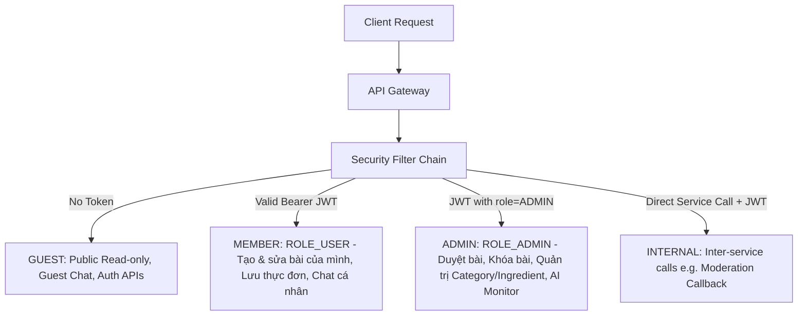
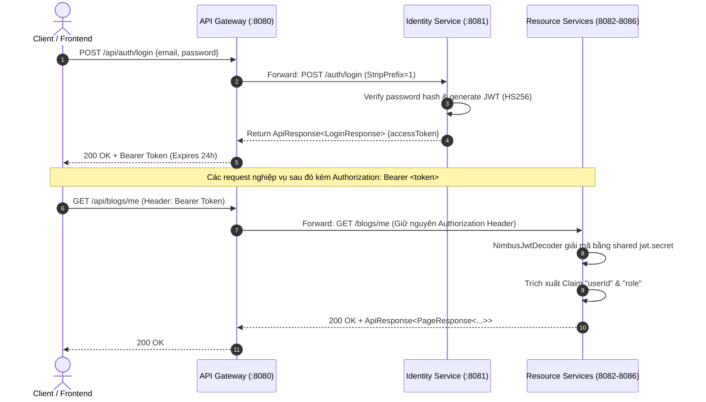
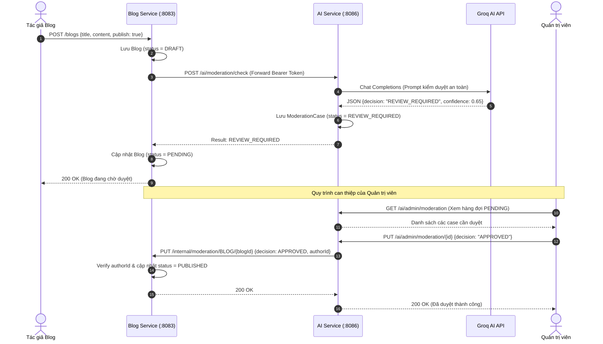
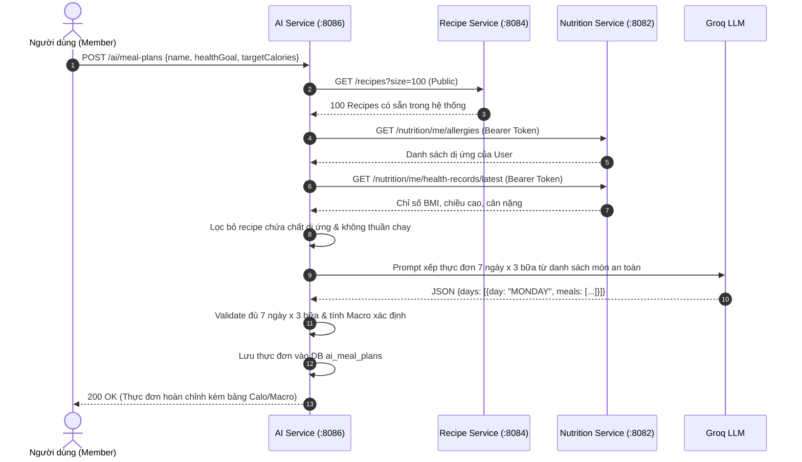
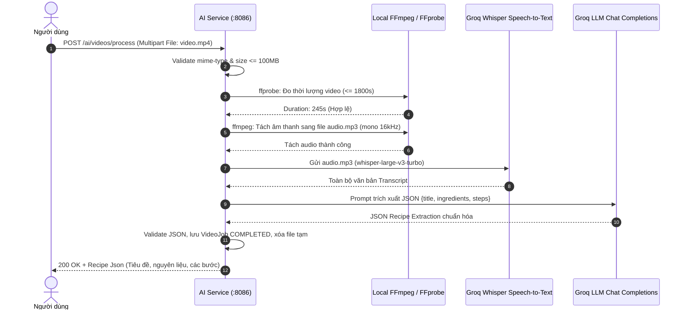
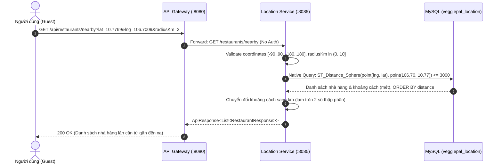

# VeggiePal Backend Workflows & Technical Architecture Documentation

> **Tài liệu Kỹ thuật Backend VeggiePal Microservices**  
> **Dành cho:** Kỹ sư phát triển, Kiểm thử E2E, Đánh giá đồ án & Vận hành hệ thống  
> **Phiên bản:** `1.0.0` | **Trạng thái:** Toàn diện 100% dựa trên mã nguồn thực tế  
> **Ngày lập tài liệu:** 16/10/2026  

---

## Mục lục

1. [Tổng quan Backend VeggiePal](#1-tổng-quan-backend-veggiepal)
2. [Kiến trúc Microservices](#2-kiến-trúc-microservices)
3. [Danh sách Toàn bộ REST API Theo Từng Microservice](#3-danh-sách-toàn-bộ-rest-api-theo-từng-microservice)
4. [Mô hình Phân quyền (Guest / Member / Admin / Internal)](#4-mô-hình-phân-quyền-guest--member--admin--internal)
5. [Chi tiết Các Workflow Nghiệp vụ Backend](#5-chi-tiết-các-workflow-nghiệp-vụ-backend)
   - [Workflow 1: Quản lý Định danh & Tài khoản người dùng](#workflow-1-quản-lý-định-danh--tài-khoản-người-dùng)
   - [Workflow 2: Tra cứu Nội dung Công khai & AI Chatbot Dùng thử cho Guest](#workflow-2-tra-cứu-nội-dung-công-khai--ai-chatbot-dùng-thử-cho-guest)
   - [Workflow 3: Quản lý Blog, Comment, Tương tác Vote & AI Content Moderation](#workflow-3-quản-lý-blog-comment-tương-tác-vote--ai-content-moderation)
   - [Workflow 4: Tìm kiếm Nội dung & AI Recommendation cá nhân hóa](#workflow-4-tìm-kiếm-nội-dung--ai-recommendation-cá-nhân-hóa)
   - [Workflow 5: AI Lập Thực đơn Dinh dưỡng Chay Cá nhân hóa (Meal Planning)](#workflow-5-ai-lập-thực-đơn-dinh-dưỡng-chay-cá-nhân-hóa-meal-planning)
   - [Workflow 6: AI Chatbot Dinh dưỡng Đa lượt cho Member & Quản lý Quota](#workflow-6-ai-chatbot-dinh-dưỡng-đa-lượt-cho-member--quản-lý-quota)
   - [Workflow 7: AI Trích xuất Công thức từ Video (FFmpeg + Whisper + LLM)](#workflow-7-ai-trích-xuất-công-thức-từ-video-ffmpeg--whisper--llm)
   - [Workflow 8: Tìm kiếm Nhà hàng Thuần chay theo Tọa độ Địa lý (Location Search)](#workflow-8-tìm-kiếm-nhà-hàng-thuần-chay-theo-tọa-độ-địa-lý-location-search)
   - [Workflow 9: Quản trị Nội dung, Danh mục, AI Monitoring & Admin Moderation](#workflow-9-quản-trị-nội-dung-danh-mục-ai-monitoring--admin-moderation)
   - [Workflow 10 (Bổ sung): Quản lý Hồ sơ Sức khỏe & Chỉ số BMI Cá nhân](#workflow-10-bổ-sung-quản-lý-hồ-sơ-sức-khỏe--chỉ-số-bmi-cá-nhân)
   - [Workflow 11 (Bổ sung): Quản lý Dị ứng Cá nhân & Danh mục Chất gây dị ứng](#workflow-11-bổ-sung-quản-lý-dị-ứng-cá-nhân--danh-mục-chất-gây-dị-ứng)
   - [Workflow 12 (Bổ sung): Quản lý & Chia sẻ Công thức Nấu ăn Cộng đồng (Recipe)](#workflow-12-bổ-sung-quản-lý--chia-sẻ-công-thức-nấu-ăn-cộng-đồng-recipe)
   - [Workflow 13 (Bổ sung): Quản lý Danh mục Nguyên liệu Chuẩn (Canonical Ingredients)](#workflow-13-bổ-sung-quản-lý-danh-mục-nguyên-liệu-chuẩn-canonical-ingredients)
   - [Workflow 14 (Bổ sung): Batch User Profile Resolution (Hiển thị tác giả chéo service)](#workflow-14-bổ-sung-batch-user-profile-resolution-hiển-thị-tác-giả-chéo-service)
6. [Sơ đồ Luồng hoạt động (Mermaid Architecture & Sequences)](#6-sơ-đồ-luồng-hoạt-động-mermaid-architecture--sequences)
7. [Giao tiếp Giữa các Microservice (Inter-service Communication)](#7-giao-tiếp-giữa-các-microservice-inter-service-communication)
8. [Phân tích Cơ sở Dữ liệu & Luồng Dữ liệu](#8-phân-tích-cơ-sở-dữ-liệu--luồng-dữ-liệu)
9. [Cơ chế Xử lý Lỗi & Chuẩn hóa Mã Lỗi (Exception Handling)](#9-cơ-chế-xử-lý-lỗi--chuẩn-hóa-mã-lỗi-exception-handling)
10. [Bảng Đánh giá Mức độ Hoàn thiện Hệ thống](#10-bảng-đánh-giá-mức-độ-hoàn-thiện-hệ-thống)
11. [Danh sách Khuyến nghị & Đề xuất Cải tiến Kỹ thuật](#11-danh-sách-khuyến-nghị--đề-xuất-cải-tiến-kỹ-thuật)

---

## 1. Tổng quan Backend VeggiePal

**VeggiePal** là nền tảng số hỗ trợ người ăn chay và thuần chay (Vegan/Vegetarian), cung cấp các dịch vụ chuyên sâu:
- Mạng xã hội chia sẻ bài viết, trải nghiệm ăn chay (Blog), bình luận đa cấp và tương tác bình chọn (Vote).
- Kho công thức nấu món chay (Recipe) với định lượng nguyên liệu chuẩn xác.
- Bản đồ định vị nhà hàng chay lân cận theo bán kính GPS (Location Service).
- Hồ sơ theo dõi chỉ số thể chất BMI và quản lý dị ứng thực phẩm (Nutrition Service).
- Trung tâm trí tuệ nhân tạo (AI Service) tích hợp LLM (Groq API), Whisper Speech-to-Text, FFmpeg xử lý video, hỗ trợ Chatbot chuyên gia dinh dưỡng, kiểm duyệt nội dung tự động, gợi ý nội dung và sinh thực đơn 7 ngày.

### Đặc điểm kỹ thuật cốt lõi:
- **Ngôn ngữ & Framework:** Java 21 LTS, Spring Boot 4.1.1 (Spring Framework 7.x).
- **Mô hình kiến trúc:** Microservices độc lập (không có parent POM gom nhóm), mỗi service sở hữu Maven wrapper riêng (`mvnw`) và cơ sở dữ liệu riêng biệt tuân thủ nguyên lý *Database-per-Service*.
- **Cổng vào tập trung (API Gateway):** Sử dụng `spring-cloud-starter-gateway-server-webmvc` chạy trên cổng `8080`, điều hướng request thông qua tiền tố `/api/**`, tích hợp CORS và Swagger UI tổng hợp.
- **Xác thực & Ủy quyền:** Stateless OAuth2 Resource Server sử dụng JSON Web Token (JWT) mã hóa đối xứng thuật toán HMAC-SHA256 (`HS256`), chia sẻ chung `jwt.secret`.

---

## 2. Kiến trúc Microservices

Hệ thống Backend VeggiePal gồm **7 ứng dụng độc lập**:

| Tên Service | Thư mục | Cổng | Cơ sở Dữ liệu | Trách nhiệm chính |
|---|---|:---:|---|---|
| **API Gateway** | `api-gateway/` | `8080` | *Không có* | Tiếp nhận toàn bộ lưu lượng client, định tuyến downstream, xử lý CORS, tập trung Swagger UI OpenAPI docs, cấu hình multipart streaming. |
| **Identity Service** | `identity-service/` | `8081` | MySQL: `veggiepal_identity` | Đăng ký, đăng nhập, phát hành JWT HS256, quản lý hồ sơ cá nhân, đổi mật khẩu, upload avatar lên Cloudinary, phân giải batch author info. |
| **Nutrition Service** | `nutrition-service/` | `8082` | MySQL: `veggiepal_nutrition` | Quản lý danh mục chất gây dị ứng thực phẩm (`allergens`), danh sách dị ứng của user (`user_allergies`), lịch sử chiều cao/cân nặng/BMI (`health_records`). |
| **Blog Service** | `blog-service/` | `8083` | MySQL: `veggiepal_blog` | Quản lý cây danh mục 2 cấp (`categories`), bài viết blog (`blogs`), ảnh thumbnail Cloudinary, bình luận 1 cấp phản hồi (`comments`), bình chọn (`content_votes`), tích hợp AI Moderation. |
| **Recipe Service** | `recipe-service/` | `8084` | MySQL: `veggiepal_recipe` | Quản lý từ điển nguyên liệu chuẩn (`ingredients`), quản lý công thức món ăn (`recipes`), nguyên liệu công thức (`recipe_ingredients`), các bước nấu (`recipe_steps`). |
| **Location Service** | `location-service/` | `8085` | MySQL: `veggiepal_location` | Tìm kiếm nhà hàng chay lân cận theo bán kính GPS (max 10km) bằng hàm không gian MySQL `ST_Distance_Sphere`. 100% Public, không dùng Spring Security. |
| **AI Service** | `ai-service/` | `8086` | MySQL: `veggiepal_ai` (Flyway) | Hội thoại AI Guest/Member, kiểm duyệt nội dung LLM, gợi ý Blog/Recipe, sinh thực đơn 7 ngày, xử lý video qua FFmpeg/Whisper, giám sát usage/quota/token. |

---

## 3. Danh sách Toàn bộ REST API Theo Từng Microservice

Hệ thống sở hữu tổng cộng **71 REST API endpoints**. Dưới đây là bảng thống kê chi tiết:

### 3.1. API Gateway (`:8080`)
API Gateway hoạt động như Reverse Proxy. Không trực tiếp cung cấp API nghiệp vụ, ngoại trừ Actuator và Swagger UI:
- `GET /swagger-ui.html`: Swagger UI tổng hợp cả 6 services qua OpenAPI 3.1.
- `GET /actuator/health`: Kiểm tra sức khỏe của Gateway.

Bảng ánh xạ Route chính trên Gateway:
| Tiền tố Gateway (Client gọi) | Filter | Điểm đến Downstream (Nội bộ) | Service tiếp nhận |
|---|---|---|---|
| `/api/auth/**` | `StripPrefix=1` | `http://localhost:8081/auth/**` | Identity Service |
| `/api/users/**` | `StripPrefix=1` | `http://localhost:8081/users/**` | Identity Service |
| `/api/nutrition/**` | `StripPrefix=1` | `http://localhost:8082/nutrition/**` | Nutrition Service |
| `/api/blogs/**` | `StripPrefix=1` | `http://localhost:8083/blogs/**` | Blog Service |
| `/api/categories/**` | `StripPrefix=1` | `http://localhost:8083/categories/**` | Blog Service |
| `/api/comments/**` | `StripPrefix=1` | `http://localhost:8083/comments/**` | Blog Service |
| `/api/ingredients/**` | `StripPrefix=1` | `http://localhost:8084/ingredients/**` | Recipe Service |
| `/api/recipes/**` | `StripPrefix=1` | `http://localhost:8084/recipes/**` | Recipe Service |
| `/api/restaurants/**` | `StripPrefix=1` | `http://localhost:8085/restaurants/**` | Location Service |
| `/ai/**` | *None* | `http://localhost:8086/ai/**` | AI Service |
| `/api/ai/**` | `StripPrefix=1` | `http://localhost:8086/ai/**` | AI Service |

---

### 3.2. Identity Service (`:8081`) — 7 APIs
File Controller: [`UserController.java`](file:///d:/project/VeggiePal/VeganApp_BE/identity-service/src/main/java/com/veggiepal/controller/UserController.java), [`ProfileController.java`](file:///d:/project/VeggiePal/VeganApp_BE/identity-service/src/main/java/com/veggiepal/controller/ProfileController.java), [`PublicUserController.java`](file:///d:/project/VeggiePal/VeganApp_BE/identity-service/src/main/java/com/veggiepal/controller/PublicUserController.java)

| HTTP | Gateway Path | Service Internal Path | Quyền | Request Body / Param | Response Model | Mô tả |
|:---:|---|---|:---:|---|---|---|
| `POST` | `/api/auth/register` | `/auth/register` | Guest | `RegisterRequest` (email, password, fullName, phone, dateOfBirth) | `ApiResponse<RegisterResponse>` | Đăng ký tài khoản mới (`status=PENDING`, `emailVerified=false`). |
| `POST` | `/api/auth/login` | `/auth/login` | Guest | `LoginRequest` (email, password) | `ApiResponse<LoginResponse>` | Đăng nhập hệ thống, trả về Bearer JWT (HS256). |
| `GET` | `/api/users/me` | `/users/me` | Member | *None* (Header Bearer JWT) | `ApiResponse<UserProfileResponse>` | Lấy thông tin hồ sơ của tài khoản đang đăng nhập. |
| `PATCH` | `/api/users/me` | `/users/me` | Member | `UpdateProfileRequest` (fullName, phone, dateOfBirth, gender, activityLevel) | `ApiResponse<UserProfileResponse>` | Cập nhật hồ sơ (chỉ đổi trường non-null; phone `""` là xóa). `gender`: `MALE`/`FEMALE`/`OTHER`; `activityLevel`: `SEDENTARY`/`LIGHT`/`MODERATE`/`ACTIVE`/`VERY_ACTIVE`; giá trị lạ trả 400/1018. |
| `PUT` | `/api/users/me/password` | `/users/me/password` | Member | `ChangePasswordRequest` (currentPassword, newPassword) | `ApiResponse<Void>` | Đổi mật khẩu cá nhân. Yêu cầu đúng mật khẩu cũ. |
| `POST` | `/api/users/me/avatar` | `/users/me/avatar` | Member | `MultipartFile file` (max 2MB, JPEG/PNG/WEBP) | `ApiResponse<UserProfileResponse>` | Tải ảnh đại diện lên Cloudinary, cập nhật `avatarUrl`. |
| `GET` | `/api/users/batch` | `/users/batch` | Guest | Query param `ids` (List\<Long\>, tối đa 50 ID) | `ApiResponse<List<PublicUserResponse>>` | Phân giải danh sách ID tác giả thành Tên và Avatar hiển thị. |

---

### 3.3. Nutrition Service (`:8082`) — 7 APIs
File Controller: [`AllergyController.java`](file:///d:/project/VeggiePal/VeganApp_BE/nutrition-service/src/main/java/com/veggiepal/nutrition/controller/AllergyController.java), [`HealthRecordController.java`](file:///d:/project/VeggiePal/VeganApp_BE/nutrition-service/src/main/java/com/veggiepal/nutrition/controller/HealthRecordController.java)

| HTTP | Gateway Path | Service Internal Path | Quyền | Request Body / Param | Response Model | Mô tả |
|:---:|---|---|:---:|---|---|---|
| `GET` | `/api/nutrition/allergens` | `/nutrition/allergens` | Member* | *None* | `ApiResponse<List<AllergenResponse>>` | Lấy danh mục tất cả chất gây dị ứng theo nhóm. *(SecurityConfig yêu cầu JWT)* |
| `GET` | `/api/nutrition/me/allergies` | `/nutrition/me/allergies` | Member | *None* (Bearer JWT) | `ApiResponse<List<AllergenResponse>>` | Lấy danh sách dị ứng đã đăng ký của bản thân. |
| `PUT` | `/api/nutrition/me/allergies` | `/nutrition/me/allergies` | Member | `UpdateAllergiesRequest` (allergenIds: List\<Long\>) | `ApiResponse<List<AllergenResponse>>` | Thay thế toàn bộ danh sách dị ứng cá nhân (`[]` là xóa hết). |
| `POST` | `/api/nutrition/me/health-records` | `/nutrition/me/health-records` | Member | `HealthRecordRequest` (heightCm, weightKg) | `ApiResponse<HealthRecordResponse>` | Ghi nhận chiều cao, cân nặng; server tự động tính chỉ số BMI. |
| `GET` | `/api/nutrition/me/health-records` | `/nutrition/me/health-records` | Member | Param: `page` (default 0), `size` (default 20) | `ApiResponse<PageResponse<HealthRecordResponse>>` | Lấy lịch sử biến động chỉ số sức khỏe, sắp xếp mới nhất trước. |
| `GET` | `/api/nutrition/me/health-records/latest` | `/nutrition/me/health-records/latest` | Member | *None* (Bearer JWT) | `ApiResponse<HealthRecordResponse>` | Lấy bản ghi sức khỏe gần nhất (chiều cao, cân nặng, BMI hiện tại). |
| `PUT` | `/api/nutrition/me/health-records/{id}` | `/nutrition/me/health-records/{id}` | Member | Path `id`, `HealthRecordRequest` | `ApiResponse<HealthRecordResponse>` | Sửa thông số chiều cao/cân nặng của một bản ghi đã lưu. |

---

### 3.4. Blog Service (`:8083`) — 23 APIs
File Controller: [`BlogController.java`](file:///d:/project/VeggiePal/VeganApp_BE/blog-service/src/main/java/com/veggiepal/blog/controller/BlogController.java), [`CategoryController.java`](file:///d:/project/VeggiePal/VeganApp_BE/blog-service/src/main/java/com/veggiepal/blog/controller/CategoryController.java), [`CommentController.java`](file:///d:/project/VeggiePal/VeganApp_BE/blog-service/src/main/java/com/veggiepal/blog/controller/CommentController.java), [`ModerationAdminController.java`](file:///d:/project/VeggiePal/VeganApp_BE/blog-service/src/main/java/com/veggiepal/blog/controller/ModerationAdminController.java)

| HTTP | Gateway Path | Service Internal Path | Quyền | Request Body / Param | Response Model | Mô tả |
|:---:|---|---|:---:|---|---|---|
| `POST` | `/api/blogs` | `/blogs` | Member | `BlogRequest` (categoryId, title, content, publish) | `ApiResponse<BlogResponse>` | Tạo bài viết mới. Nếu `publish=true` sẽ gọi AI Moderation ngay. |
| `GET` | `/api/blogs/me` | `/blogs/me` | Member | Param: `status`, `page`, `size` | `ApiResponse<PageResponse<BlogSummaryResponse>>` | Xem danh sách bài viết của chính mình ở mọi trạng thái. |
| `PUT` | `/api/blogs/{id}` | `/blogs/{id}` | Member/Admin | Path `id`, `BlogRequest` | `ApiResponse<BlogResponse>` | Cập nhật blog. Bài đã duyệt sẽ bị gửi kiểm duyệt lại. |
| `POST` | `/api/blogs/{id}/submit` | `/blogs/{id}/submit` | Member | Path `id` | `ApiResponse<BlogResponse>` | Gửi bài viết từ trạng thái DRAFT vào quy trình AI Moderation. |
| `POST` | `/api/blogs/{id}/thumbnail` | `/blogs/{id}/thumbnail` | Member/Admin | Path `id`, `MultipartFile file` (max 5MB) | `ApiResponse<BlogResponse>` | Tải ảnh bìa (thumbnail) bài viết lên Cloudinary. |
| `DELETE` | `/api/blogs/{id}` | `/blogs/{id}` | Member/Admin | Path `id` | `ApiResponse<Void>` | Tác giả xóa bài (hard delete); Admin xóa thì gán trạng thái BANNED. |
| `GET` | `/api/blogs` | `/blogs` | Guest | Param: `categoryId`, `keyword`, `sort`, `page`, `size` | `ApiResponse<PageResponse<BlogSummaryResponse>>` | Xem danh sách blog đã PUBLISHED; tìm kiếm ưu tiên khớp tiêu đề. |
| `GET` | `/api/blogs/{id}` | `/blogs/{id:[0-9]+}` | Guest | Path `id` | `ApiResponse<BlogResponse>` | Xem chi tiết bài viết đã PUBLISHED; tự động tăng `view_count + 1`. |
| `GET` | `/api/blogs/{id}/related` | `/blogs/{id:[0-9]+}/related` | Guest | Path `id` | `ApiResponse<List<BlogSummaryResponse>>` | Lấy tối đa 5 bài viết liên quan cùng danh mục. |
| `POST` | `/api/blogs/{id}/vote` | `/blogs/{id}/vote` | Member | Path `id`, `VoteRequest` (value: 1 hoặc -1) | `ApiResponse<VoteResponse>` | Vote bài viết (1 tim / -1 dislike). Bấm lại giá trị cũ sẽ hủy vote. |
| `DELETE` | `/api/blogs/{id}/vote` | `/blogs/{id}/vote` | Member | Path `id` | `ApiResponse<VoteResponse>` | Hủy vote đã thực hiện trên bài viết. |
| `GET` | `/api/blogs/me/votes` | `/blogs/me/votes` | Member | Param `blogIds` (List\<Long\>, max 100) | `ApiResponse<List<VoteResponse>>` | Lấy trạng thái vote của user trên danh sách bài viết. |
| `GET` | `/api/categories` | `/categories` | Guest | Param: `type` (FOOD_TYPE, RECIPE_TYPE), `activeOnly` | `ApiResponse<List<CategoryResponse>>` | Lấy cây danh mục phân cấp tối đa 2 cấp. |
| `GET` | `/api/categories/{id}` | `/categories/{id:[0-9]+}` | Guest | Path `id` | `ApiResponse<CategoryResponse>` | Xem chi tiết thông tin một danh mục. |
| `POST` | `/api/categories` | `/categories` | Admin | `CategoryRequest` (name, type, parentId, displayOrder, isActive) | `ApiResponse<CategoryResponse>` | Tạo danh mục mới (`@PreAuthorize("hasRole('ADMIN')")`). |
| `PUT` | `/api/categories/{id}` | `/categories/{id}` | Admin | Path `id`, `CategoryRequest` | `ApiResponse<CategoryResponse>` | Cập nhật thông tin/trạng thái danh mục. |
| `DELETE` | `/api/categories/{id}` | `/categories/{id}` | Admin | Path `id` | `ApiResponse<Void>` | Xóa danh mục (chỉ xóa được nếu chưa có bài viết/danh mục con). |
| `GET` | `/api/comments` | `/comments` | Guest | Param: `targetType` (BLOG), `targetId`, `page`, `size` | `ApiResponse<PageResponse<CommentResponse>>` | Lấy bình luận gốc (top-level) trên bài viết đã xuất bản. |
| `GET` | `/api/comments/{id}/replies` | `/comments/{id:[0-9]+}/replies` | Guest | Path `id`, `page`, `size` | `ApiResponse<PageResponse<CommentResponse>>` | Lấy danh sách phản hồi (cấp 1) của một bình luận. |
| `POST` | `/api/comments` | `/comments` | Member | `CommentRequest` (targetType, targetId, parentId, content) | `ApiResponse<CommentResponse>` | Đăng bình luận hoặc trả lời. Kiểm duyệt AI trước khi hiển thị. |
| `PUT` | `/api/comments/{id}` | `/comments/{id}` | Member | Path `id`, `CommentRequest` | `ApiResponse<CommentResponse>` | Sửa nội dung bình luận cá nhân (chạy lại AI Moderation). |
| `DELETE` | `/api/comments/{id}` | `/comments/{id}` | Member/Admin | Path `id` | `ApiResponse<Void>` | Xóa bình luận (chuyển sang tombstone `DELETED` để không đứt cây reply). |
| `PUT` | *None (Internal)* | `/internal/moderation/{contentType}/{id}` | Internal/Admin | Path `contentType`, `id`, `ModerationDecisionRequest` | `ApiResponse<Void>` | Nhận quyết định duyệt thủ công từ AI Service để cập nhật Blog/Comment. |

---

### 3.5. Recipe Service (`:8084`) — 12 APIs
File Controller: [`RecipeController.java`](file:///d:/project/VeggiePal/VeganApp_BE/recipe-service/src/main/java/com/veggiepal/recipe/controller/RecipeController.java), [`IngredientController.java`](file:///d:/project/VeggiePal/VeganApp_BE/recipe-service/src/main/java/com/veggiepal/recipe/controller/IngredientController.java)

| HTTP | Gateway Path | Service Internal Path | Quyền | Request Body / Param | Response Model | Mô tả |
|:---:|---|---|:---:|---|---|---|
| `GET` | `/api/recipes` | `/recipes` | Guest | Param: `keyword`, `page` (default 0), `size` (default 10) | `ApiResponse<PageResponse<RecipeResponse>>` | Danh sách công thức PUBLISHED; tìm kiếm theo tiêu đề. |
| `GET` | `/api/recipes/{id}` | `/recipes/{id:\d+}` | Guest | Path `id` | `ApiResponse<RecipeResponse>` | Chi tiết công thức nấu ăn, nguyên liệu, các bước thực hiện. |
| `GET` | `/api/recipes/me` | `/recipes/me` | Member | Param: `page`, `size` | `ApiResponse<PageResponse<RecipeResponse>>` | Lấy các công thức do chính mình tạo (mọi trạng thái). |
| `POST` | `/api/recipes` | `/recipes` | Member | `RecipeRequest` (title, description, imageUrl, servings, prepTime, cookTime, ingredients, steps) | `ApiResponse<RecipeResponse>` | Tạo công thức mới ở trạng thái DRAFT. |
| `PUT` | `/api/recipes/{id}` | `/recipes/{id}` | Member/Admin | Path `id`, `RecipeRequest` | `ApiResponse<RecipeResponse>` | Cập nhật thông tin, danh sách nguyên liệu và các bước nấu. |
| `POST` | `/api/recipes/{id}/publish` | `/recipes/{id}/publish` | Member/Admin | Path `id` | `ApiResponse<RecipeResponse>` | Công khai công thức ra cộng đồng (`status=PUBLISHED`). |
| `DELETE` | `/api/recipes/{id}` | `/recipes/{id}` | Member/Admin | Path `id` | `ApiResponse<Void>` | Xóa công thức (chuyển trạng thái ARCHIVED). |
| `GET` | `/api/ingredients` | `/ingredients` | Guest | Param: `keyword`, `vegan`, `allergen`, `page`, `size` | `ApiResponse<PageResponse<IngredientResponse>>` | Tìm kiếm nguyên liệu chuẩn trong từ điển ẩm thực. |
| `GET` | `/api/ingredients/{id}` | `/ingredients/{id}` | Guest | Path `id` | `ApiResponse<IngredientResponse>` | Chi tiết thông tin và giá trị dinh dưỡng của nguyên liệu. |
| `POST` | `/api/ingredients` | `/ingredients` | Admin | `IngredientRequest` (name, isVegan, isAllergen, calo, protein, fat, carbs...) | `ApiResponse<IngredientResponse>` | Thêm nguyên liệu mới vào từ điển (`@PreAuthorize("hasRole('ADMIN')")`). |
| `PUT` | `/api/ingredients/{id}` | `/ingredients/{id}` | Admin | Path `id`, `IngredientRequest` | `ApiResponse<IngredientResponse>` | Cập nhật thông số dinh dưỡng nguyên liệu. |
| `DELETE` | `/api/ingredients/{id}` | `/ingredients/{id}` | Admin | Path `id` | `ApiResponse<Void>` | Xóa nguyên liệu (soft delete: đặt `isActive=false`). |

---

### 3.6. Location Service (`:8085`) — 1 API
File Controller: [`RestaurantController.java`](file:///d:/project/VeggiePal/VeganApp_BE/location-service/src/main/java/com/veggiepal/location/controller/RestaurantController.java)

| HTTP | Gateway Path | Service Internal Path | Quyền | Request Body / Param | Response Model | Mô tả |
|:---:|---|---|:---:|---|---|---|
| `GET` | `/api/restaurants/nearby` | `/restaurants/nearby` | Guest | Param: `lat`, `lng`, `radiusKm` (0 < r <= 10, def 5), `veganOnly` (def false) | `ApiResponse<List<RestaurantResponse>>` | Tìm kiếm nhà hàng chay gần nhất theo tọa độ GPS, sắp xếp theo khoảng cách mét. |

---

### 3.7. AI Service (`:8086`) — 21 APIs
File Controller: [`ChatController.java`](file:///d:/project/VeggiePal/VeganApp_BE/ai-service/src/main/java/com/veggiepal/ai/chat/ChatController.java), [`MealPlanController.java`](file:///d:/project/VeggiePal/VeganApp_BE/ai-service/src/main/java/com/veggiepal/ai/mealplan/MealPlanController.java), [`ModerationController.java`](file:///d:/project/VeggiePal/VeganApp_BE/ai-service/src/main/java/com/veggiepal/ai/moderation/ModerationController.java), [`MonitoringController.java`](file:///d:/project/VeggiePal/VeganApp_BE/ai-service/src/main/java/com/veggiepal/ai/monitoring/MonitoringController.java), [`RecommendationController.java`](file:///d:/project/VeggiePal/VeganApp_BE/ai-service/src/main/java/com/veggiepal/ai/recommendation/RecommendationController.java), [`VideoProcessingController.java`](file:///d:/project/VeggiePal/VeganApp_BE/ai-service/src/main/java/com/veggiepal/ai/video/VideoProcessingController.java)

| HTTP | Gateway Path | Service Internal Path | Quyền | Request Body / Param | Response Model | Mô tả |
|:---:|---|---|:---:|---|---|---|
| `POST` | `/ai/chat/guest-sessions` | `/ai/chat/guest-sessions` | Guest | *None* (Header nhận IP client) | `ApiResponse<GuestSessionResponse>` | Khởi tạo phiên chat thử nghiệm cho khách vãng lai (UUID, TTL 24h). |
| `POST` | `/ai/chat/guest` | `/ai/chat/guest` | Guest | `GuestChatRequest` (guestSession, message) | `ApiResponse<ChatReply>` | Hội thoại với AI dinh dưỡng dưới tư cách khách (giới hạn 3 req/ngày). |
| `POST` | `/ai/chat` | `/ai/chat` | Member | `ChatRequest` (conversationId, message) | `ApiResponse<ChatReply>` | Trò chuyện AI đa lượt có lưu ngữ cảnh (giới hạn 50 req/ngày). |
| `GET` | `/ai/chat/conversations` | `/ai/chat/conversations` | Member | *None* (Bearer JWT) | `ApiResponse<List<ConversationSummary>>` | Lấy danh sách các cuộc hội thoại đã tạo của tài khoản. |
| `GET` | `/ai/chat/conversations/{id}` | `/ai/chat/conversations/{id}` | Member | Path `id` | `ApiResponse<ConversationDetail>` | Xem toàn bộ lịch sử tin nhắn trong một cuộc hội thoại. |
| `DELETE` | `/ai/chat/conversations/{id}` | `/ai/chat/conversations/{id}` | Member | Path `id` | `ApiResponse<Void>` | Xóa một cuộc hội thoại cùng toàn bộ tin nhắn liên quan. |
| `POST` | `/ai/meal-plans` | `/ai/meal-plans` | Member | `GenerateRequest` (name, healthGoal, preferences, availableIngredients, dailyNutritionTarget) | `ApiResponse<MealPlanResponse>` | Tạo thực đơn chay 7 ngày x 3 bữa từ dữ liệu Recipe thật và lọc dị ứng. |
| `GET` | `/ai/meal-plans` | `/ai/meal-plans` | Member | *None* (Bearer JWT) | `ApiResponse<List<MealPlanResponse>>` | Lấy danh sách các kế hoạch thực đơn đã lưu của user. |
| `GET` | `/ai/meal-plans/{id}` | `/ai/meal-plans/{id}` | Member | Path `id` | `ApiResponse<MealPlanResponse>` | Xem chi tiết thực đơn, danh sách món và tổng hợp Macro dinh dưỡng. |
| `POST` | `/ai/meal-plans/{id}/replace` | `/ai/meal-plans/{id}/replace` | Member | Path `id`, `ReplaceMealRequest` (day, mealType, currentRecipeId) | `ApiResponse<MealPlanResponse>` | Đổi một món ăn trong thực đơn bằng món chay an toàn khác. |
| `POST` | `/ai/moderation/check` | `/ai/moderation/check` | Member/Internal | `ModerationRequest` (contentType, externalContentId, authorId, text) | `ApiResponse<ModerationResponse>` | Kiểm duyệt tự động bài viết/bình luận bằng mô hình LLM Groq. |
| `GET` | `/ai/admin/moderation` | `/ai/admin/moderation` | Admin | *None* | `ApiResponse<List<ModerationResponse>>` | Lấy danh sách nội dung đang chờ kiểm duyệt thủ công (`REVIEW_REQUIRED`). |
| `PUT` | `/ai/admin/moderation/{id}` | `/ai/admin/moderation/{id}` | Admin | Path `id`, `ReviewRequest` (decision: APPROVED/REJECTED, reason) | `ApiResponse<ModerationResponse>` | Admin ra quyết định duyệt và đồng bộ trạng thái về Blog Service. |
| `GET` | `/ai/admin/monitoring/summary` | `/ai/admin/monitoring/summary` | Admin | Param `days` (default 7, max 90) | `ApiResponse<Map<String, Object>>` | Tổng hợp thống kê: số request, token prompt/completion, latency, lỗi. |
| `GET` | `/ai/admin/monitoring/logs` | `/ai/admin/monitoring/logs` | Admin | *None* | `ApiResponse<List<UsageLog>>` | Lấy 100 log sử dụng AI gần nhất trong hệ thống. |
| `GET` | `/ai/admin/monitoring/logs/search` | `/ai/admin/monitoring/logs/search` | Admin | Param: `feature`, `status`, `userId`, `from`, `to`, `page`, `size` | `ApiResponse<UsageLogPage>` | Tìm kiếm, lọc và phân trang lịch sử gọi AI chi tiết. |
| `GET` | `/ai/admin/monitoring/models` | `/ai/admin/monitoring/models` | Admin | *None* | `ApiResponse<Map<String, String>>` | Xem danh sách các mô hình Groq LLM đang được cấu hình cho từng module. |
| `GET` | `/ai/admin/monitoring/limits` | `/ai/admin/monitoring/limits` | Admin | *None* | `ApiResponse<Map<String, Object>>` | Xem các định mức quota, giới hạn ký tự và token hiện tại. |
| `GET` | `/ai/recommendations` | `/ai/recommendations` | Member | Param: `interest`, `limit` (default 6, max 10) | `ApiResponse<List<Recommendation>>` | AI phân tích và đề xuất bài viết/công thức phù hợp sở thích người dùng. |
| `POST` | `/ai/videos/process` | `/ai/videos/process` | Member | `MultipartFile file` (max 100MB, duration <= 30m) | `ApiResponse<VideoJobResponse>` | Tách audio bằng FFmpeg, Whisper speech-to-text và trích xuất JSON công thức. |
| `GET` | `/ai/videos/{id}` | `/ai/videos/{id}` | Member | Path `id` | `ApiResponse<VideoJobResponse>` | Xem lại kết quả trích xuất công thức từ video đã xử lý. |

---

## 4. Mô hình Phân quyền (Guest / Member / Admin / Internal)

Backend VeggiePal áp dụng mô hình phân quyền dựa trên vai trò (Role-Based Access Control - RBAC) kết hợp OAuth2 Resource Server.

### 4.1. Định nghĩa các Role và Phạm vi truy cập



1. **Guest (Khách vãng lai):**
   - Không cần gửi `Authorization` header.
   - Được phép: Đăng ký (`/auth/register`), đăng nhập (`/auth/login`), tra cứu công khai danh sách và chi tiết Blog, Category, Recipe, Ingredient, tìm kiếm nhà hàng Location, phân giải batch tác giả (`/users/batch`), tạo session và chat thử nghiệm AI (`/ai/chat/guest`).
2. **Member (Thành viên - `ROLE_USER`):**
   - Bắt buộc gửi kèm header: `Authorization: Bearer <access_token>`.
   - Được trích xuất `userId` từ token thông qua `CurrentUser.id(jwt)` (không bao giờ lấy từ path hay request body để chống giả mạo danh tính).
   - Được phép: Xem và sửa hồ sơ cá nhân, đổi mật khẩu, tải avatar, ghi nhận số đo sức khỏe & dị ứng, tạo/sửa/xóa bài viết của mình, bình luận, bình chọn (Vote), tạo/quản lý công thức nấu ăn, chat AI có lưu lịch sử, sinh và chỉnh sửa thực đơn tuần, tải video trích xuất công thức.
3. **Admin (Quản trị viên - `ROLE_ADMIN`):**
   - Token chứa claim `role: "ADMIN"`. `JwtAuthenticationConverter` chuyển đổi thành authority `ROLE_ADMIN`.
   - Được phép: Toàn quyền của Member, đồng thời có quyền can thiệp đặc quyền:
     - Tạo, sửa, xóa danh mục Blog (`/categories/**`).
     - Tạo, sửa, xóa nguyên liệu chuẩn trong Recipe Service (`/ingredients/**`).
     - Takedown (khóa) bài viết vi phạm của người khác (`DELETE /blogs/{id}` -> chuyển sang trạng thái `BANNED`).
     - Xóa bình luận của người khác (`DELETE /comments/{id}` -> chuyển sang `DELETED`).
     - Truy cập hàng đợi kiểm duyệt AI Moderation (`/ai/admin/moderation/**`) và ra quyết định phê duyệt/từ chối.
     - Truy cập toàn bộ số liệu giám sát AI, Usage Logs và Quota limits (`/ai/admin/monitoring/**`).
4. **Internal (Giao tiếp Nội bộ):**
   - Các API giao tiếp giữa các service không thông qua Gateway (ví dụ: `Blog Service` gọi `AI Service` kiểm duyệt bài; `AI Service` gọi ngược lại `Blog Service` để cập nhật trạng thái duyệt qua `/internal/moderation/{contentType}/{id}`).
   - Yêu cầu chuyển tiếp (forward) Bearer Token của người dùng hoặc Admin để đảm bảo xác thực danh tính xuyên suốt.

### 4.2. Cấu hình bảo mật thực tế vs Cấu hình Swagger

> [!WARNING]
> **Điểm lệch bảo mật cần lưu ý:**  
> Tại `Nutrition Service`, file [`SecurityConfig.java`](file:///d:/project/VeggiePal/VeganApp_BE/nutrition-service/src/main/java/com/veggiepal/nutrition/configuration/SecurityConfig.java) khai báo `PUBLIC_ENDPOINTS` chỉ bao gồm Swagger và `/v3/api-docs/**`. Do đó, endpoint `GET /nutrition/allergens` (danh mục dị ứng chung) trên thực tế **bắt buộc phải có JWT** mới gọi được, khác với mô tả public trong một số tài liệu sơ khởi.

---

## 5. Chi tiết Các Workflow Nghiệp vụ Backend

---

### Workflow 1: Quản lý Định danh & Tài khoản người dùng
- **Tên chức năng:** Đăng ký, đăng nhập, lấy hồ sơ, cập nhật hồ sơ, đổi mật khẩu và cập nhật ảnh đại diện.
- **Actor:** Guest (cho đăng ký/đăng nhập), Member (cho quản lý tài khoản).
- **Điều kiện tiên quyết:** Với Member, phải có JWT hợp lệ còn hạn (24h).
- **Điểm bắt đầu:** 
  - `POST /api/auth/register`
  - `POST /api/auth/login`
  - `GET /api/users/me`
  - `PATCH /api/users/me`
  - `PUT /api/users/me/password`
  - `POST /api/users/me/avatar`
- **Controller tiếp nhận:** [`UserController.java`](file:///d:/project/VeggiePal/VeganApp_BE/identity-service/src/main/java/com/veggiepal/controller/UserController.java), [`ProfileController.java`](file:///d:/project/VeggiePal/VeganApp_BE/identity-service/src/main/java/com/veggiepal/controller/ProfileController.java)
- **Service xử lý:** [`UserService.java`](file:///d:/project/VeggiePal/VeganApp_BE/identity-service/src/main/java/com/veggiepal/service/UserService.java), [`ProfileService.java`](file:///d:/project/VeggiePal/VeganApp_BE/identity-service/src/main/java/com/veggiepal/service/ProfileService.java), [`CloudinaryFileStorageService.java`](file:///d:/project/VeggiePal/VeganApp_BE/identity-service/src/main/java/com/veggiepal/service/CloudinaryFileStorageService.java)
- **DTOs:**
  - Request: `RegisterRequest`, `LoginRequest`, `UpdateProfileRequest`, `ChangePasswordRequest`.
  - Response: `RegisterResponse`, `LoginResponse`, `UserProfileResponse`.
- **Thứ tự thực thi mã nguồn:**
  1. *Đăng ký (`createUser`):* Chuẩn hóa email (`trim().toLowerCase()`). Kiểm tra `userRepository.existsByEmail()`. Nếu trùng báo lỗi `1002 EMAIL_EXISTED`. Mã hóa mật khẩu bằng BCrypt (strength 10). Khởi tạo User với `role=USER`, `status=PENDING`, `emailVerified=false`. Lưu MySQL. Trả về `RegisterResponse`.
  2. *Đăng nhập (`login`):* Chuẩn hóa email. Tìm User theo email. So khớp mật khẩu bằng `passwordEncoder.matches()`. Nếu sai ném `1008 UNAUTHENTICATED`. Gọi `jwtService.generateToken(user)` tạo JWT (HS256) chứa `sub=email`, `userId`, `role`, thời hạn 24h. Trả về `LoginResponse`.
  3. *Lấy hồ sơ (`getProfile`):* Lấy `userId` từ token claims. Tìm User trong DB. Trả về thông tin đầy đủ.
  4. *Cập nhật hồ sơ (`updateProfile`):* MapStruct cập nhật các trường non-null. Phone nếu là chuỗi rỗng sẽ được set về `null`. Lưu DB và trả về kết quả.
  5. *Đổi mật khẩu (`changePassword`):* Kiểm tra mật khẩu hiện tại có khớp không. Kiểm tra mật khẩu mới không được trùng mật khẩu cũ (`1012 PASSWORD_UNCHANGED`). Hash mật khẩu mới và lưu vào DB.
  6. *Upload Avatar (`uploadAvatar`):* Kiểm tra file không rỗng, dung lượng <= 2MB (`1016 AVATAR_TOO_LARGE`). Dùng `ImageTypeDetector` đọc magic bytes của file để xác định định dạng thực tế (JPEG/PNG/WEBP) và đối chiếu với Content-Type khai báo. Tải lên Cloudinary theo key `avatars/{userId}/{UUID}.{ext}`. Lưu `avatarUrl` mới vào DB. Xóa ảnh đại diện cũ trên Cloudinary. Nếu lưu DB lỗi thì xóa ảnh vừa upload để rollback.
- **Database & Bảng:** Đọc/Ghi bảng `users` trong cơ sở dữ liệu `veggiepal_identity`.
- **Tích hợp bên ngoài:** Cloudinary API qua thư viện Cloudinary Java SDK.
- **Lỗi & Ngoại lệ:**
  - `1002 EMAIL_EXISTED` (400 Bad Request): Email đã được đăng ký.
  - `1008 UNAUTHENTICATED` (401 Unauthorized): Sai email hoặc mật khẩu.
  - `1011 WRONG_PASSWORD` (400 Bad Request): Mật khẩu hiện tại không đúng.
  - `1012 PASSWORD_UNCHANGED` (400 Bad Request): Mật khẩu mới trùng mật khẩu cũ.
  - `1015 INVALID_AVATAR_TYPE` (400 Bad Request): File không đúng định dạng ảnh hoặc magic bytes bị giả mạo.
  - `1016 AVATAR_TOO_LARGE` (400 Bad Request): File ảnh vượt quá 2MB.
  - `1017 FILE_UPLOAD_FAILED` (503 Service Unavailable): Lỗi mạng hoặc Cloudinary không cấu hình key.
- **Khoảng trống nghiệp vụ:** Chưa có chức năng gửi email xác thực tài khoản và đổi trạng thái `emailVerified=true`. Chưa có endpoint Logout / Revoke JWT.

---

### Workflow 2: Tra cứu Nội dung Công khai & AI Chatbot Dùng thử cho Guest
- **Tên chức năng:** Khách vãng lai xem bài viết, cây danh mục, tìm kiếm và trò chuyện thử nghiệm với AI.
- **Actor:** Guest.
- **Điều kiện tiên quyết:** Không cần tài khoản.
- **Điểm bắt đầu:** 
  - `GET /api/blogs`
  - `GET /api/blogs/{id}`
  - `GET /api/categories`
  - `POST /ai/chat/guest-sessions`
  - `POST /ai/chat/guest`
- **Controller tiếp nhận:** `BlogController.java`, `CategoryController.java`, `ChatController.java`
- **Service xử lý:** `BlogService.java`, `CategoryService.java`, `ChatService.java`, `GuestSessionService.java`, `QuotaService.java`, `GroqClient.java`
- **Thứ tự thực thi mã nguồn:**
  1. *Đọc bài viết:* Client gửi request kèm tiêu chí lọc (`categoryId`, `keyword`, `sort`). Repository lọc bài viết có `status = PUBLISHED`. Khi mở xem chi tiết một bài viết (`GET /blogs/{id}`), method `@Modifying` tự động tăng `view_count = view_count + 1`.
  2. *Khởi tạo phiên chat:* Guest gọi `POST /ai/chat/guest-sessions`. Hệ thống lấy IP client từ Servlet Request, băm địa chỉ IP bằng SHA-256 kèm Pepper bí mật (`ai.guest.session-pepper`). Kiểm tra số lượng phiên trong ngày của IP đó (tối đa 3 phiên/ngày). Sinh mã UUID ngẫu nhiên làm `guestSessionId`, lưu vào bảng `ai_guest_sessions` với thời hạn 24 giờ.
  3. *Chat thử nghiệm:* Guest gửi `POST /ai/chat/guest` kèm `guestSession` và câu hỏi `message`. `GuestSessionService.requireValid()` kiểm tra phiên tồn tại, chưa hết hạn và khớp băm IP. `QuotaService.reserveChat("guest:" + guestSession, true)` kiểm tra số lượng câu hỏi trong ngày (tối đa 3 câu). Gọi Groq LLM hoàn thành câu trả lời. Ghi nhận `ai_usage_logs` và trả lời cho người dùng kèm số lượt còn lại.
- **Database & Bảng:** Đọc `blogs`, `categories` trong `veggiepal_blog`; Đọc/Ghi `ai_guest_sessions`, `ai_daily_quotas`, `ai_usage_logs` trong `veggiepal_ai`.
- **API bên ngoài:** Groq Cloud Chat Completions API (`openai/gpt-oss-20b`).
- **Lỗi & Ngoại lệ:**
  - `6000 INVALID_REQUEST`: Phiên không hợp lệ hoặc hết hạn.
  - `6003 QUOTA_EXCEEDED`: Đã hết 3 lượt chat dùng thử trong ngày.
  - `6004 GROQ_UNAVAILABLE`: Groq API bị gián đoạn hoặc timeout.

---

### Workflow 3: Quản lý Blog, Comment, Tương tác Vote & AI Content Moderation
- **Tên chức năng:** Tạo bài viết, gửi duyệt, kiểm duyệt tự động bằng AI, duyệt thủ công, bình luận bài viết và thả tim/vote.
- **Actor:** Member (tác giả bài/bình luận), Admin (duyệt/takedown).
- **Điểm bắt đầu:** 
  - `POST /api/blogs`
  - `POST /api/blogs/{id}/submit`
  - `POST /api/comments`
  - `POST /api/blogs/{id}/vote`
  - `DELETE /api/blogs/{id}`
- **Controller tiếp nhận:** `BlogController.java`, `CommentController.java`, `ModerationController.java` (AI), `ModerationAdminController.java` (Blog).
- **Service xử lý:** `BlogService.java`, `CommentService.java`, `VoteService.java`, `AiContentModerationService.java` (Blog), `ModerationService.java` (AI), `ModerationOwnerClient.java` (AI).
- **Thứ tự thực thi mã nguồn:**
  1. *Tạo bài viết:* Tác giả tạo bài. Nếu `publish=true`, `BlogService` lưu bài vào MySQL ở trạng thái `DRAFT` để lấy ID, sau đó gọi đồng bộ sang `AI Service` (`POST /ai/moderation/check`) qua `RestClient`, gửi kèm Bearer Token của người dùng.
  2. *AI Kiểm duyệt:* `ModerationService` trong `AI Service` gửi tiêu đề và nội dung bài viết đến mô hình Groq LLM với prompt kiểm duyệt an toàn (phát hiện thù hằn, quấy rối, bạo lực, nội dung nguy hại).
     - Nếu an toàn: Groq trả về `APPROVED`. `BlogService` chuyển bài viết sang `PUBLISHED` và gán `publishedAt = now()`.
     - Nếu vi phạm rõ ràng (`confidence >= 0.85`): Groq trả về `REJECTED`. `BlogService` chuyển bài sang `REJECTED`, lưu lý do kiểm duyệt.
     - Nếu không chắc chắn: Trả về `REVIEW_REQUIRED`. `BlogService` đặt bài ở trạng thái `PENDING` (chờ Admin duyệt).
     - Đồng thời, `AI Service` lưu một bản ghi `ModerationCase` vào bảng `ai_moderation_cases`.
  3. *Admin Duyệt can thiệp:* Admin xem danh sách bài chờ duyệt qua `GET /ai/admin/moderation`. Khi Admin bấm duyệt hoặc từ chối (`PUT /ai/admin/moderation/{id}`), `AI Service` dùng `ModerationOwnerClient` gọi ngược lại endpoint nội bộ của Blog Service: `PUT /internal/moderation/BLOG/{id}`, chuyển tiếp token Admin. `ModerationAdminController` đối chiếu `authorId` và chuyển trạng thái bài viết thành `PUBLISHED` hoặc `REJECTED`.
  4. *Bình luận (Comment):* Thành viên gửi bình luận vào bài viết đã xuất bản. Hệ thống chạy qua quy trình AI Moderation tương tự: An toàn thì hiển thị ngay (`VISIBLE`), vi phạm thì ẩn (`HIDDEN`), nghi ngờ thì chuyển sang `PENDING`.
  5. *Bình chọn (Vote):* Thành viên gửi `value = 1` (upvote) hoặc `-1` (downvote). Nghiệp vụ quy định không được tự vote bài của mình (`CANNOT_VOTE_OWN_CONTENT`). Nếu bấm lại đúng giá trị đã vote trước đó, hệ thống sẽ **hủy vote** (toggle heart). Điểm `vote_score` trên bảng `blogs` được cập nhật đồng bộ trong cùng transaction thông qua câu lệnh UPDATE tăng giảm delta: `UPDATE blogs SET vote_score = vote_score + :delta WHERE id = :id`.
- **Database & Bảng:** Đọc/Ghi `blogs`, `comments`, `content_votes`, `categories` trên `veggiepal_blog`; Đọc/Ghi `ai_moderation_cases`, `ai_usage_logs` trên `veggiepal_ai`.
- **Lỗi & Ngoại lệ:**
  - `3014 BLOG_NOT_EXISTED` (404): Bài viết không tồn tại.
  - `3015 INVALID_BLOG_STATUS_TRANSITION` (400): Bài viết đang ở trạng thái không cho phép sửa/gửi duyệt.
  - `3041 CANNOT_VOTE_OWN_CONTENT` (400): Không thể tự vote bài của chính mình.
  - `3050 MODERATION_UNAVAILABLE` (503): AI Service không phản hồi trong 20s.
  - `3052 MODERATION_TARGET_MISMATCH` (409): ID tác giả không khớp với dữ liệu gốc khi Admin can thiệp.

---

### Workflow 4: Tìm kiếm Nội dung & AI Recommendation cá nhân hóa
- **Tên chức năng:** Tìm kiếm từ khóa bài viết/công thức và hệ thống gợi ý nội dung AI theo sở thích.
- **Actor:** Guest (cho tìm kiếm thường), Member (cho AI Recommendation).
- **Điểm bắt đầu:** 
  - `GET /api/blogs?keyword=...`
  - `GET /api/recipes?keyword=...`
  - `GET /ai/recommendations?interest=...&limit=6`
- **Controller tiếp nhận:** `BlogController.java`, `RecipeController.java`, `RecommendationController.java`
- **Service xử lý:** `BlogService.java`, `RecipeService.java`, `RecommendationService.java`, `GroqClient.java`
- **Thứ tự thực thi mã nguồn:**
  1. *Tìm kiếm Blog thông thường:* `BlogRepository.search()` thực hiện câu truy vấn SQL tùy chỉnh. Để tối ưu trải nghiệm gõ tìm kiếm tiếng Việt không dấu/có dấu, hệ thống sử dụng mệnh đề `ORDER BY CASE WHEN lower(b.title) LIKE :keywordPattern THEN 0 ELSE 1 END, <sort>` để ưu tiên đẩy các bài viết có tiêu đề khớp từ khóa lên trước bài viết chỉ khớp nội dung.
  2. *AI Recommendation:*
     - Member gửi request kèm sở thích ẩm thực (ví dụ: `interest=món chay giảm cân`).
     - `RecommendationService` trong `AI Service` đồng thời gọi API public sang `Blog Service` (`GET /blogs?size=20&keyword=...`) và `Recipe Service` (`GET /recipes?size=20&keyword=...`).
     - Tổng hợp danh sách ứng viên thực tế từ response (đọc trường `items` của Blog và trường `content` của Recipe).
     - Định dạng danh sách ứng viên (ID, Tiêu đề, Loại) thành chuỗi JSON nhỏ gọn gửi vào Groq LLM kèm prompt: *"Chọn tối đa N nội dung phù hợp sở thích nhất từ danh sách thật. Không bịa ID."*
     - Parse kết quả JSON trả về từ Groq, đối chiếu ID để lấy dữ liệu chi tiết gốc và trả về cho người dùng kèm lý do gợi ý (`reason`).
- **Database & Bảng:** Đọc `blogs` trên `veggiepal_blog`; Đọc `recipes` trên `veggiepal_recipe`; Ghi `ai_usage_logs` trên `veggiepal_ai`.
- **Lỗi & Ngoại lệ:**
  - `6006 DOWNSTREAM_UNAVAILABLE` (503): Blog Service hoặc Recipe Service bị sập.
  - `6007 INVALID_AI_RESPONSE` (502): AI trả về định dạng JSON sai quy cách.

---

### Workflow 5: AI Lập Thực đơn Dinh dưỡng Chay Cá nhân hóa (Meal Planning)
- **Tên chức năng:** Tạo thực đơn dinh dưỡng 7 ngày x 3 bữa (Sáng, Trưa, Tối) hoàn toàn thuần chay, né tránh dị ứng thực phẩm, bám sát hồ sơ sức khỏe và thay đổi món linh hoạt.
- **Actor:** Member.
- **Điều kiện tiên quyết:** Đã đăng nhập, nên có thông tin dị ứng hoặc hồ sơ BMI trong Nutrition Service.
- **Điểm bắt đầu:** 
  - `POST /ai/meal-plans`
  - `GET /ai/meal-plans`
  - `GET /ai/meal-plans/{id}`
  - `POST /ai/meal-plans/{id}/replace`
- **Controller tiếp nhận:** `MealPlanController.java`
- **Service xử lý:** `MealPlanService.java`, `MealPlanValidator.java`, `GroqClient.java`
- **Thứ tự thực thi mã nguồn:**
  1. *Thu thập dữ liệu thực tế:*
     - Gọi `Recipe Service` lấy 100 công thức đang lưu hành (`GET /recipes?size=100`).
     - Gọi `Nutrition Service` kèm Bearer Token lấy danh sách dị ứng của user (`GET /nutrition/me/allergies`).
     - Gọi `Nutrition Service` kèm Bearer Token lấy chỉ số sức khỏe gần nhất (`GET /nutrition/me/health-records/latest`).
  2. *Lọc an toàn cục bộ (`safeCandidates`):*
     - `MealPlanValidator` duyệt từng công thức trong Recipe Service.
     - Loại bỏ các công thức có nguyên liệu chứa chất gây dị ứng của người dùng.
     - Loại bỏ các công thức không thuần chay (`isVegan = false`).
  3. *Gọi mô hình AI:*
     - Đưa danh sách các món an toàn đã lọc vào prompt Groq LLM.
     - Yêu cầu AI xếp lịch 7 ngày (MONDAY -> SUNDAY), mỗi ngày đủ 3 bữa (BREAKFAST, LUNCH, DINNER) phù hợp mục tiêu sức khỏe của người dùng (tăng cơ, giảm cân, duy trì vóc dáng).
  4. *Hậu kiểm & Tính toán Macro xác định (`validateAndEnrich`):*
     - Kiểm tra kết quả AI: Đảm bảo đủ 7 ngày, mỗi ngày đúng 3 bữa, toàn bộ `recipeId` đều nằm trong danh sách an toàn.
     - **Tính toán Macro chuẩn xác bằng thuật toán:** Không để AI tự bịa calo. Hệ thống tự cộng dồn Calo, Protein, Carbs, Fat dựa trên từng nguyên liệu của công thức để đưa ra bảng Macro thực tế cho từng ngày.
  5. *Lưu trữ:* Gói cấu trúc thực đơn và ràng buộc (dị ứng, mục tiêu, chỉ số BMI tại thời điểm tạo) thành JSON lưu vào bảng `ai_meal_plans`.
  6. *Thay đổi món (`replace`):* Khi người dùng không thích một món bất kỳ, gửi yêu cầu đổi món cho bữa đó. Hệ thống tải lại danh sách dị ứng mới nhất, lọc món an toàn thay thế khác với món cũ, gọi AI chọn món phù hợp, cập nhật lại JSON thực đơn và tính toán lại bảng Macro dinh dưỡng trong ngày.
- **Database & Bảng:** Đọc/Ghi bảng `ai_meal_plans` trong `veggiepal_ai`.
- **Giao tiếp liên service:** Đồng bộ từ `ai-service` sang `recipe-service` (8084) và `nutrition-service` (8082).
- **Lỗi & Ngoại lệ:**
  - `6000 INVALID_REQUEST` (400): Mục tiêu dinh dưỡng không hợp lệ (ví dụ calo âm) hoặc ngày/bữa cần đổi không tồn tại.
  - `6006 DOWNSTREAM_UNAVAILABLE` (503): Không kết nối được Recipe hoặc Nutrition service.
  - `6007 INVALID_AI_RESPONSE` (502): AI trả về thiếu ngày hoặc thiếu bữa.

---

### Workflow 6: AI Chatbot Dinh dưỡng Đa lượt cho Member & Quản lý Quota
- **Tên chức năng:** Trò chuyện tư vấn dinh dưỡng chay chuyên sâu cho thành viên có lưu vết lịch sử hội thoại, chống tràn ngữ cảnh và quản lý định mức sử dụng theo ngày.
- **Actor:** Member.
- **Điểm bắt đầu:** 
  - `POST /ai/chat`
  - `GET /ai/chat/conversations`
  - `GET /ai/chat/conversations/{id}`
  - `DELETE /ai/chat/conversations/{id}`
- **Controller tiếp nhận:** `ChatController.java`
- **Service xử lý:** `ChatService.java`, `QuotaService.java`, `UsageService.java`, `GroqClient.java`
- **Thứ tự thực thi mã nguồn:**
  1. *Kiểm tra Quota & Token Budget:*
     - Lấy `userId` từ token (`principal = "user:" + userId`).
     - `QuotaService.checkTokenBudget()` kiểm tra tổng token tiêu thụ trong ngày xem có vượt quá 50,000 tokens không.
     - `QuotaService.reserveChat()` kiểm tra số lượng câu hỏi trong ngày (tối đa 50 lượt/ngày). Nếu hợp lệ thì tăng bộ đếm `request_count`.
  2. *Quản lý Hội thoại (Conversation):*
     - Nếu request không có `conversationId`, tạo cuộc hội thoại mới với tiêu đề lấy từ 80 ký tự đầu của câu hỏi.
     - Nếu có `conversationId`, tìm cuộc hội thoại và kiểm tra quyền sở hữu (`user_id = userId`).
  3. *Kiểm soát ngữ cảnh đa lượt (Sliding Window):*
     - Lấy tối đa 12 tin nhắn gần nhất từ bảng `ai_chat_messages` theo thứ tự thời gian.
     - Ghép System Prompt của VeggiePal (định vị chuyên gia dinh dưỡng thực vật, không chẩn đoán y khoa, từ chối câu hỏi ngoài luồng).
     - Ghép 12 tin nhắn lịch sử và câu hỏi mới của người dùng.
  4. *Gọi Groq LLM & Lưu trữ:*
     - Gửi request đến mô hình chat Groq (`openai/gpt-oss-20b`).
     - Lưu tin nhắn của User và tin nhắn trả lời của Assistant vào bảng `ai_chat_messages` kèm số token tiêu thụ.
     - Cập nhật thời gian `updated_at` của cuộc hội thoại.
     - Ghi nhận nhật ký sử dụng vào `ai_usage_logs` và cộng dồn token vào `ai_daily_quotas`.
- **Database & Bảng:** Đọc/Ghi `ai_conversations`, `ai_chat_messages`, `ai_daily_quotas`, `ai_usage_logs` trên `veggiepal_ai`.
- **Lỗi & Ngoại lệ:**
  - `6002 RESOURCE_NOT_FOUND` (404): Cuộc hội thoại không tồn tại hoặc không thuộc về user.
  - `6003 QUOTA_EXCEEDED` (429): Vượt quá 50 câu hỏi/ngày hoặc vượt quá 50,000 token/ngày.

---

### Workflow 7: AI Trích xuất Công thức từ Video (FFmpeg + Whisper + LLM)
- **Tên chức năng:** Người dùng tải lên video nấu ăn (tối đa 100MB, thời lượng tối đa 30 phút). Hệ thống tự động bóc tách audio, phiên âm giọng nói và trích xuất thành công thức có cấu trúc JSON.
- **Actor:** Member.
- **Điểm bắt đầu:** 
  - `POST /ai/videos/process` (Multipart file)
  - `GET /ai/videos/{id}`
- **Controller tiếp nhận:** `VideoProcessingController.java`
- **Service xử lý:** `VideoProcessingService.java`, `GroqClient.java`, `UsageService.java`
- **Thứ tự thực thi mã nguồn:**
  1. *Validation đầu vào:* Kiểm tra file không rỗng, Content-Type bắt đầu bằng `video/`, kích thước file <= 100MB.
  2. *Lưu Job & Tạo file tạm:* Tạo bản ghi `VideoJob` với trạng thái `PENDING`. Lưu video vào file tạm trên ổ đĩa.
  3. *Kiểm tra thời lượng bằng FFprobe:* Kích hoạt tiến trình bên ngoài thực thi lệnh `ffprobe` để đo thời lượng video. Nếu thời lượng > 1800 giây (30 phút) hoặc không đọc được, ném lỗi `6008 VIDEO_PROCESSING_FAILED`.
  4. *Tách Audio bằng FFmpeg:* Kích hoạt tiến trình `ffmpeg` với tham số: `-i <video> -vn -acodec libmp3lame -ar 16000 -ac 1 <audio.mp3>` để trích xuất âm thanh đơn kênh (mono), tần số mẫu 16kHz, định dạng MP3. Quá trình xử lý bị timeout nếu quá 120 giây.
  5. *Phiên âm bằng Whisper:* Gửi file MP3 đến Groq Audio Transcriptions API sử dụng mô hình `whisper-large-v3-turbo` để thu được toàn bộ văn bản lời thoại (Transcript).
  6. *Trích xuất công thức qua LLM:* Gửi Transcript đến Groq LLM với prompt yêu cầu trích xuất duy nhất định dạng JSON chuẩn gồm: `title`, mảng nguyên liệu `ingredients` (tên, định lượng) và mảng các bước nấu `steps` (số thứ tự, hướng dẫn).
  7. *Hậu kiểm & Cập nhật Job:* Validate cấu trúc JSON trả về. Cập nhật `VideoJob` sang trạng thái `COMPLETED` cùng dữ liệu Transcript và JSON công thức. Xóa các file video và audio tạm. Trả về kết quả cho client.
- **Database & Bảng:** Đọc/Ghi bảng `ai_video_jobs`, `ai_usage_logs` trên `veggiepal_ai`.
- **Công cụ bên ngoài:** Executable `ffmpeg` và `ffprobe` cài đặt trên máy chủ; Groq Audio API & Chat API.
- **Lỗi & Ngoại lệ:**
  - `6009 FILE_TOO_LARGE` (413): File vượt quá 100MB.
  - `6008 VIDEO_PROCESSING_FAILED` (422): Video lỗi định dạng, thời lượng vượt 30 phút, hoặc FFmpeg/FFprobe gặp lỗi.
  - `6007 INVALID_AI_RESPONSE` (502): LLM không trích xuất được nguyên liệu hoặc các bước nấu từ transcript.

---

### Workflow 8: Tìm kiếm Nhà hàng Thuần chay theo Tọa độ Địa lý (Location Search)
- **Tên chức năng:** Tìm kiếm các quán ăn chay, nhà hàng thuần chay xung quanh vị trí người dùng trong bán kính tối đa 10km, không cần đăng nhập, sắp xếp từ gần nhất đến xa nhất.
- **Actor:** Guest / Mọi người dùng.
- **Điểm bắt đầu:** `GET /api/restaurants/nearby?lat=...&lng=...&radiusKm=5&veganOnly=false`
- **Controller tiếp nhận:** [`RestaurantController.java`](file:///d:/project/VeggiePal/VeganApp_BE/location-service/src/main/java/com/veggiepal/location/controller/RestaurantController.java)
- **Service xử lý:** [`RestaurantService.java`](file:///d:/project/VeggiePal/VeganApp_BE/location-service/src/main/java/com/veggiepal/location/service/RestaurantService.java)
- **Repository:** [`RestaurantRepository.java`](file:///d:/project/VeggiePal/VeganApp_BE/location-service/src/main/java/com/veggiepal/location/repository/RestaurantRepository.java)
- **Thứ tự thực thi mã nguồn:**
  1. *Validation tọa độ & bán kính:*
     - Kiểm tra `lat` nằm trong khoảng `[-90, 90]`, `lng` nằm trong khoảng `[-180, 180]`. Kiểm tra giá trị không phải là `NaN`. Nếu sai ném `5001 INVALID_COORDINATES`.
     - Kiểm tra `radiusKm` phải lớn hơn 0 và nhỏ hơn hoặc bằng 10 km (`MAX_RADIUS_KM = 10`). Nếu sai ném `5002 INVALID_SEARCH_RADIUS`.
  2. *Thực thi hàm tính khoảng cách địa lý MySQL:*
     - Chạy Native SQL Query sử dụng hàm không gian của MySQL:
       `ST_Distance_Sphere(point(r.longitude, r.latitude), point(:lng, :lat))`
     - **Lưu ý quy tắc hình học không gian MySQL:** Tọa độ X là kinh độ (`longitude`), tọa độ Y là vĩ độ (`latitude`). Viết ngược `point(lat, lng)` sẽ khiến MySQL báo lỗi vĩ độ vượt quá ngưỡng.
     - Lọc theo điều kiện khoảng cách `<= radiusMeters` (`radiusKm * 1000`).
     - Nếu `veganOnly = true`, thêm điều kiện `r.is_vegan_only = 1`.
     - Sắp xếp kết quả tăng dần theo `distanceMeters` (gần nhất lên đầu).
  3. *Định dạng kết quả:* Chuyển đổi khoảng cách từ mét sang kilomet (`distanceKm`), làm tròn 2 chữ số thập phân và trả về danh sách `RestaurantResponse`.
- **Database & Bảng:** Đọc bảng `vegetarian_restaurants` trong database `veggiepal_location` (được nạp sẵn từ `data.sql`).
- **Lỗi & Ngoại lệ:**
  - `5001 INVALID_COORDINATES` (400 Bad Request): Tọa độ GPS ngoài phạm vi địa cầu hoặc chuỗi không hợp lệ.
  - `5002 INVALID_SEARCH_RADIUS` (400 Bad Request): Bán kính <= 0 hoặc > 10km.

---

### Workflow 9: Quản trị Nội dung, Danh mục, AI Monitoring & Admin Moderation
- **Tên chức năng:** Các tác vụ đặc quyền của quản trị viên (Admin): Duyệt nội dung vi phạm, quản lý cây danh mục ẩm thực, quản lý từ điển nguyên liệu, khóa bài viết và giám sát hoạt động AI.
- **Actor:** Admin (yêu cầu JWT claim `role = "ADMIN"`).
- **Điểm bắt đầu:** 
  - `GET /ai/admin/moderation`
  - `PUT /ai/admin/moderation/{id}`
  - `GET /ai/admin/monitoring/summary`
  - `GET /ai/admin/monitoring/logs/search`
  - `POST/PUT/DELETE /api/categories`
  - `POST/PUT/DELETE /api/ingredients`
  - `DELETE /api/blogs/{id}`
- **Controller tiếp nhận:** `ModerationController.java`, `MonitoringController.java`, `CategoryController.java`, `IngredientController.java`, `BlogController.java`
- **Thứ tự thực thi mã nguồn:**
  1. *Admin Moderation Callback:* Admin duyệt bài trong danh sách `REVIEW_REQUIRED`. Khi Admin quyết định APPROVED hoặc REJECTED, `ai-service` gọi HTTP PUT sang `blog-service` tại `/internal/moderation/{contentType}/{id}` kèm Bearer token của Admin. `BlogService` đổi trạng thái của blog sang `PUBLISHED` hoặc `REJECTED`.
  2. *Takedown Blog vi phạm:* Khi Admin gọi `DELETE /blogs/{id}` trên bài viết của một tác giả khác, hệ thống nhận diện đây là hành động Takedown: **không xóa dòng dữ liệu khỏi database**, mà cập nhật `status = BANNED`. Bài viết sẽ biến mất khỏi toàn bộ API đọc công khai, nhưng tác giả vẫn thấy bài viết bị khóa trong danh sách `/blogs/me` của họ. Trạng thái `BANNED` là trạng thái kết thúc (terminal), tác giả không thể sửa bài để lách luật duyệt lại.
  3. *Takedown Comment:* Tương tự, Admin xóa bình luận vi phạm sẽ chuyển status sang `DELETED` (tombstone) để bảo toàn cây reply của các bình luận con bên dưới.
  4. *Quản trị Danh mục (Category):* Admin tạo mới danh mục (`POST /categories`), cập nhật thứ tự hiển thị hoặc xóa (`DELETE /categories/{id}`). Nghiệp vụ ràng buộc: Chỉ được tạo tối đa 2 cấp danh mục (`CATEGORY_DEPTH_EXCEEDED`), tên danh mục là duy nhất toàn hệ thống (so sánh có phân biệt dấu `utf8mb4_0900_as_ci`), và không thể xóa danh mục đang có bài viết sử dụng (`CATEGORY_IN_USE`).
  5. *Quản trị Nguyên liệu (Ingredient):* Admin thêm/sửa/xóa nguyên liệu chuẩn trong Recipe Service. Tên nguyên liệu được chuẩn hóa loại bỏ dấu tiếng Việt để kiểm tra chống trùng lặp.
  6. *Giám sát AI (Monitoring):* Admin xem bảng tổng hợp thời gian thực: Tổng request, lượng token prompt/completion, độ trễ trung bình (latency ms), tỷ lệ lỗi trong N ngày gần nhất; tìm kiếm và phân trang chi tiết từng lượt gọi AI của các User.
- **Database & Bảng:** Đọc/Ghi trên tất cả các database: `veggiepal_blog`, `veggiepal_recipe`, `veggiepal_ai`.
- **Lỗi & Ngoại lệ:**
  - `1009 UNAUTHORIZED` (403 Forbidden): Người dùng không có quyền `ROLE_ADMIN`.
  - `3004 CATEGORY_NAME_DUPLICATED` (400): Tên danh mục đã tồn tại.
  - `3005 CATEGORY_IN_USE` (400): Danh mục đang có bài viết hoặc danh mục con, không thể xóa.
  - `4004 INGREDIENT_NAME_DUPLICATED` (400): Trùng tên nguyên liệu chuẩn.

---

### Workflow 10 (Bổ sung): Quản lý Hồ sơ Sức khỏe & Chỉ số BMI Cá nhân
- **Service:** `nutrition-service`
- **Actor:** Member.
- **Mục đích:** Giúp người ăn chay theo dõi thể trạng cơ thể theo thời gian, hỗ trợ tính toán BMI tự động và làm căn cứ cho AI đề xuất thực đơn.
- **Chi tiết xử lý:**
  - Client gửi chiều cao `heightCm` (từ 50 đến 250 cm) và cân nặng `weightKg` (từ 20 đến 300 kg) lên `POST /nutrition/me/health-records`.
  - Service tự động tính toán chỉ số BMI theo công thức chuẩn y khoa:  
    $$\text{BMI} = \frac{\text{weightKg}}{(\text{heightCm} / 100)^2}$$
  - Kết quả BMI được làm tròn số học (`RoundingMode.HALF_UP`) đến **1 chữ số thập phân**.
  - Lưu vào bảng `health_records` cùng thời điểm ghi nhận `recordedAt`.
  - Cung cấp API `GET /nutrition/me/health-records/latest` trả về thể trạng hiện tại để `ai-service` tái sử dụng khi sinh thực đơn.

---

### Workflow 11 (Bổ sung): Quản lý Dị ứng Cá nhân & Danh mục Chất gây dị ứng
- **Service:** `nutrition-service`
- **Actor:** Member.
- **Mục đích:** Đăng ký các chất gây dị ứng của cá nhân để hệ thống tự động loại trừ các món ăn không phù hợp trong toàn bộ ứng dụng.
- **Chi tiết xử lý:**
  - Danh mục chất gây dị ứng (`allergens`) được nạp tự động khi khởi động qua `data.sql` với các nhóm: Ngũ cốc (`CEREAL`), Trứng sữa (`DAIRY_EGG`), Đậu (`LEGUME`), Hạt (`NUT_SEED`), Rau củ quả (`VEGETABLE_FRUIT`), Hải sản (`SEAFOOD`), Khác (`OTHER`).
  - Người dùng gọi `PUT /nutrition/me/allergies` gửi danh sách `allergenIds`.
  - Transaction trong `AllergyService.replaceAllergies()` xóa toàn bộ các dòng dị ứng cũ của user trong bảng `user_allergies` và nạp danh sách mới. Nếu gửi mảng rỗng `[]`, hệ thống sẽ xóa sạch danh sách dị ứng.

---

### Workflow 12 (Bổ sung): Quản lý & Chia sẻ Công thức Nấu ăn Cộng đồng (Recipe)
- **Service:** `recipe-service`
- **Actor:** Member (người nấu ăn), Guest (người xem).
- **Mục đích:** Cho phép cộng đồng đóng góp và tìm kiếm công thức nấu món chay chi tiết từng bước.
- **Chi tiết xử lý:**
  - Tác giả tạo công thức với tiêu đề, mô tả, ảnh, thời gian chuẩn bị, thời gian nấu, số khẩu phần, danh sách nguyên liệu và các bước thực hiện (`POST /recipes`). Trạng thái ban đầu luôn là `DRAFT`.
  - Mỗi nguyên liệu trong công thức phải tham chiếu đến ID hợp lệ trong từ điển `ingredients` và nguyên liệu đó phải đang ở trạng thái kích hoạt (`isActive = true`).
  - Tác giả kiểm tra công thức trong danh sách cá nhân (`GET /recipes/me`).
  - Khi hoàn thiện, tác giả gọi `POST /recipes/{id}/publish` để công khai công thức (`status = PUBLISHED`), người dùng vãng lai bắt đầu tìm kiếm và xem được.

---

### Workflow 13 (Bổ sung): Quản lý Danh mục Nguyên liệu Chuẩn (Canonical Ingredients)
- **Service:** `recipe-service`
- **Actor:** Admin (quản trị nguyên liệu), Guest/Member (tra cứu).
- **Mục đích:** Đảm bảo tính nhất quán dữ liệu nguyên liệu để AI có thể tính toán Calo/Macro chính xác.
- **Chi tiết xử lý:**
  - Admin tạo nguyên liệu kèm các giá trị dinh dưỡng trên 100g: Calo, Protein, Carbs, Fat, cờ thuần chay `isVegan`, cờ gây dị ứng `isAllergen`.
  - Tên nguyên liệu được chuẩn hóa (`normalizedName`) loại bỏ dấu tiếng Việt và ký tự đặc biệt để chống tạo trùng lặp.
  - Hỗ trợ tìm kiếm phân trang có lọc theo cờ `vegan` và `allergen`.

---

### Workflow 14 (Bổ sung): Batch User Profile Resolution (Hiển thị tác giả chéo service)
- **Service:** `identity-service`
- **Actor:** Guest / Frontend Client.
- **Mục đích:** Giải quyết bài toán hiển thị thông tin tác giả trong kiến trúc Microservices mà không vi phạm nguyên tắc phân tách cơ sở dữ liệu.
- **Chi tiết xử lý:**
  - Các service như `blog-service` và `recipe-service` chỉ lưu trường `author_id` (hoặc `user_id`) dạng số nguyên `BIGINT`, hoàn toàn không lưu tên, email hay avatar của tác giả.
  - Khi Frontend hiển thị danh sách 10 bài viết hoặc bình luận, Frontend thu thập danh sách các `authorId` duy nhất (tối đa 50 ID) và gọi một request duy nhất: `GET /api/users/batch?ids=1,2,5,9`.
  - `PublicUserService` tìm kiếm các user có trạng thái `ACTIVE` trong bảng `users` và trả về danh sách gồm: `id`, `fullName`, `avatarUrl`. Các tài khoản bị khóa (`SUSPENDED`) hoặc chưa xác thực (`PENDING`) sẽ bị ẩn.

---

## 6. Sơ đồ Luồng hoạt động (Mermaid Architecture & Sequences)

### 6.1. Sơ đồ Kiến trúc Tổng thể Backend VeggiePal

```mermaid
flowchart TB
    Client["Client Apps (Web / Mobile / Postman)"] -->|HTTP / REST (Port 8080)| GW["API Gateway (Spring Cloud Gateway WebMVC)"]

    subgraph Microservices["Hệ thống Microservices Backend"]
        GW -->|/api/auth/**, /api/users/**| ID["Identity Service (:8081)"]
        GW -->|/api/nutrition/**| NUTRI["Nutrition Service (:8082)"]
        GW -->|/api/blogs/**, /api/categories/**, /api/comments/**| BLOG["Blog Service (:8083)"]
        GW -->|/api/ingredients/**, /api/recipes/**| RECIPE["Recipe Service (:8084)"]
        GW -->|/api/restaurants/**| LOC["Location Service (:8085)"]
        GW -->|/ai/**, /api/ai/**| AI["AI Service (:8086)"]
    end

    subgraph Databases["Cơ sở Dữ liệu Độc lập (MySQL 8.x)"]
        ID --> DB_ID[(veggiepal_identity)]
        NUTRI --> DB_NUTRI[(veggiepal_nutrition)]
        BLOG --> DB_BLOG[(veggiepal_blog)]
        RECIPE --> DB_RECIPE[(veggiepal_recipe)]
        LOC --> DB_LOC[(veggiepal_location)]
        AI --> DB_AI[(veggiepal_ai)]
    end

    subgraph External["Tích hợp Bên ngoài"]
        ID -.->|Upload Avatar| CLOUD[Cloudinary CDN]
        BLOG -.->|Upload Thumbnail| CLOUD
        AI -->|Chat / Whisper Audio / Vision| GROQ[Groq Cloud AI API]
        AI -->|CLI Process| FFMPEG[Local FFmpeg / FFprobe]
    end

    subgraph InterService["Giao tiếp Liên Service Đồng bộ (HTTP RestClient)"]
        BLOG -->|POST /ai/moderation/check| AI
        AI -->|PUT /internal/moderation/{type}/{id}| BLOG
        AI -->|GET /recipes| RECIPE
        AI -->|GET /blogs| BLOG
        AI -->|GET /nutrition/me/allergies| NUTRI
        AI -->|GET /nutrition/me/health-records/latest| NUTRI
    end
```

---

### 6.2. Sơ đồ Xác thực JWT & Luồng Request qua Gateway



---

### 6.3. Sơ đồ AI Content Moderation & Admin Review



---

### 6.4. Sơ đồ AI Lập Thực đơn 7 Ngày (Meal Planning)



---

### 6.5. Sơ đồ AI Trích xuất Công thức Video (Video Processing)



---

### 6.6. Sơ đồ Tìm kiếm Nhà hàng Chay Không dùng AI (Location Search)



---

## 7. Giao tiếp Giữa các Microservice (Inter-service Communication)

Toàn bộ giao tiếp giữa các microservice trong Backend VeggiePal hiện tại đều là **đồng bộ (Synchronous HTTP REST)** sử dụng `org.springframework.web.client.RestClient`. Hệ thống **hoàn toàn không sử dụng** Message Broker (Kafka/RabbitMQ), không sử dụng gRPC hay Eureka Service Discovery.

### Bảng Ma trận Giao tiếp Liên Service:

| Service Gọi | Service Bị Gọi | Giao thức / Client | Endpoint Nội bộ | Cơ chế Xác thực | Timeout Cấu hình | Xử lý khi Service Bị Gọi Không Hoạt động |
|---|---|---|---|---|:---:|---|
| **Blog Service** (`8083`) | **AI Service** (`8086`) | HTTP RestClient (sync) | `POST /ai/moderation/check` | Chuyển tiếp Bearer JWT của tác giả | Connect: 3s<br>Read: 20s | Ném `AppException(MODERATION_UNAVAILABLE)` (503). Transaction tạo bài bị rollback. |
| **AI Service** (`8086`) | **Blog Service** (`8083`) | HTTP RestClient (sync) | `PUT /internal/moderation/{type}/{id}` | Chuyển tiếp Bearer JWT của Admin (`ROLE_ADMIN`) | Connect: 5s<br>Read: 10s | Ném `AppException(DOWNSTREAM_UNAVAILABLE)` (503). Admin review không hoàn tất. |
| **AI Service** (`8086`) | **Recipe Service** (`8084`) | HTTP RestClient (sync) | `GET /recipes?size=100` | Không cần token (Public endpoint) | Connect: 5s<br>Read: 10s | Ném `AppException(DOWNSTREAM_UNAVAILABLE)` (503). Hủy quy trình sinh thực đơn. |
| **AI Service** (`8086`) | **Blog Service** (`8083`) | HTTP RestClient (sync) | `GET /blogs?size=20&keyword=...` | Không cần token (Public endpoint) | Connect: 5s<br>Read: 10s | Ném `AppException(DOWNSTREAM_UNAVAILABLE)` (503). Recommendation trả về rỗng hoặc lỗi. |
| **AI Service** (`8086`) | **Nutrition Service** (`8082`) | HTTP RestClient (sync) | `GET /nutrition/me/allergies` | Chuyển tiếp Bearer JWT của người dùng | Connect: 5s<br>Read: 10s | Ném `AppException(DOWNSTREAM_UNAVAILABLE)` (503). Hủy quy trình sinh thực đơn. |
| **AI Service** (`8086`) | **Nutrition Service** (`8082`) | HTTP RestClient (sync) | `GET /nutrition/me/health-records/latest` | Chuyển tiếp Bearer JWT của người dùng | Connect: 5s<br>Read: 10s | Ném `AppException(DOWNSTREAM_UNAVAILABLE)` (503). Hủy quy trình sinh thực đơn. |

### Đánh giá Tính nhất quán & Transaction:
1. **Không có Distributed Transaction (2PC/Saga):** Do các service giao tiếp qua HTTP thuần túy và không có saga orchestrator, nếu thao tác ghi ở service B thành công nhưng mạng bị ngắt trước khi service A nhận response, dữ liệu có nguy cơ không đồng nhất tạm thời.
2. **Cơ chế Rollback cục bộ:** Ví dụ trong `BlogService.createBlog()`, bài viết được lưu `DRAFT` vào DB trước khi gọi AI Moderation. Nếu AI Service gặp sự cố hoặc timeout, transaction Spring `@Transactional` của Blog Service sẽ tự động rollback câu lệnh INSERT đó.

---

## 8. Phân tích Cơ sở Dữ liệu & Luồng Dữ liệu

### 8.1. Cơ chế Quản lý DDL theo từng Microservice

| Microservice | Tên Database MySQL | Cơ chế Khởi tạo DDL | File Seed Dữ liệu |
|---|---|---|---|
| **Identity Service** | `veggiepal_identity` | Hibernate `ddl-auto = update` | *Không có* |
| **Nutrition Service** | `veggiepal_nutrition` | Hibernate `ddl-auto = update` | `src/main/resources/data.sql` (Seed bảng `allergens`) |
| **Blog Service** | `veggiepal_blog` | Hibernate `ddl-auto = update` | *Không có* |
| **Recipe Service** | `veggiepal_recipe` | Hibernate `ddl-auto = update` | *Không có* |
| **Location Service** | `veggiepal_location` | Hibernate `ddl-auto = update` | `src/main/resources/data.sql` (Seed 100 nhà hàng chay) |
| **AI Service** | `veggiepal_ai` | **Flyway Migration** (`ddl-auto = validate`) | `V1__create_ai_schema.sql`, `V2__secure_guest_sessions.sql` |

> [!NOTE]
> `ai-service` là service duy nhất áp dụng chuẩn công nghiệp **Flyway Migration** để kiểm soát phiên bản schema cơ sở dữ liệu (`V1`, `V2`), tắt hoàn toàn `ddl-auto=update` để tránh làm biến dạng schema khi vận hành thực tế.

---

### 8.2. Danh sách Entity và Bảng dữ liệu chi tiết

#### 1. Database `veggiepal_identity`
- **Bảng `users`** (Entity: [`User.java`](file:///d:/project/VeggiePal/VeganApp_BE/identity-service/src/main/java/com/veggiepal/entity/User.java)):
  - Cột: `id` (PK, Auto-increment), `email` (Unique, VARCHAR), `password_hash`, `full_name`, `phone`, `avatar_url`, `date_of_birth`, `role` (ENUM: `USER`, `ADMIN`), `status` (ENUM: `PENDING`, `ACTIVE`, `SUSPENDED`), `email_verified` (BOOLEAN), `created_at`, `updated_at`.

#### 2. Database `veggiepal_nutrition`
- **Bảng `allergens`** (Entity: [`Allergen.java`](file:///d:/project/VeggiePal/VeganApp_BE/nutrition-service/src/main/java/com/veggiepal/nutrition/entity/Allergen.java)):
  - Cột: `id` (PK), `name` (VARCHAR), `category` (ENUM: `CEREAL`, `DAIRY_EGG`, `LEGUME`, `NUT_SEED`, `VEGETABLE_FRUIT`, `SEAFOOD`, `OTHER`).
- **Bảng `user_allergies`** (Entity: [`UserAllergy.java`](file:///d:/project/VeggiePal/VeganApp_BE/nutrition-service/src/main/java/com/veggiepal/nutrition/entity/UserAllergy.java)):
  - Cột: `id` (PK), `user_id` (BIGINT), `allergen_id` (FK -> `allergens.id`), `created_at`.
- **Bảng `health_records`** (Entity: [`HealthRecord.java`](file:///d:/project/VeggiePal/VeganApp_BE/nutrition-service/src/main/java/com/veggiepal/nutrition/entity/HealthRecord.java)):
  - Cột: `id` (PK), `user_id` (BIGINT), `height_cm` (DECIMAL 5,1), `weight_kg` (DECIMAL 5,1), `bmi` (DECIMAL 4,1), `recorded_at`.

#### 3. Database `veggiepal_blog`
- **Bảng `categories`** (Entity: [`Category.java`](file:///d:/project/VeggiePal/VeganApp_BE/blog-service/src/main/java/com/veggiepal/blog/entity/Category.java)):
  - Cột: `id` (PK), `parent_id` (FK -> `categories.id`), `name` (Unique toàn cây, Collation `utf8mb4_0900_as_ci`), `type` (ENUM: `FOOD_TYPE`, `RECIPE_TYPE`), `display_order`, `is_active`, `created_at`, `updated_at`.
- **Bảng `blogs`** (Entity: [`Blog.java`](file:///d:/project/VeggiePal/VeganApp_BE/blog-service/src/main/java/com/veggiepal/blog/entity/Blog.java)):
  - Cột: `id` (PK), `author_id` (BIGINT), `category_id` (FK -> `categories.id`), `title` (VARCHAR 255), `content` (TEXT), `summary` (VARCHAR 500), `thumbnail_url`, `status` (ENUM: `DRAFT`, `PENDING`, `PUBLISHED`, `REJECTED`, `BANNED`), `moderation_reason`, `view_count` (INT), `vote_score` (INT), `created_at`, `updated_at`, `published_at`.
- **Bảng `comments`** (Entity: [`Comment.java`](file:///d:/project/VeggiePal/VeganApp_BE/blog-service/src/main/java/com/veggiepal/blog/entity/Comment.java)):
  - Cột: `id` (PK), `author_id` (BIGINT), `target_type` (ENUM: `BLOG`, `VIDEO`), `target_id` (BIGINT), `parent_id` (FK -> `comments.id`), `content` (VARCHAR), `status` (ENUM: `PENDING`, `VISIBLE`, `HIDDEN`, `DELETED`), `created_at`, `updated_at`.
- **Bảng `content_votes`** (Entity: [`ContentVote.java`](file:///d:/project/VeggiePal/VeganApp_BE/blog-service/src/main/java/com/veggiepal/blog/entity/ContentVote.java)):
  - Cột: `id` (PK), `user_id` (BIGINT), `target_type` (ENUM: `BLOG`, `VIDEO`), `target_id` (BIGINT), `value` (TINYINT: `1` hoặc `-1`), `created_at`, `updated_at`.

#### 4. Database `veggiepal_recipe`
- **Bảng `ingredients`** (Entity: [`Ingredient.java`](file:///d:/project/VeggiePal/VeganApp_BE/recipe-service/src/main/java/com/veggiepal/recipe/entity/Ingredient.java)):
  - Cột: `id` (PK), `name`, `normalized_name` (Unique), `is_vegan` (BOOLEAN), `is_allergen` (BOOLEAN), `calories_per_100g`, `protein_per_100g`, `fat_per_100g`, `carbs_per_100g`, `description`, `is_active`.
- **Bảng `recipes`** (Entity: [`Recipe.java`](file:///d:/project/VeggiePal/VeganApp_BE/recipe-service/src/main/java/com/veggiepal/recipe/entity/Recipe.java)):
  - Cột: `id` (PK), `user_id` (BIGINT), `title`, `description`, `cover_image_url`, `prep_time_minutes`, `cook_time_minutes`, `servings`, `difficulty`, `status` (ENUM: `DRAFT`, `PUBLISHED`, `ARCHIVED`), `view_count`, `like_count`, `created_at`, `updated_at`.
- **Bảng `recipe_ingredients`** (Entity: [`RecipeIngredient.java`](file:///d:/project/VeggiePal/VeganApp_BE/recipe-service/src/main/java/com/veggiepal/recipe/entity/RecipeIngredient.java)):
  - Cột: `id` (PK), `recipe_id` (FK -> `recipes.id`), `ingredient_id` (FK -> `ingredients.id`), `amount` (DECIMAL), `unit`, `note`.
- **Bảng `recipe_steps`** (Entity: [`RecipeStep.java`](file:///d:/project/VeggiePal/VeganApp_BE/recipe-service/src/main/java/com/veggiepal/recipe/entity/RecipeStep.java)):
  - Cột: `id` (PK), `recipe_id` (FK -> `recipes.id`), `step_number` (INT), `title`, `instruction` (TEXT), `image_url`, `timer_minutes`.

#### 5. Database `veggiepal_location`
- **Bảng `vegetarian_restaurants`** (Entity: [`Restaurant.java`](file:///d:/project/VeggiePal/VeganApp_BE/location-service/src/main/java/com/veggiepal/location/entity/Restaurant.java)):
  - Cột: `id` (PK), `name`, `address`, `latitude` (DOUBLE), `longitude` (DOUBLE), `phone_number`, `opening_hours`, `price_range`, `is_vegan_only` (BOOLEAN), `rating` (DOUBLE), `review_count`, `image_url`, `description`.

#### 6. Database `veggiepal_ai` (Flyway Managed)
- **Bảng `ai_guest_sessions`:** `id` (PK, UUID), `ip_hash` (VARCHAR 64), `created_at`, `expires_at`.
- **Bảng `ai_conversations`:** `id` (PK), `user_id` (BIGINT), `title` (VARCHAR 160), `created_at`, `updated_at`.
- **Bảng `ai_chat_messages`:** `id` (PK), `conversation_id` (FK -> `ai_conversations.id`), `principal_key`, `role` (`user`/`assistant`), `content` (TEXT), `prompt_tokens`, `completion_tokens`, `created_at`.
- **Bảng `ai_daily_quotas`:** `id` (PK), `principal_key`, `feature` (`CHAT`), `usage_date` (DATE), `request_count`, `input_tokens`, `output_tokens`, `version` (Optimistic Locking).
- **Bảng `ai_usage_logs`:** `id` (PK), `user_id`, `principal_key`, `feature`, `model`, `status` (`SUCCESS`/`FAILURE`), `prompt_tokens`, `completion_tokens`, `latency_ms`, `error_message`, `created_at`.
- **Bảng `ai_moderation_cases`:** `id` (PK), `content_type` (`BLOG`/`COMMENT`), `external_content_id`, `author_id`, `decision` (`APPROVED`/`REJECTED`/`REVIEW_REQUIRED`), `categories`, `reason`, `confidence`, `reviewed_by`, `reviewed_at`, `created_at`.
- **Bảng `ai_meal_plans`:** `id` (PK), `user_id`, `name`, `goal`, `plan_json` (LONGTEXT), `created_at`, `updated_at`.
- **Bảng `ai_video_jobs`:** `id` (PK), `user_id`, `status` (`PENDING`/`COMPLETED`/`FAILED`), `original_filename`, `transcript` (LONGTEXT), `extraction_json` (LONGTEXT), `error_message`, `created_at`, `updated_at`.

---

## 9. Cơ chế Xử lý Lỗi & Chuẩn hóa Mã Lỗi (Exception Handling)

### 9.1. Cấu trúc Response Envelope Chuẩn Toàn Hệ thống

Tất cả các microservices trả về chung một định dạng envelope duy nhất:

**Thành công (HTTP Status 200/201):**
```json
{
  "code": 1000,
  "message": "Operation successful",
  "result": { ... }
}
```

**Thất bại (HTTP Status 400/401/403/404/500/503):**
```json
{
  "code": 3014,
  "message": "Blog not existed"
}
```

### 9.2. Quy tắc Phân dải Mã Lỗi (Error Code Ranges)

Các mã lỗi được đánh số theo từng dải nghiệp vụ chuyên biệt:
- **Dải dùng chung:** `1001` (Validation key), `1008` (Unauthenticated), `1009` (Unauthorized), `1018` (Invalid request), `9999` (Uncategorized).
- **`10xx` - Identity Service:** `1002` (Email trùng), `1003` (Mật khẩu yếu), `1011` (Sai mật khẩu cũ), `1012` (Mật khẩu không đổi), `1015` (Sai định dạng avatar), `1016` (Avatar quá 2MB), `1017` (Upload thất bại).
- **`20xx` - Nutrition Service:** `2001-2004` (Chiều cao/cân nặng không hợp lệ), `2005` (Bản ghi sức khỏe không tồn tại), `2006-2007` (Dị ứng không tồn tại).
- **`30xx` - Blog Service:** `3001-3008` (Lỗi danh mục), `3010-3015` (Lỗi bài viết), `3020-3022` (Lỗi thumbnail), `3030-3037` (Lỗi bình luận), `3040-3042` (Lỗi vote), `3050-3052` (Lỗi kiểm duyệt).
- **`40xx` - Recipe Service:** `4000-4009` (Lỗi nguyên liệu), `4100-4104` (Lỗi công thức).
- **`50xx` - Location Service:** `5001` (Tọa độ GPS sai), `5002` (Bán kính tìm kiếm vượt quá 10km).
- **`60xx` - AI Service:** `6000` (Request sai), `6001` (Chưa đăng nhập), `6002` (Không tìm thấy tài nguyên), `6003` (Vượt quá quota), `6004-6005` (Groq lỗi/chưa cấu hình), `6006` (Downstream sập), `6007` (Phản hồi AI sai format), `6008` (Xử lý video lỗi), `6009` (File video > 100MB).

---

## 10. Bảng Đánh giá Mức độ Hoàn thiện Hệ thống

| Nhóm Nghiệp vụ / Workflow | Service Phụ Trách | API Đại Diện | Trạng thái | Chi tiết Đánh giá & Phần Còn Thiếu |
|---|---|---|:---:|---|
| **1. Xác thực & Hồ sơ** | `identity-service` | `POST /auth/register`<br>`POST /auth/login`<br>`PATCH /users/me`<br>`POST /users/me/avatar` | **PARTIAL** | **Đã có:** Đăng ký, đăng nhập JWT, sửa hồ sơ, đổi mật khẩu, upload avatar Cloudinary (đã test unit).<br>**Thiếu:** Chưa có xác thực email qua OTP/link (User luôn `emailVerified=false`); chưa có Logout/Revoke token; chưa có quên mật khẩu. |
| **2. Tra cứu & Guest Chat** | `blog-service`<br>`ai-service` | `GET /blogs`<br>`GET /categories`<br>`POST /ai/chat/guest` | **IMPLEMENTED** | **Đã có:** Xem blog, xem cây danh mục, khởi tạo guest session bảo mật băm IP, giới hạn 3 câu hỏi AI/ngày. |
| **3. Blog, Comment & AI Moderation** | `blog-service`<br>`ai-service` | `POST /blogs`<br>`POST /comments`<br>`POST /ai/moderation/check`<br>`PUT /internal/moderation/{type}/{id}` | **VERIFIED** | **Đã có:** Tạo bài, submit duyệt, kiểm duyệt tự động qua Groq LLM, duyệt thủ công Admin callback đồng bộ (đã có bộ kiểm thử tích hợp `BlogServiceIntegrationTests` và `ModerationOwnerClientTest`).<br>**Thiếu:** Đối tượng `VIDEO` trong `target_type` chưa có service sở hữu thực tế. |
| **4. Tìm kiếm & AI Recommendation** | `blog-service`<br>`recipe-service`<br>`ai-service` | `GET /blogs?keyword=...`<br>`GET /recipes?keyword=...`<br>`GET /ai/recommendations` | **IMPLEMENTED** | **Đã có:** Tìm kiếm ưu tiên tiêu đề bằng SQL; AI đọc dữ liệu thật từ Blog & Recipe để xếp hạng theo sở thích.<br>**Thiếu:** Chưa có gợi ý Video (do thiếu Video catalog). |
| **5. AI Lập Thực đơn 7 Ngày** | `ai-service`<br>`recipe-service`<br>`nutrition-service` | `POST /ai/meal-plans`<br>`POST /ai/meal-plans/{id}/replace` | **VERIFIED** | **Đã có:** Tích hợp liên 3 service; lọc dị ứng và thuần chay; tính Macro xác định; đổi món có tái kiểm tra dị ứng. Đã có bộ test `MealPlanValidatorTest`. |
| **6. AI Chat Member & Quota** | `ai-service` | `POST /ai/chat`<br>`GET /ai/chat/conversations` | **VERIFIED** | **Đã có:** Lưu hội thoại, sliding window 12 tin nhắn, kiểm soát 50 req/ngày và 50,000 token/ngày. Đã kiểm thử `ChatPersistenceIntegrationTest`. |
| **7. AI Trích xuất Video** | `ai-service` | `POST /ai/videos/process`<br>`GET /ai/videos/{id}` | **PARTIAL** | **Đã có:** Validate thời lượng qua ffprobe, tách audio bằng ffmpeg, whisper speech-to-text, LLM trích xuất JSON.<br>**Thiếu:** Xử lý đồng bộ (blocking HTTP request dễ bị timeout Gateway); chưa có hàng đợi bất đồng bộ (Queue); chưa tự động lưu công thức vào Recipe Service. |
| **8. Tìm kiếm Nhà hàng Chay** | `location-service` | `GET /restaurants/nearby` | **VERIFIED** | **Đã có:** Truy vấn không gian `ST_Distance_Sphere`, lọc bán kính <= 10km, 100 nhà hàng seed sẵn. Đã kiểm thử `LocationServiceIntegrationTests` với tọa độ chợ Bến Thành. |
| **9. Quản trị Admin & Monitoring** | `blog-service`<br>`recipe-service`<br>`ai-service` | `PUT /ai/admin/moderation/{id}`<br>`GET /ai/admin/monitoring/summary`<br>`POST/PUT /categories`<br>`POST/PUT /ingredients` | **PARTIAL** | **Đã có:** Admin duyệt nội dung vi phạm, khóa bài viết (`BANNED`), quản trị danh mục/nguyên liệu, xem log và thống kê AI.<br>**Thiếu:** Chưa có màn hình quản lý tài khoản User (khóa user, đổi role) trong `identity-service`. |
| **10. Hồ sơ Sức khỏe & BMI** | `nutrition-service` | `POST /nutrition/me/health-records`<br>`GET /nutrition/me/health-records/latest` | **VERIFIED** | **Đã có:** Tự động tính chỉ số BMI, lưu lịch sử, cập nhật số đo. Đã kiểm thử `HealthRecordServiceTest`. |
| **11. Quản lý Dị ứng** | `nutrition-service` | `GET /nutrition/allergens`<br>`PUT /nutrition/me/allergies` | **VERIFIED** | **Đã có:** Seed danh mục chất gây dị ứng, thay thế danh sách dị ứng cá nhân. Đã kiểm thử `AllergyServiceTest`. |
| **12. Quản lý Recipe Cộng đồng** | `recipe-service` | `POST /recipes`<br>`POST /recipes/{id}/publish` | **IMPLEMENTED** | **Đã có:** CRUD công thức, liên kết nguyên liệu và từng bước nấu ăn, chuyển trạng thái PUBLISHED.<br>**Thiếu:** Chưa có bộ unit test / integration test chuyên biệt cho Recipe Controller & Service. |
| **13. Quản lý Nguyên liệu Chuẩn** | `recipe-service` | `GET /ingredients`<br>`POST /ingredients` (Admin) | **IMPLEMENTED** | **Đã có:** Quản lý từ điển nguyên liệu, chuẩn hóa tên tiếng Việt chống trùng lặp, lưu giá trị dinh dưỡng trên 100g. |
| **14. Batch User Info** | `identity-service` | `GET /users/batch?ids=...` | **VERIFIED** | **Đã có:** Phân giải tối đa 50 ID thành Tên hiển thị và Avatar cho Blog/Recipe. Đã kiểm thử `PublicUserServiceTest`. |

---

## 11. Danh sách Khuyến nghị & Đề xuất Cải tiến Kỹ thuật

1. **Chuyển đổi Video Processing sang Bất đồng bộ (Asynchronous Task Queue):**
   - *Hiện trạng:* `POST /ai/videos/process` xử lý tuần tự (FFprobe -> FFmpeg -> Whisper -> LLM) trong cùng một luồng HTTP. Nếu video dài 10-20 phút, request có thể mất từ 30s đến 2 phút, dẫn đến lỗi timeout ở API Gateway hoặc phía Mobile/Web.
   - *Đề xuất:* Trả về ngay `jobId` với HTTP status `202 Accepted`. Đẩy công việc vào hàng đợi xử lý nền (`@Async` kết hợp ThreadPoolTaskExecutor hoặc RabbitMQ), client sẽ poll trạng thái qua `GET /ai/videos/{id}` hoặc nhận thông báo qua WebSocket/SSE.
2. **Bổ sung Service Quản lý Video (Video Service):**
   - *Hiện trạng:* Cả Blog Service (`target_type = VIDEO`), Comment Service, Vote Service và AI Service đều đã chuẩn bị sẵn trường dữ liệu cho Video, nhưng trong hệ thống chưa có Microservice nào quản lý bài đăng video.
   - *Đề xuất:* Xây dựng `video-service` hoặc mở rộng `blog-service` thành `media-service` để lưu trữ URL video, tác giả và lượt xem.
3. **Hoàn thiện Xác thực Email & Quản trị User:**
   - *Hiện trạng:* `identity-service` có trường `email_verified=false` nhưng chưa có endpoint gửi mail kích hoạt tài khoản; chưa có API cho Admin quản lý danh sách người dùng.
   - *Đề xuất:* Tích hợp Spring Mail (hoặc SendGrid/Amazon SES) để gửi mã xác thực OTP 6 số; bổ sung `AdminUserController` để khóa/mở khóa tài khoản vi phạm.
4. **Cơ chế Thu hồi Token (Token Revocation / Blacklist):**
   - *Hiện trạng:* JWT có thời hạn 24 giờ và là stateless hoàn toàn. Khi người dùng đổi mật khẩu hoặc bị Admin khóa tài khoản, token cũ vẫn có hiệu lực cho đến khi hết hạn.
   - *Đề xuất:* Triển khai Redis Cache lưu Blacklist các token đã logout hoặc lưu `token_version` trên `User` để vô hiệu hóa token cũ tức thì.
5. **Đồng bộ DDL Migration giữa các Service:**
   - *Hiện trạng:* `ai-service` dùng Flyway, trong khi 5 service còn lại đang dùng Hibernate `ddl-auto=update`. Việc dùng `ddl-auto=update` trên môi trường Production rất nguy hiểm (không hỗ trợ thêm giá trị cho MySQL native ENUM, không kiểm soát được rollback).
   - *Đề xuất:* Áp dụng Flyway đồng bộ cho cả `identity-service`, `blog-service`, `recipe-service`, `nutrition-service`, `location-service`.
6. **Bổ sung Tự động hóa Kiểm thử cho Recipe Service:**
   - *Hiện trạng:* `recipe-service` hiện chỉ có file context load test, thiếu vắng các unit test cho `RecipeService` và `IngredientService`.
   - *Đề xuất:* Bổ sung suite test Mockito và `@WebMvcTest` tương tự như `blog-service` và `identity-service`.
7. **Sửa cấu hình Public Endpoint cho Allergen Catalog:**
   - *Hiện trạng:* `GET /nutrition/allergens` bị chặn yêu cầu đăng nhập do thiếu trong `PUBLIC_ENDPOINTS` của `SecurityConfig` trong Nutrition Service.
   - *Đề xuất:* Đưa `/nutrition/allergens` vào `PUBLIC_ENDPOINTS` để người dùng chưa đăng nhập vẫn có thể tra cứu danh mục dị ứng.
