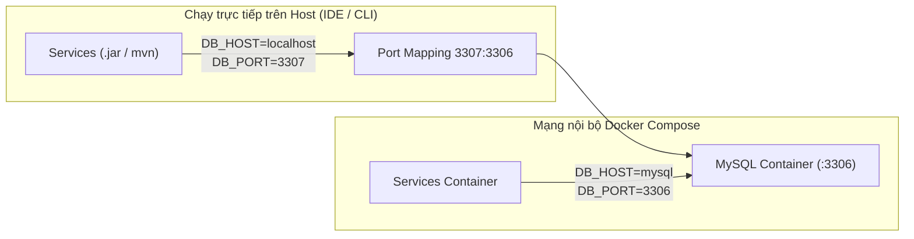

# Hướng dẫn Chuẩn hóa Cấu hình Môi trường Backend VeggiePal (.env)

> Dự án: **VeggiePal Microservices Backend**  
> Quản lý cấu hình: Tập trung qua file `.env` tại thư mục gốc `VeganApp_BE`  
> Phiên bản: `1.0.0`

---

## 1. Cơ chế Hoạt động của `spring.config.import`

Tất cả 6 microservice (`identity-service`, `nutrition-service`, `blog-service`, `recipe-service`, `location-service`, `ai-service`) và `api-gateway` đều được tích hợp cơ chế nạp cấu hình tự động thông qua tính năng native của Spring Boot:

```properties
spring.config.import=optional:file:.env[.properties],optional:file:../.env[.properties]
```

### Ưu điểm kỹ thuật:
- **Nạp không phụ thuộc thư viện ngoài:** Spring Boot ConfigData parser tự động đọc các file định dạng `KEY=VALUE` dưới dạng properties thông qua cú pháp `[.properties]`.
- **Hỗ trợ đa vị trí thực thi:**
  - Khi chạy từ thư mục gốc `VeganApp_BE` (IDE, root Maven), Spring nạp `./.env`.
  - Khi chạy từ bên trong thư mục con của service (như `cd identity-service && mvn spring-boot:run`), Spring nạp `../.env`.
- **An toàn linh hoạt với `optional:`:** Nếu file `.env` chưa được tạo (ví dụ trong môi trường CI/CD hoặc container truyền trực tiếp env qua Docker/Kubernetes), Spring Boot sẽ không báo lỗi mà tự động fallback về biến môi trường hệ thống hoặc giá trị mặc định an toàn.
- **Bảo mật tuyệt đối:** File `.env` chứa secret thật đã được cấu hình trong `.gitignore` để không bao giờ bị lộ vào source control.

---

## 2. Bảng Danh mục Biến Môi trường Chuẩn hóa

### 2.1. Cấu hình Cơ sở dữ liệu (MySQL)
| Tên biến | Kiểu giá trị | Mô tả | Mặc định Local (Host) | Giá trị trong Docker Compose |
| :--- | :--- | :--- | :--- | :--- |
| `DB_HOST` | String | Địa chỉ máy chủ MySQL | `localhost` | `mysql` (tên service) |
| `DB_PORT` | Integer | Cổng kết nối MySQL | `3307` *(veggiepal-mysql)* / `3306` | `3306` (cổng nội bộ container) |
| `DB_USERNAME` | String | Tên tài khoản database | `root` | `root` |
| `DB_PASSWORD` | String | Mật khẩu tài khoản database | Mật khẩu MySQL local | Khớp với `MYSQL_ROOT_PASSWORD` |

> [!NOTE]  
> **Database độc lập:** Mỗi microservice tự động kết nối và quản lý schema riêng biệt trên cùng cụm database với tham số `createDatabaseIfNotExist=true`:
> - `veggiepal_identity` (Identity Service)
> - `veggiepal_nutrition` (Nutrition Service)
> - `veggiepal_blog` (Blog Service)
> - `veggiepal_recipe` (Recipe Service)
> - `veggiepal_location` (Location Service)
> - `veggiepal_ai` (AI Service)

---

### 2.2. Bảo mật & Xác thực (JWT)
| Tên biến | Kiểu giá trị | Mô tả | Ràng buộc |
| :--- | :--- | :--- | :--- |
| `JWT_SECRET` | String | Khóa bí mật dùng để ký và xác thực token JWT (HS256) | Tối thiểu 32 ký tự, tất cả 6 microservice phải dùng chung |

---

### 2.3. Dịch vụ Đám mây Cloudinary (Lưu trữ Hình ảnh)
| Tên biến | Dịch vụ sử dụng | Mô tả |
| :--- | :--- | :--- |
| `CLOUDINARY_CLOUD_NAME` | Identity, Blog | Tên Cloud Account từ Cloudinary Dashboard |
| `CLOUDINARY_API_KEY` | Identity, Blog | API Key xác thực |
| `CLOUDINARY_API_SECRET` | Identity, Blog | API Secret bí mật |

---

### 2.4. Dịch vụ Trí tuệ Nhân tạo Groq Cloud & AI Service
| Tên biến | Mô tả | Giá trị khuyến nghị |
| :--- | :--- | :--- |
| `GROQ_BASE_URL` | Base URL của Groq OpenAI-compatible API | `https://api.groq.com/openai/v1` |
| `GROQ_API_KEY` | API Key Groq cá nhân | `gsk_...` |
| `GROQ_CONNECT_TIMEOUT` | Timeout kết nối máy chủ Groq | `5s` |
| `GROQ_READ_TIMEOUT` | Timeout đọc kết quả từ Groq | `45s` |
| `GROQ_MAX_RETRIES` | Số lần thử lại khi gặp lỗi mạng/rate limit | `2` |
| `GROQ_CHAT_MODEL` | Mô hình LLM cho Chat tư vấn | `openai/gpt-oss-20b` |
| `GROQ_MODERATION_MODEL`| Mô hình LLM kiểm duyệt nội dung bài viết | `openai/gpt-oss-20b` |
| `GROQ_RECOMMENDATION_MODEL`| Mô hình đề xuất công thức/thực đơn | `openai/gpt-oss-20b` |
| `GROQ_MEAL_PLAN_MODEL` | Mô hình sinh thực đơn tuần | `openai/gpt-oss-20b` |
| `GROQ_VIDEO_EXTRACTION_MODEL`| Mô hình trích xuất công thức từ video | `openai/gpt-oss-20b` |
| `GROQ_TRANSCRIPTION_MODEL`| Mô hình Audio-to-Text trích xuất âm thanh | `whisper-large-v3-turbo` |
| `FFMPEG_PATH` | Đường dẫn file nhị phân ffmpeg | `ffmpeg` |
| `FFPROBE_PATH` | Đường dẫn file nhị phân ffprobe | `ffprobe` |
| `AI_GUEST_DAILY_LIMIT` | Hạn ngạch tin nhắn chat cho khách vãng lai | `3` |
| `AI_MEMBER_DAILY_LIMIT`| Hạn ngạch tin nhắn chat cho thành viên đăng nhập | `50` |
| `AI_DAILY_TOKEN_LIMIT` | Hạn ngạch token tối đa / ngày | `50000` |

---

### 2.5. Cổng Dịch vụ & URL Định tuyến Liên dịch vụ (Inter-service & Gateway)
| Tên biến | Mặc định | Dịch vụ sử dụng & Mô tả |
| :--- | :---: | :--- |
| `GATEWAY_PORT` | `8080` | Cổng tiếp nhận chính của API Gateway |
| `IDENTITY_SERVICE_PORT` | `8081` | Cổng của Identity Service |
| `NUTRITION_SERVICE_PORT`| `8082` | Cổng của Nutrition Service |
| `BLOG_SERVICE_PORT` | `8083` | Cổng của Blog Service |
| `RECIPE_SERVICE_PORT` | `8084` | Cổng của Recipe Service |
| `LOCATION_SERVICE_PORT`| `8085` | Cổng của Location Service |
| `AI_SERVICE_PORT` | `8086` | Cổng của AI Service |
| `GATEWAY_URL` | `http://localhost:8080` | URL Gateway |
| `IDENTITY_SERVICE_URL` | `http://localhost:8081` | Gateway định tuyến `/api/auth/**`, `/api/users/**` |
| `NUTRITION_SERVICE_URL`| `http://localhost:8082` | Gateway định tuyến `/api/nutrition/**`; AI Client |
| `BLOG_SERVICE_URL` | `http://localhost:8083` | Gateway định tuyến `/api/blogs/**`; AI Client |
| `RECIPE_SERVICE_URL` | `http://localhost:8084` | Gateway định tuyến `/api/recipes/**`; AI Client |
| `LOCATION_SERVICE_URL` | `http://localhost:8085` | Gateway định tuyến `/api/restaurants/**` |
| `AI_SERVICE_URL` | `http://localhost:8086` | Gateway định tuyến `/ai/**`, `/api/ai/**`; Blog moderation client |

---

## 3. Phân biệt Môi trường: Máy Host Cục bộ vs Docker Compose



### Khi chạy trực tiếp trên máy Host:
- Microservice chạy trên JVM của máy host sẽ đọc file `.env` tại thư mục gốc `VeganApp_BE/.env`.
- Database: Nếu dùng MySQL container từ `docker-compose.yml`, cổng map ra host là `3307`, cấu hình:
  ```properties
  DB_HOST=localhost
  DB_PORT=3307
  DB_USERNAME=root
  DB_PASSWORD=12345
  ```
- URL liên dịch vụ: Sử dụng `http://localhost:808x`.

### Khi chạy bên trong Docker Container (Docker Compose):
- Container ứng dụng kết nối trực tiếp đến container cơ sở dữ liệu thông qua DNS nội bộ của Docker Network:
  ```properties
  DB_HOST=mysql
  DB_PORT=3306
  DB_USERNAME=root
  DB_PASSWORD=12345
  ```
- URL liên dịch vụ: Sử dụng tên service trong Docker, ví dụ `http://identity-service:8081`.

---

## 4. Hướng dẫn Thiết lập Nhanh (Quick Start)

### Bước 1: Khởi tạo file `.env` từ file mẫu `.env.example`
Tại thư mục gốc `VeganApp_BE`:
```powershell
Copy-Item .env.example .env
```

### Bước 2: Điền thông tin cấu hình thực tế
Mở file `.env` và kiểm tra:
1. `DB_PASSWORD`: Đảm bảo trùng khớp với mật khẩu MySQL của bạn.
2. `DB_PORT`: Đặt `3307` nếu chạy với Docker MySQL `veggiepal-mysql`, hoặc `3306` nếu chạy MySQL cài trực tiếp trên máy.
3. `JWT_SECRET`: Đảm bảo chuỗi bí mật dài ít nhất 32 ký tự.
4. `GROQ_API_KEY`: Điền API key từ trang Groq Console nếu cần sử dụng tính năng AI.
5. `CLOUDINARY_*`: Điền bộ thông số Cloudinary nếu cần kiểm thử upload ảnh đại diện và ảnh bài viết.

### Bước 3: Khởi chạy Database
```powershell
docker compose up -d mysql
```

### Bước 4: Khởi chạy các Microservice
Bạn có thể khởi chạy từng service độc lập mà không cần truyền bất kỳ tham số dòng lệnh `--spring.datasource...` nào:

```powershell
# Khởi chạy Identity Service
cd identity-service
java -jar target/identity-service-0.0.1-SNAPSHOT.jar

# Khởi chạy Nutrition Service
cd ../nutrition-service
java -jar target/nutrition-service-0.0.1-SNAPSHOT.jar

# Khởi chạy Blog Service
cd ../blog-service
java -jar target/blog-service-0.0.1-SNAPSHOT.jar

# Khởi chạy Recipe Service
cd ../recipe-service
java -jar target/recipe-service-0.0.1-SNAPSHOT.jar

# Khởi chạy Location Service
cd ../location-service
java -jar target/location-service-0.0.1-SNAPSHOT.jar

# Khởi chạy AI Service
cd ../ai-service
java -jar target/ai-service-0.0.1-SNAPSHOT.jar

# Khởi chạy API Gateway
cd ../api-gateway
java -jar target/api-gateway-0.0.1-SNAPSHOT.jar
```

---

## 5. Quy tắc An toàn và Bảo mật

1. **Tuyệt đối không commit file `.env`:** File `.env` chứa mật khẩu thật, API key và JWT secret. File này đã được thêm vào `.gitignore`:
   ```gitignore
   ### Secrets ###
   .env
   .env.*
   !.env.example
   ```
2. **Luôn duy trì `.env.example`:** Khi thêm bất kỳ biến môi trường mới nào vào bất kỳ microservice nào, bắt buộc phải khai báo giá trị mẫu (không chứa secret thật) vào `.env.example`.
3. **Đồng nhất `JWT_SECRET`:** Tất cả các microservice nhận diện và xác thực người dùng dựa trên việc cùng chia sẻ một khóa bí mật `JWT_SECRET`. Nếu một service có secret lệch với Identity Service, các request gửi đến service đó sẽ nhận mã lỗi `401 Unauthorized` (`code: 1008` hoặc `6001`).
